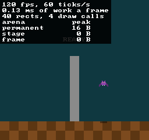
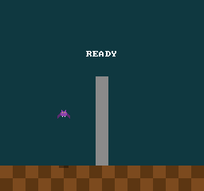

# 13 · Debug Text and Capture

> **Goal:** press `` ` `` and the engine's numbers appear over the game: 120 frames and 60 ticks a second, how long each frame's work took, what the game drew and in how many draw calls, and the most each of its arenas has held. And `momo --capture 72 shot.png` runs the game to tick 72, saves the 256×240 screen as a PNG file, and quits. Run it again, or under X11 in a window of another size, and the file comes out the same, byte for byte. The pictures in this chapter are those files.

## The problem

Every number the last few chapters reported came from outside momo, or from code written for the occasion and thrown away. Chapter 09 counted frames and ticks in the log momo printed when it quit. Chapters 10 and 12 asked Mesa how many draw calls a frame made, with `GALLIUM_HUD`. The arenas' peaks show up only in the log, after momo quits (chapter 04). And every picture in the book so far has been words, or rows of `#` and `.`: chapter 11 took screenshots of the window with `grim` and read pixels with a script, at whatever scale the window happened to have.

[Plan §4.10](plan.md#410-debug-tools-and-tests) asks for two tools, and the outline gives them to this chapter:

- A **debug overlay**: the engine's numbers, drawn over the game while it runs, in the font chapter 12 made for it.
- **`--capture`**: a picture of the game's screen, saved to a file. [Plan §2](plan.md#2-the-book) says that from this chapter on, the book's pictures are captures, checked before each commit.

Earlier chapters left this one questions. Chapter 10 asked how the engine's overlay ends up on top, when the game owns all eight layers. Chapter 11 noted that OpenGL counts a framebuffer's rows from the bottom, so the screen's top row is the texture's last. Chapter 05 set a rule for an overlay that keeps log lines. And neither tool has a way in: `main` has taken no arguments since chapter 02, and momo hears no keys.

## Design

### What the overlay shows

Seven lines, at the screen's top left:

```
120 fps, 60 ticks/s           frames and ticks in the last second (chapter 09)
0.14 ms of work a frame       how long a frame took before it waited for the display
40 rects, 4 draw calls        what the game drew in the last frame (chapters 10 and 12)
arena          peak           the most each of the game's arenas has held (chapter 04)
permanent      16 B
stage           0 B
frame           0 B
```

Each line answers a question an earlier chapter needed a tool for:

- **Frames and ticks a second** are chapter 09's lesson, live: frames follow the display, and ticks stay at 60.
- **Work** is new. With vsync, every frame on your laptop lasts 8.33 ms, so the frame rate says nothing about cost: a frame that works for 0.1 ms and one that works for 8 ms both show 120 fps. The work is the time from the start of a frame until the swap, where vsync waits.
- **Rectangles and draw calls** are what `GALLIUM_HUD` counted, without Mesa's own two and without the overlay's.
- **Arenas** are what [plan §4.2](plan.md#42-memory) promised the overlay would show. Only the game's three: the engine's own arena isn't the game's to watch. The log still prints all four peaks when momo quits, since the chapters quote it, and it stays after the window is gone.

Log lines stay in the terminal. 32 columns of 8×8 letters hold little of a log, and the terminal already shows all of it. Chapter 05's rule waits for the chapter that brings them over.

### Counting a second

A number that changes every frame flickers too fast to read. So the overlay counts frames and ticks for a second, shows that second's numbers, and counts the next one. But which second?

The first version of this chapter ended a second at the first frame that ended at least 1 s after it started. In a 30-second run it read 120 frames a second nearly every time, but 61 ticks a second five times, with every frame on time. Ticks come every 16.7 ms, and a second's edges can fall anywhere between them. At 120 Hz a second ends at a frame, 1.000 to 1.008 s after it started, and whether its edges catch 60 ticks or 61 depends on where they fell:

```
ticks     |       |       |       |   ...   |       |       |
second    [                                       ]               60 ticks
second       [                                       ]            61 ticks
```

A second that ends on a tick doesn't have that problem.

| Option | The catch |
|---|---|
| A second of real time: the first frame to end 1 s or more after the second started ends it | The ticks a second jump between 60 and 61 while nothing is wrong |
| **A second of game time: the frame that runs the second's 60th tick ends it** | A game that runs no ticks, such as one that failed to load, never ends a second, so a second also ends after 2 s of real time |

momo takes the second. At 120 Hz a tick comes every other frame, so a second is exactly 120 frames, and both of its edges come right after a tick. Another 30-second run, counting seconds of game time, read 120 frames and 60 ticks in 28 of its seconds. The other two each held a slow frame: the first, while the window opened, and the last, which saved a capture. A slow frame really happened, and the numbers should show it. When the game falls far enough behind that the timestep drops time (chapter 09), 60 ticks take longer than 1 s, and the overlay shows fewer than 60 ticks a second, which is exactly when you want to know.

Counting, and turning counts into numbers a second, is a module of its own, `stats::`, which never calls SDL or OpenGL. Like the timestep, it's handed the time instead of reading a clock, so its tests make up the times.

### On top of the game

The game draws on layers 0 to 7, and the engine gives them no meaning (chapter 10). The overlay has to end up on top of all of them.

| Option | The catch |
|---|---|
| Draw on the top layer, 7, after the game's `render`: the sort keeps drawing order inside a layer, so the overlay comes last | The overlay's 140 or so rectangles come out of the game's 4,096, so a game that draws 4,000 hits the `ASSERT` only while the overlay is shown. The renderer's counts include the overlay's own rectangles. |
| Keep a ninth layer for the engine | The same two problems |
| Draw after the copy into the window, at the window's resolution, as chapter 11 suggested | A second set of coordinates: the overlay laid out in window pixels, its letters at a size picked from the display's scale, and the shader's `screen_size` changed between the two. It would never be in a capture. |
| **A batch of the overlay's own, drawn after the game's** | Two batches, and the renderer has to know which one the drawing functions add to |

momo takes the last. After the game's `render`, the engine calls `renderer::begin_overlay`, and from then on `draw_rect` and `draw_text` add to the overlay's batch. At the end of the frame, the renderer sorts both batches into one array, the game's first, and draws it as before, one draw call per run. The overlay comes after the game's top layer, so it's on top whatever the game draws. It has room of its own, 1,024 rectangles, and the counts it shows are the game's alone.

It draws on the screen, like the game: the same chunky 8×8 letters as READY, scaled up with everything else, and in a capture when it's shown.

The counts are the last frame's. The renderer works out a frame's draw calls when the frame ends, after the overlay has drawn its text, so the overlay shows the frame before. That's 8 ms late, which you notice only when the game's drawing changes from one frame to the next. Exercise 3 catches it.

### Text without the frame arena

The overlay formats its text again every frame. Chapter 05 said text used during one frame, "like the overlay", goes in the frame arena. But as chapter 12 put it, the frame arena is the game's, and its peak is one of the overlay's own lines. The engine's arena is never reset, so it would keep every frame's text for the rest of the run.

The text is needed only until `draw_text` has turned each char into a rectangle, which happens during the call. So it goes on the stack: 1 KB, made into an arena with `arena::init`. An arena doesn't own its memory (chapter 04), and chapter 04's tests did the same with a buffer on the stack. `str::fmt` then works as usual, and the memory goes when `draw_overlay` returns.

### A key of the engine's own

The overlay is hidden until you press `` ` ``. Chapter 14 is about keys: it maps them onto the game's virtual pad ([plan §4.4](plan.md#44-platform-and-input)). The overlay's key isn't a button on the pad. It belongs to the engine, and the game never sees it, like the window's close button.

So `platform::handle_events`, which already turns a closed window into a quit, also reports one key: `` ` ``, the key left of 1, under Esc. It reports that the key went down, not what the key does. What it does is the engine's decision, in `momo.cpp`. SDL names keys two ways: by the char the keyboard layout prints on them, and by **scancode**, their place on the keyboard. momo uses the scancode, so it's the key left of 1 on any layout. Quake opened its console with the same key, and the game won't want it: its controls will be the arrows and a few letters.

`--overlay` starts momo with the overlay shown. A capture can't press a key, and this chapter's picture of the overlay is a capture.

### A command line

The host now passes `main`'s arguments to `momo::run`, and the engine reads them: the engine owns `main` ([plan §4.1](plan.md#41-three-binaries-and-hot-reload)), and the host stays one line. Reading them is a module of its own, `options::`, tested like `stats::`. There are two options:

```
momo [--overlay] [--capture TICK FILE]
```

Anything else stops momo before it opens a window: the log says what was wrong, then gives that line. A mistyped option is better as an error than ignored. A tick is digits and nothing else: `-1`, `1e3` and `12x` are all errors, instead of whatever a C library function would make of them.

### What a capture saves

A capture saves the screen texture, 256×240 pixels, as chapter 11 planned: the game's own pixels, the same picture on every display. A picture of the window is the window's size, 1432×1720 on your laptop with the bars included, and every screen pixel in it is a 5×5 square. Under X11 the window opens at 768×720, and every screen pixel is 3×3.

`glGetTextureImage` copies a texture's pixels into memory. Two details:

- **The rows come bottom first.** OpenGL's row 0 is the bottom of whatever it draws into. The vertex shader turns y around (chapter 10), so the screen's top row is at the top of the texture, which is its last row. `read_screen` swaps the rows, so they come out top first, the way PNG files and every image editor store them.
- **No alpha.** Blending mixes alpha the same way as the colors (chapter 10), so the screen's alpha isn't 255 everywhere. Under the bat's shadow, which is black at 96, a throwaway read of the screen's alpha found 195. A PNG with that alpha would be see-through under the shadow. The screen is always shown opaque, so `read_screen` reads red, green and blue, three bytes a pixel, and leaves alpha out. Exercise 1 looks at what alpha would have saved.

### When a capture saves

| Option | The catch |
|---|---|
| After a number of seconds | Frames don't line up with ticks the same way twice, so each run would save a different tick |
| After a number of frames | A frame runs 0 to 6 ticks, so frame 100 is one tick at 60 Hz, another at 120 Hz, and another when the window took longer to open |
| **After a number of ticks** | None: the game's state depends only on its ticks |

Chapter 09 made the game depend only on `GameState` and its inputs, and there are no inputs yet. So the state after tick 72, and the picture drawn from it, is the same every time, on any display. The loop runs no tick past the capture's: when a frame is owed more, it runs up to the capture's tick, draws, saves, and quits. A capture runs at the game's usual speed, so tick 72 comes after 1.2 s. It could run its ticks as fast as the computer can, but a capture with the overlay would then show the fast-forward's numbers.

Tick 0 works too: it saves the first frame, before any tick.

### Writing a PNG

| Option | The catch |
|---|---|
| stb_image_write, the library [plan §7](plan.md#7-build-dependencies-repo) lists, vendored like stb_image | About 1,700 more lines in `third_party/`, for one function |
| **SDL's `SDL_SavePNG`, new in SDL 3.4, behind `platform::`** | The file's bytes come from whichever SDL is installed. A newer SDL may compress them differently. The pixels don't change. |
| Write the file ourselves | A compressor and checksums. File formats aren't a learning goal ([plan §4.9](plan.md#49-audio) said so for audio). |

momo takes SDL's, by chapter 07's rule: `platform::` uses SDL wherever SDL has the function, and since 3.4 it has this one. momo has used SDL 3.4 from the start.

SDL 3.4 can read PNGs too, with `SDL_LoadPNG`, which chapter 12 didn't consider. Should stb_image go? A throwaway test loaded three PNGs with it: `bat.png` came back as 4 bytes a pixel, a PNG with no alpha as 3, and a PNG with a palette as one index a pixel. momo would convert each of them to the 4 bytes OpenGL is given, and stb_image hands back 4 bytes whatever the file holds. Chapter 30's bake tool will read PNGs too, in a program that runs during the build and has no reason to link SDL. stb_image stays.

### The book's pictures

Captures go in `book/images/`, named by chapter. They're 256×240, the screen's own pixels, so zoom in to see each one. The chapter gives the command that made each picture, so you can make it yourself and compare: `cmp` prints nothing when two files are the same.

## The code

### The command line: `engine/options.h`

`engine/options.h:16`

```cpp
struct Options {
    bool overlay;
    const char* capture_path;
    i32 capture_tick;
};

namespace options {

bool parse(i32 argc, const char* const* argv, Options* options);

} // namespace options
```

Without their comments, which give the usage line from Design. All zeros is a plain run, so the null path means no capture, and a capture at tick 0 is still possible. The path points into `argv`, which lasts as long as the process.

`engine/options.cpp:30`

```cpp
bool parse(i32 argc, const char* const* argv, Options* options)
{
    *options = {};
    for (i32 i = 1; i < argc; i++) {
        const char* arg = argv[i];
        if (strcmp(arg, "--overlay") == 0) {
            options->overlay = true;
        } else if (strcmp(arg, "--capture") == 0) {
            if (i + 2 >= argc) {
                LOG_ERROR("--capture needs a tick and a file\n%s", USAGE);
                return false;
            }
            if (!parse_tick(argv[i + 1], &options->capture_tick)) {
                LOG_ERROR("--capture's tick must be a whole number, 0 or more, not \"%s\"\n%s",
                          argv[i + 1], USAGE);
                return false;
            }
            options->capture_path = argv[i + 2];
            i += 2;
        } else {
            LOG_ERROR("unknown argument \"%s\"\n%s", arg, USAGE);
            return false;
        }
    }
    return true;
}
```

Without its comment. One pass over the arguments after the program's name. `--capture` takes the next two, so `i` skips them. `const char* const*` is a pointer to pointers that are const, to chars that are const: `parse` changes neither the list nor the text. `main`'s `char**` turns into it without a cast, and a test can pass an array of string literals. `parse_tick` (`engine/options.cpp:14`) reads digits one at a time into an `i64`, and stops at anything that isn't a digit or at a number bigger than an `i32` holds.

`host/main.cpp:6`

```cpp
int main(int argc, char** argv)
{
    return momo::run(argc, argv);
}
```

`momo.h`, the boundary, now declares `run(i32 argc, char** argv)`, and its comment says that `run` returns 1 if anything failed.

### Counting: `engine/stats.h`

`engine/stats.h:23`

```cpp
struct FrameStats {
    i64 second_start_ns;
    i32 frames;
    i32 ticks;
    i64 work_ns;

    i32 frames_per_second;
    i32 ticks_per_second;
    i64 work_ns_per_frame;
};
```

Without its comments, which say what Design said about seconds. The first four fields count the second in progress, and the last three are the last whole second's, which the overlay shows: all 0 until the first second ends.

`engine/stats.cpp:25`

```cpp
void count_frame(FrameStats* stats, i64 now_ns, i32 ticks, i64 work_ns)
{
    ASSERT(now_ns >= stats->second_start_ns);
    stats->frames++;
    stats->ticks += ticks;
    stats->work_ns += work_ns;

    i64 elapsed_ns = now_ns - stats->second_start_ns;
    if (stats->ticks < TICKS_PER_SECOND && elapsed_ns < LONGEST_SECOND_NS)
        return;

    FrameStats next = {
        .second_start_ns = now_ns,
        .frames_per_second = per_second(stats->frames, elapsed_ns),
        .ticks_per_second = per_second(stats->ticks, elapsed_ns),
        .work_ns_per_frame = stats->work_ns / stats->frames,
    };
    *stats = next;
}
```

Without its comments. Count the frame, and return unless it ends the second: 60 ticks, or 2 s. Then the next second starts with zeroed counts, ZII, and keeps the numbers of the one that ended. `per_second` (`engine/stats.cpp:15`) divides a count by the second's real length, rounded to the nearest whole number, so a second that took 2 s with 60 ticks in it shows 30 ticks a second.

`format_size` (`engine/stats.cpp:51`) writes a size the way the overlay shows it: bytes under 1 KB, then KB or MB with one decimal.

### A key: `engine/platform.h`

`engine/platform.h:40`

```cpp
struct Events {
    bool quit;              // the window was closed, or Ctrl+C was pressed in the terminal
    bool backquote_pressed; // the ` key, left of 1, went down
};

Events handle_events();
```

`handle_events` returned `false` to mean quit. Now it returns what it saw, and the loop asks `events.quit`. `platform::Events` is inside the namespace, so the name can be that short.

`engine/platform.cpp:126`

```cpp
        bool key_down = event.type == SDL_EVENT_KEY_DOWN && !event.key.repeat;
        if (key_down && event.key.scancode == SDL_SCANCODE_GRAVE)
            events.backquote_pressed = true;
```

Inside the event loop, after the quit event. Hold a key down and SDL sends its key-down event again and again, the way a text box repeats a held letter, and marks every one after the first with `repeat`. Without the `!event.key.repeat`, holding `` ` `` would make the overlay flicker. SDL calls the key **grave** after the accent, and US keyboards call it backquote.

### Writing a PNG: `engine/platform.cpp`

`engine/platform.cpp:229`

```cpp
bool write_png(const char* path, i32 width, i32 height, const u8* rgb)
{
    SDL_Surface* surface =
        SDL_CreateSurfaceFrom(width, height, SDL_PIXELFORMAT_RGB24, (void*)rgb, width * 3);
    if (!surface) {
        LOG_ERROR("%s", SDL_GetError());
        return false;
    }

    bool saved = SDL_SavePNG(surface, path);
    if (!saved)
        LOG_ERROR("%s", SDL_GetError());
    SDL_DestroySurface(surface);
    return saved;
}
```

Without its comments. A **surface** is SDL's picture in memory. `SDL_CreateSurfaceFrom` wraps pixels that are already there, without copying them: `RGB24` is three bytes a pixel in that order, and each row starts `width * 3` bytes after the last. SDL takes non-const pixels, since a surface can be drawn on, so the cast drops the `const`. Saving only reads them. `SDL_DestroySurface` frees the surface, not the pixels it wrapped.

### Two batches: `engine/renderer.cpp`

`engine/renderer.cpp:132`

```cpp
static Batch game_batch;         // the frame's rectangles, as the game drew them
static Batch overlay_batch;      // and the overlay's, drawn after the game's
static Batch* drawing_into;      // the batch draw_rect and the rest add to
```

Chapter 10's `batch` is now `game_batch`. `begin_frame` empties both batches and points `drawing_into` at the game's. `draw_rect`, `draw_sprite` and `draw_text` add to whichever batch it points at, and `begin_overlay` (`engine/renderer.cpp:533`) points it at the overlay's. The overlay's batch holds `MAX_OVERLAY_RECTS`, 1,024 rectangles (`engine/renderer.cpp:111`), and the arrays the frame is sorted into, the GPU's buffer and the draw calls have room for both batches.

`engine/renderer.cpp:541`

```cpp
static void draw_batches()
{
    i32 game_count = game_batch.count;
    i32 count = game_count + overlay_batch.count;
    batch::sort(game_batch, sorted, sorted_textures);
    batch::sort(overlay_batch, sorted + game_count, sorted_textures + game_count);
    stats = {
        .rects = game_count,
        .draw_calls = batch::draw_calls(sorted_textures, game_count, calls),
    };
    if (count == 0)
        return;

    i32 call_count = batch::draw_calls(sorted_textures, count, calls);
    glNamedBufferSubData(rect_buffer, 0, count * (i64)sizeof(RectInstance), sorted);
    ...
```

Without its comments. Each batch is sorted on its own, the overlay's into the array right after the game's, so the array is the whole frame in drawing order. The game's draw calls are counted first, on the game's part alone, and kept in `stats` for the overlay. Then the draw calls for the whole frame overwrite them, and the rest is chapter 12's: one upload, one draw call per run. `last_frame_stats` (`engine/renderer.cpp:619`) returns `stats`, a `RenderStats` of two numbers declared in `renderer.h`.

### Reading the screen

`engine/renderer.cpp:624`

```cpp
void read_screen(u8* rgb)
{
    ASSERT(!in_frame);

    constexpr i32 ROW_SIZE = SCREEN_WIDTH * 3;
    glGetTextureImage(screen_texture, 0, GL_RGB, GL_UNSIGNED_BYTE, SCREEN_HEIGHT * ROW_SIZE, rgb);

    for (i32 y = 0; y < SCREEN_HEIGHT / 2; y++) {
        u8* top = rgb + (i64)y * ROW_SIZE;
        u8* bottom = rgb + (i64)(SCREEN_HEIGHT - 1 - y) * ROW_SIZE;
        u8 row[ROW_SIZE];
        memcpy(row, top, ROW_SIZE);
        memcpy(top, bottom, ROW_SIZE);
        memcpy(bottom, row, ROW_SIZE);
    }
}
```

Without its comments, which say what Design said about rows and alpha. `glGetTextureImage` is DSA's way to read a texture: level 0, as three bytes a pixel, into at most the size it's given. OpenGL draws on the GPU after the calls that asked for it have returned, so to hand back the pixels it first waits for the frame to be drawn. A capture does that once.

Three bytes a pixel has a catch. OpenGL starts each row it writes at a multiple of 4 bytes, unless told otherwise (`GL_PACK_ALIGNMENT`), and a row of three-byte pixels isn't always a multiple of 4: 255 of them would be 765 bytes, and OpenGL would skip 3 bytes after each row. A row of 256 is 768 bytes, so the rows come with no gaps between them, and the comment says so. Uploading a texture has the same rule, `GL_UNPACK_ALIGNMENT`, which is why a texture of odd-sized rows sometimes comes out slanted.

The loop swaps the first row with the last, the second with the second to last, and so on to the middle, through a row on the stack. clang-tidy asked for the `(i64)` casts: `y * ROW_SIZE` is worked out in `i32` and then added to a pointer, and a pointer offset is 64 bits.

### The loop: `engine/momo.cpp`

`engine/momo.cpp:315`

```cpp
        i64 frame_start_ns = platform::clock_ns();
        platform::Events events = platform::handle_events();
        if (events.quit)
            break; // the window was closed, or Ctrl+C
        if (events.backquote_pressed)
            engine.overlay_shown = !engine.overlay_shown;
        reload_game_if_changed();
        arena::reset(&engine.frame); // last frame's memory is free again

        i32 ticks = timestep::advance(&engine.timestep, frame_start_ns);
        ...
        if (!engine.game_lib)
            ticks = 0;
        if (engine.options.capture_path)
            ticks = min(ticks, engine.options.capture_tick - engine.tick_count);
        for (i32 i = 0; i < ticks; i++)
            engine.game.update(engine.state);
        engine.tick_count += ticks;

        renderer::begin_frame();
        if (engine.game_lib)
            engine.game.render(engine.state);
        if (engine.overlay_shown)
            draw_overlay();
        renderer::end_frame();
        if (engine.options.capture_path && engine.tick_count == engine.options.capture_tick)
            save_capture();

        i64 work_ns = platform::clock_ns() - frame_start_ns;
        platform::present(); // with vsync, waits for the display
        engine.frame_count++;
        stats::count_frame(&engine.stats, platform::clock_ns(), ticks, work_ns);
```

The frame from [plan §4.3](plan.md#43-the-frame), with the comments left out and the dropped-time warning at the `...`. Four changes from chapter 12:

- The clock is read once, at the top. The timestep gets that time, and the frame's work is measured from it to just before the swap.
- `ticks` becomes the number of ticks the frame really runs. A game that didn't load runs none, as before, and a capture runs none past its tick: `min` cuts the frame's ticks to the ones left before it.
- The overlay draws after the game's `render`, so it's on top, and before `end_frame`, which draws both batches.
- After `end_frame` the screen holds the whole frame, so that's where a capture is saved. `count_frame` comes last, after the swap, with the time the frame ended.

### The overlay

`engine/momo.cpp:191`

```cpp
static void draw_overlay()
{
    u8 memory[1024];
    Arena text = {};
    arena::init(&text, memory, sizeof(memory));

    const FrameStats& frames = engine.stats;
    RenderStats drawn = renderer::last_frame_stats();
    Str lines[] = {
        str::fmt(&text, "%d fps, %d ticks/s", frames.frames_per_second, frames.ticks_per_second),
        str::fmt(&text, "%.2f ms of work a frame", (f64)frames.work_ns_per_frame / 1e6),
        str::fmt(&text, "%d rects, %d draw calls", drawn.rects, drawn.draw_calls),
        str::fmt(&text, "%-9s %9s", "arena", "peak"),
        arena_line(&text, "permanent", engine.permanent),
        arena_line(&text, "stage", engine.stage),
        arena_line(&text, "frame", engine.frame),
    };
    ...
```

The stack arena from Design, then the seven lines. `%-9s` pads a name with spaces to 9 chars on the right, and `%9s` pads a size to 9 on the left, so names line up on the left and sizes on the right, under `peak`. `arena_line` (`engine/momo.cpp:184`) formats one arena's line. It passes `format_size`'s text to `%s`, which needs a 0 at the end, and `str::fmt` always puts one there (chapter 05).

The rest, at the `...`, finds the longest line, makes a box that fits around the text with 4 pixels of margin, and draws:

`engine/momo.cpp:232`

```cpp
    renderer::begin_overlay();
    renderer::draw_rect(box, OVERLAY_BACKDROP_COLOR, 0);
    for (i32 i = 0; i < line_count; i++)
        renderer::draw_text(lines[i], OVERLAY_MARGIN, OVERLAY_MARGIN + i * OVERLAY_LINE_HEIGHT,
                            OVERLAY_TEXT_COLOR, 0);
```

All on layer 0 of the overlay's batch, so in drawing order: the box, then the text. The box is black with an alpha of 224, so the game shows through it, an eighth as bright. Lines are 10 pixels apart: 8 for the letters and 2 between lines. The first version had them 8 apart, which leaves one blank row between lines, and the lines ran together. The box's width and height subtract 1, since a glyph's last column and last row are blank already. That leaves the same margin on all four sides.

### Saving a capture

`engine/momo.cpp:240`

```cpp
static void save_capture()
{
    u8 pixels[SCREEN_WIDTH * SCREEN_HEIGHT * 3];
    renderer::read_screen(pixels);
    const char* path = engine.options.capture_path;
    if (platform::write_png(path, SCREEN_WIDTH, SCREEN_HEIGHT, pixels))
        LOG_INFO("saved the screen at tick %d as %s", engine.tick_count, path);
    else
        engine.exit_code = 1; // already logged
    engine.quit_requested = true;
}
```

Without its comment, which says that the pixels' 180 KB fit on the stack, whose size on Linux is 8 MB. A capture that can't be saved still quits, and `run` returns `engine.exit_code`, so a script that makes captures sees the failure.

### The tests

`tests/options_test.cpp` is new: nine tests of the command line, among them a capture at tick 0, options in any order, six ticks that aren't one (`"-1"`, `"1.5"`, `"12x"`, `"1e3"`, `" 7"` and `""`), and the biggest tick an `i32` holds next to one more. The refused command lines log why, like momo would, so their errors show up between the test names.

`tests/stats_test.cpp` is new too: nine tests of seconds and sizes.

`tests/stats_test.cpp:22`

```cpp
static void a_120_hz_second_is_120_frames_and_60_ticks()
{
    FrameStats stats = {};
    stats::init(&stats, START_NS);
    for (i32 frame = 0; frame < 120; frame++)
        stats::count_frame(&stats, START_NS + (frame + 1) * (TICK_NS / 2), frame % 2, 0);
    CHECK_EQ(stats.frames_per_second, 120);
    CHECK_EQ(stats.ticks_per_second, 60);
    CHECK_EQ(stats.frames, 0);
}
```

Without its comment. Frames half a tick apart, with a tick every other frame, the way chapter 09's timestep runs them at 120 Hz. The 120th frame runs the 60th tick and ends the second, and the next second has started with nothing counted. The others try 20 frames a second with 3 ticks each, a game that drops time and shows 30 ticks a second, a game with no ticks that ends its second after 2 s, the work averaged over a second, and a second at 120 Hz followed by one at 60 Hz. The sizes go through `format_size` with a 64-byte arena on the stack.

## Run it

### The overlay

```
$ make
$ ./build/debug/momo
```

The log is chapter 12's. Press `` ` ``:



`./build/debug/momo --overlay --capture 170 book/images/13-overlay.png` made this picture. The numbers you see will differ a little, since they're measured.

- **120 fps, 60 ticks/s**: the laptop's 120 Hz, and the game's 60. The first second can read less, since frames are slow while the window opens (chapter 09). In one run the window took two seconds to open, and those seconds read 20 fps and 60 ticks/s: frames of 50 ms, with 3 ticks each.
- **0.14 ms of work a frame**: about 1.7% of the 8.33 ms a frame lasts at 120 Hz. The release build reads 0.08 ms. The overlay counts its own drawing in that.
- **40 rects, 4 draw calls**: 32 floor tiles, the pillar, the shadow, the bat and 5 letters of READY, in chapter 12's 4 runs. Wait for READY to blink off: 35 rects, 3 draw calls.
- **16 B**: the permanent arena holds `GameState`, 16 bytes since chapter 12. The game has used neither of the other two.

READY is under the box, an eighth as bright. Press `` ` `` again and the overlay is gone.

### A capture

```
$ ./build/debug/momo --capture 72 shot.png
engine/momo.cpp:92: reserved 64 MB at 0x7b411a200000
engine/momo.cpp:301: loaded /home/mairuu/repos/momo/build/debug/game.so
engine/platform.cpp:87: SDL 3.4.18, video driver wayland, window 716x860, 1432x1720 pixels, display scale 2, 120 Hz
engine/renderer.cpp:358: OpenGL 4.6 (Core Profile) Mesa 26.2.4-arch1.1, AMD Radeon 880M Graphics (radeonsi, strix1, ACO, DRM 3.64, 7.2.9-arch1-1)
game/game.cpp:47: init
engine/renderer.cpp:338: loaded assets/bat.png, 32x16, as texture 2
engine/renderer.cpp:591: the screen at 5x: 1280x1200 pixels, in a window of 1432x1720
engine/momo.cpp:248: saved the screen at tick 72 as shot.png
game/game.cpp:105: shutdown, with the bat at x = 72
engine/momo.cpp:366: quit after 1.24 s: 147 frames, 72 ticks
...
$ echo $?
0
```

The window opens, the bat flies for 1.2 s, and momo quits. The bat is at x = 72 after 72 ticks, one pixel a tick:



`./build/debug/momo --capture 72 book/images/13-tick-72.png` made this one. 72 / 8 is 9, odd, so the wings are down, and 72 / 16 is 4, even, so READY is showing. Now run it again, and once more under X11, where the window opens at another size:

```
$ ./build/debug/momo --capture 72 again.png 2>/dev/null
$ cmp shot.png again.png
$ SDL_VIDEO_DRIVER=x11 ./build/debug/momo --capture 72 x11.png
...
engine/platform.cpp:87: SDL 3.4.18, video driver x11, window 768x720, 768x720 pixels, display scale 2, 120 Hz
...
engine/renderer.cpp:591: the screen at 3x: 768x720 pixels, in a window of 768x720
engine/renderer.cpp:591: the screen at 5x: 1280x1200 pixels, in a window of 1420x1712
engine/momo.cpp:248: saved the screen at tick 72 as x11.png
...
$ cmp shot.png x11.png
$ cmp shot.png book/images/13-tick-72.png
```

`cmp` prints nothing: the files are the same, byte for byte. The X11 window opened at 3x and was tiled to 5x a moment later, and the capture didn't change. The file is 1,442 bytes. `rm shot.png again.png x11.png` when you're done looking.

### Mistakes

```
$ ./build/debug/momo --capture 1x shot.png
engine/options.cpp:44: error: --capture's tick must be a whole number, 0 or more, not "1x"
usage: momo [--overlay] [--capture TICK FILE]
$ echo $?
1
$ ./build/debug/momo --fullscreen
engine/options.cpp:51: error: unknown argument "--fullscreen"
usage: momo [--overlay] [--capture TICK FILE]
```

No window, no memory: the command line is read first. A file that can't be written is found out only when the capture is saved:

```
$ ./build/debug/momo --capture 30 /nonexistent/shot.png
...
engine/platform.cpp:247: error: Couldn't open /nonexistent/shot.png: No such file or directory
game/game.cpp:105: shutdown, with the bat at x = 30
engine/momo.cpp:366: quit after 0.55 s: 62 frames, 30 ticks
...
$ echo $?
1
```

SDL's message names the file and says why.

### Memory

```
engine/momo.cpp:98: engine    arena: at most 491630 bytes used of 8 MB
```

Chapter 12 used 393,326 bytes. The 98,304 more are the overlay's 1,024 rectangles, 96 bytes each: 44 in its batch (a 36-byte `RectInstance`, a layer and a texture), 40 more in the sorted arrays, and 12 for a draw call. The overlay's text and a capture's pixels live on the stack, and the PNG in SDL's memory, freed before `write_png` returns.

### The tests

```
$ make test
...
options_test
  no_arguments_is_a_plain_run ... ok
  overlay_shows_the_overlay_from_the_start ... ok
  capture_takes_a_tick_and_a_file ... ok
  capture_at_tick_0_saves_the_first_picture ... ok
  arguments_come_in_any_order ... ok
  a_tick_is_only_digits ... engine/options.cpp:44: error: --capture's tick must be a whole number, 0 or more, not "-1"
usage: momo [--overlay] [--capture TICK FILE]
...
ok
  ...
  9 passed
...
stats_test
  nothing_is_known_before_a_second_ends ... ok
  a_120_hz_second_is_120_frames_and_60_ticks ... ok
  a_20_hz_second_is_20_frames_and_60_ticks ... ok
  a_game_that_drops_time_shows_fewer_ticks ... ok
  a_game_without_ticks_ends_its_second_after_2_s ... ok
  work_is_the_average_over_the_second ... ok
  each_second_starts_counting_again ... ok
  sizes_under_a_kb_are_bytes ... ok
  bigger_sizes_are_kb_or_mb_with_one_decimal ... ok
  9 passed
...
```

## Recap

```
momo/
  host/
    main.cpp        passes its command line to momo::run
  engine/
    options.h/cpp   new: --overlay and --capture TICK FILE; anything else is an error
    stats.h/cpp     new: frames and ticks a second, over a second of game time; sizes as text
    platform.h/cpp  + Events: quit, and the ` key; write_png, through SDL_SavePNG
    renderer.h/cpp  + the overlay's batch, drawn after the game's; RenderStats;
                      read_screen, top row first, without alpha
    momo.h          run takes argc and argv
    momo.cpp        + the overlay and captures; the loop measures each frame's work
  tests/
    options_test.cpp  new: nine tests of the command line
    stats_test.cpp    new: nine tests of seconds and sizes
  book/images/
    13-overlay.png    new: the overlay, at tick 170
    13-tick-72.png    new: the game at tick 72
```

- `` ` `` shows and hides the **debug overlay**: frames and ticks a second, each frame's work before the swap, the game's rectangles and draw calls, and its arenas' peaks. `--overlay` starts with it shown.
- The overlay's second is **a second of game time**: it ends with the frame that runs its 60th tick, or after 2 s of real time. A second of real time read 60 or 61 ticks, with nothing wrong.
- The overlay draws into **a batch of its own**, which the renderer draws after the game's: on top of every layer, out of the game's 4,096, and out of the counts it shows.
- Its text is formatted into **an arena on the stack**, since the frame arena is the game's.
- The engine has **a key of its own**, which the platform reports and the game never sees.
- **`--capture TICK FILE`** runs the game to that tick, saves the 256×240 screen as a PNG, and quits. The game depends only on its ticks, so the file is the same on every run, under Wayland or X11, at any scale.
- The screen is read back **top row first, without alpha**: OpenGL's rows start at the bottom, and blending leaves the screen's alpha at 195 under the shadow.
- PNG files are written by **SDL 3.4's `SDL_SavePNG`**, instead of a vendored stb_image_write. stb_image stays for reading.

The plan records the overlay and captures in [§4.10](plan.md#410-debug-tools-and-tests), the overlay's batch and reading the screen in [§4.5](plan.md#45-rendering), the second of game time in [§4.3](plan.md#43-the-frame), the engine's key in [§4.4](plan.md#44-platform-and-input), the command line in [§4.1](plan.md#41-three-binaries-and-hot-reload), the arenas' peaks in [§4.2](plan.md#42-memory), the book's pictures in [§2](plan.md#2-the-book), and `SDL_SavePNG` in [§7](plan.md#7-build-dependencies-repo). The outline now says this chapter also gave momo a command line and the engine its first key.

Chapter 14 gives the game keys: the virtual pad, keyboard and gamepad, with presses latched to ticks.

## Exercises

Undo each change before the next exercise: `git checkout -- engine game` puts the code back.

1. **See-through.** Make captures keep alpha: in `read_screen`, read `GL_RGBA` with rows of `SCREEN_WIDTH * 4` bytes; in `write_png`, use `SDL_PIXELFORMAT_RGBA32` with rows of `width * 4`; and give `save_capture` room for 4 bytes a pixel. Capture tick 72 and look at a pixel under the shadow with `magick shot.png -crop 1x1+80+209 txt:`. Open the file in an image viewer that shows transparency. Then change `glBlendFunc` in `renderer::init` to `glBlendFuncSeparate(GL_SRC_ALPHA, GL_ONE_MINUS_SRC_ALPHA, GL_ONE, GL_ONE_MINUS_SRC_ALPHA)`, which blends alpha with its own factors. Work out the alpha under the shadow before you capture again.
2. **A second of real time.** In `stats::count_frame`, end a second after 1 s of real time instead: `if (elapsed_ns < SECOND_NS) return;`. Run with the overlay and watch ticks/s for a minute. How often isn't it 60? Draw a second of frames at 120 Hz on a time line, with the ticks, and show how it can catch 61. Then put it back, and run `stats_test`: which test catches the change?
3. **One frame late.** Capture with the overlay at tick 160, then at tick 161: `./build/debug/momo --overlay --capture 160 a.png`. READY comes back at tick 160. What do the rectangles and draw calls say in each picture, and why?
4. **The top layer.** In `draw_overlay`, take out the call to `renderer::begin_overlay`, and change the layer of the box and the text from 0 to `MAX_LAYERS - 1`, the game's top layer. Predict what the overlay's rectangles and draw calls say now, then run it. Then make the game's `render` draw 4,000 more rectangles, 1×1 each, in a loop. Run it, and press `` ` ``. Put `begin_overlay` back and try again.
5. **Work without waiting.** Compare the work line in the debug and release builds. Then turn vsync off under X11, with `SDL_VIDEO_DRIVER=x11 vblank_mode=0 ./build/release/momo --overlay` (chapter 09). How many frames a second now, and how does that compare with the work a frame? Where does the rest of each frame go?
6. **A stall.** Run `./build/debug/momo --overlay` from a terminal, press Ctrl+Z, wait three seconds, and type `fg`. What do the overlay's numbers say for the second that held the stall? Work it out from chapter 09's cap before you look.
7. **A flip book.** Capture every fourth tick from 0 to 60 and make an animated GIF of them with ImageMagick:
   ```
   for t in $(seq 0 4 60); do ./build/debug/momo --capture $t $(printf 'f%02d.png' $t) 2>/dev/null; done
   magick -delay 7 -loop 0 f*.png -filter point -resize 300% bat.gif
   ```
   How long did the loop take, and why? Would a second run of the loop make the same GIF? Delete the files afterwards: `rm f*.png bat.gif`.
