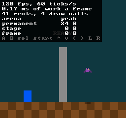

# 14 · Input

> **Goal:** the game's first player, a blue block on the floor, walks when you hold the arrows: behind the pillar and out the other side. Q and W step it through four colors, one for each power, one step per press however long you hold the key. A gamepad does the same, plugged in before momo starts or while it runs. A new line in the overlay lights up each button while you hold it. And no press is lost or doubled: not at 120 Hz, where half the frames run no tick, and not at 20 frames a second, where each frame runs three.

## The problem

momo hears one key, `` ` ``, and it's the engine's (chapter 13). The game hears nothing. The bat flies by itself, and nothing on the screen answers you.

[Plan §4.4](plan.md#44-platform-and-input) asks for a **virtual pad**: the game asks whether a button is down, never which key is, and the keyboard and gamepads both drive the same pad. Earlier chapters left this one their promises. Chapter 07 said the game would reach the keyboard through an `input::` module, which gets it from `platform::`. Chapter 09 put "read the virtual pad's presses" in the once-per-tick column of its table. Chapter 13 gave `platform::handle_events` its first key, and said this chapter would grow it into the pad's keys.

The hard part is in chapter 09's table. Events arrive while a frame runs, but the game asks about the pad during a tick, and a frame runs any number of ticks from 0 to 6. "Was A pressed?" has to be true on exactly one tick per press, whatever the frames do. The plan calls that **latching** presses to ticks.

## Design

### A pad of bits

The NES pad had eight buttons: the d-pad's four directions, Select, Start, B and A. The console read them one bit at a time, in the order A, B, Select, Start, Up, Down, Left, Right, and games kept the eight bits as one byte. momo's pad works the same way, with two more buttons, L and R (below). `Buttons` is a 16-bit number with one bit per button, so "every button held right now" is one number, and so is "every button pressed since the last tick".

### Who names the buttons

The plan's row lists the pad's buttons as the d-pad, Jump, Shoot, Start, Select and previous and next power. Jump and Shoot are what this game does with two of them. When chapter 10's first draft named four layers for this game, you asked why the engine didn't just number them and let the game name them. The buttons have the same problem.

| Option | The catch |
|---|---|
| The plan's buttons: Jump, Shoot, previous and next power, and the rest | Ideas from this game inside the engine, as chapter 10's first layers were |
| Numbered buttons, and the game hands the engine its key bindings | The game would deal in keys again, which plan §4.4 says it never does. The bindings would be a table in `game.so`, which the engine would have to copy after every reload. |
| **Buttons named for where they are on the pad: the d-pad, A, B, Select, Start, L and R. The game says what each one does.** | The game writes one line for each button it uses: `NEXT_POWER_BUTTON = BUTTON_R` |

momo takes the last. The buttons can't be bare numbers, as the layers are. A layer means nothing to the engine but its place in the order. A button is tied to keys and gamepad buttons, so the engine has to know which button is Up: the up arrow, the d-pad's up, the stick pushed up. A name for where the button is, rather than what it does, is the split consoles have always made. Nintendo made a pad with an A button, and Capcom decided that A jumps.

L and R are the plan's previous and next power. The NES pad had no shoulder buttons: MegaMan 2 changes weapons in a menu, opened with Start. MegaMan X, on the SNES, steps through them with L and R, and momo's pad takes the SNES's two shoulder buttons for that.

### Presses and ticks

The game asks three things about a button during a tick:

- **down**: is it held?
- **pressed**: did it go down since the last tick? Jumping and shooting happen once per press.
- **released**: did it go up since the last tick? Chapter 20 ends a jump early when you let go, which makes the jump's height depend on how long you hold it.

Down is easy. Pressed and released are where frames and ticks get in the way.

| Option | The catch |
|---|---|
| Look at the keys once per frame. A button is pressed if it's down now and wasn't in the last frame, and every tick in the frame sees that. | At 120 Hz every other frame runs no tick, and a press that arrives in one of those frames is gone by the next. A frame that runs three ticks hands all three the same press. |
| Look at the keys at every tick, and compare with the last tick | The ticks in a frame run one after the other, in microseconds, so they all see the keys as the frame found them. A tap that started and ended between two looks is never seen. |
| **Latch: between ticks, collect what went down and what went up, as it happens. Each tick takes what was collected, and the next starts collecting from nothing.** | A tap that ends before the next tick is pressed and released on that tick, but not down |

The first is the usual way, and it's how Unity's `Input.GetKeyDown` works: true during the frame the key went down. Unity's `FixedUpdate`, its fixed-timestep update, is notorious for missing those presses or seeing them twice, for exactly the reason in the table.

To see how often, a throwaway patch made the game count presses of W, and a small program sent momo's window 40 taps, each held between 60 and 120 ms, the way a finger taps:

| | 120 Hz: a tick every other frame | 50 ms frames: 3 ticks each |
|---|---|---|
| Pressed, comparing each frame with the last | 21, then 20 in a second run | 122 |
| Latched to ticks | 40 | 40 |

At 120 Hz, the frame-by-frame version lost half the presses: the ones that arrived in a frame with no tick. With 50 ms frames, which is how fast SDL draws while the window opens on Wayland (chapter 09), it saw every press about three times. Latched, both saw 40 out of 40.

momo latches. The engine keeps a `Pad` between ticks, three sets of buttons:

- **down**: what's held right now.
- **pressed**: buttons that went down since the last tick.
- **released**: buttons that went up since the last tick.

Every time a key or a gamepad button goes down or up, `input::set_held` records the buttons held now. Each button that wasn't down before gets its bit in `pressed`, and each button that was down and isn't gets its bit in `released`. Bits are only ever added, never cleared, so a press stays a press however many frames go by before a tick. Before each tick, `input::take_tick` hands the tick the whole `Pad`, then clears `pressed` and `released`, so the next tick sees only what happens after this one.

W, which is the pad's R, through a few frames at 120 Hz:

| Frame | Ticks | What happens | The engine's pad after it: down, pressed, released | The tick sees |
|---|---|---|---|---|
| 1 | 0 | W goes down | R, R, none | |
| 2 | 1 | | R, R, none | R down and pressed |
| 3 | 0 | | R, none, none | |
| 4 | 1 | | R, none, none | R down |
| 5 | 0 | W goes up | none, none, R | |
| 6 | 1 | W goes down and up again | none, R, R | R pressed and released, not down |

Frame 1 is the press the first option loses: it arrives in a frame without a tick. Frame 2 runs the tick, which sees it. Frame 6 is a tap shorter than a frame. A finger hardly manages one in 8 ms, but can in a 50 ms frame, and the program in Run it sends seven, each 0 ms long. The tick sees the press and the release, and the button isn't down: "jump, then let go at once" gives the smallest jump, which is what the tap asked for.

Handmade Hero, the other engine people often learn from, keeps a count of half transitions and whether the button ended down. momo's three sets of bits answer the same questions, for all the buttons at once.

### Only in `update`

`input::down`, `pressed` and `released` work only during a tick, and anywhere else they hit an `ASSERT`, like the renderer's drawing functions outside `render` (chapter 10).

Outside a tick there's no right answer for `pressed`: in `render`, it could only repeat what the last tick saw, in every frame until the next tick. More importantly, `render` draws `GameState` and nothing else. If the picture is to show a button, the game copies it into `GameState` in `update`. Chapter 21 will replay a recording by putting `GameState` back as it was and handing each tick the pad it had. A `render` that read the pad itself would show the keys you're holding, not the replay's.

The tick's `Pad` is 6 bytes, and it's the only input a tick has. Six bytes per tick is what chapter 21 records.

Instead of functions, `update` could take the pad as an argument, `update(state, pad)`, which would say in its signature that the game depends on nothing else. The plan chose functions, like the renderer's: no argument to pass down to every function that reads a button, no change to `GameApi`, and the `ASSERT` keeps the pad inside the tick all the same.

### Keys and gamepads

The tables from keys and gamepad buttons to the pad's buttons are in `platform.cpp`, written in SDL's names, since only `platform::` includes SDL (chapter 07). Keys are scancodes, places on the keyboard, as `` ` `` was in chapter 13:

| The pad | Key | Gamepad |
|---|---|---|
| d-pad | the arrows | the d-pad, or the left stick pushed more than halfway |
| A | X | south: A on an Xbox pad, cross on a PlayStation pad |
| B | Z | west: X on an Xbox pad, square on a PlayStation pad |
| L, R | Q, W | the shoulder buttons |
| Start | Enter | Start |
| Select | right Shift | Back: View on an Xbox pad, − on a Nintendo pad |

Z and X sit side by side, B left of A as on the NES pad, with Q and W above them where shoulder buttons would be. With scancodes they stay in those places on any layout: on a French keyboard, they're the keys marked W, X, A and Z.

SDL's gamepad functions turn hundreds of gamepads into one layout, and name its face buttons by where they are: south, east, west and north. A name like "the A button" would mean a different place on an Xbox pad than on a Nintendo one. momo uses south and west for A and B, again B to the left of A.

The keyboard and every gamepad drive the same pad. One person plays, with whatever is in their hands. A button is down while any key, gamepad button or stick holds it, and it goes up only when the last one lets go. The platform keeps what each device holds, every key in the table and each gamepad's buttons and stick, and after every event works out the pad's buttons again from all of them. Unplugging a gamepad empties its slot, so whatever it was holding goes up. momo opens up to four gamepads, which is more than one player needs.

Only the window with the keyboard's focus hears the keyboard, and by default SDL does the same with gamepads, so momo plays only while it's the window you're working in. A throwaway test also checked the edges. A key held while the window loses the focus goes up then, since SDL lets go of every key. A gamepad's button pressed elsewhere is ignored, and one let go elsewhere still goes up, so neither gets stuck down. Whether the game also pauses when it loses the focus is chapter 21's decision.

`` ` `` stays the engine's, and isn't on the pad.

### Captures take no input

`--capture` promised the same file for the same command (chapter 13). A key pressed while a capture runs would change the picture, so a capture empties the pad every frame. Captures with input wait for chapter 21's recordings.

### A line for the pad

The overlay gets one more line at the bottom: the name of every button, white while it's held and gray while it isn't. When a key seems to do nothing, it says whether the pad saw it, before you start suspecting the game's code. It shows the pad as it is right now, which is what the next tick will see.

### The game

The game's first player is a 16×24 block on the floor, in the game's entity layer, so it walks behind the pillar. It walks at 1 pixel per tick while the d-pad is held left or right, and holding both cancels out. MegaMan walks 1.375 pixels per tick, which a whole number of pixels can't hold: chapter 15's problem.

L and R step through four powers, which for now are only colors: blue, as MegaMan starts, then orange, green and purple, from the NES's palette. That uses `pressed`, the press the latch protects: hold W, and the color moves on once.

## The code

### The pad: `engine/input.h`

`engine/input.h:16`

```cpp
enum Button : u8 {
    BUTTON_A,
    BUTTON_B,
    BUTTON_SELECT,
    BUTTON_START,
    BUTTON_UP,
    BUTTON_DOWN,
    BUTTON_LEFT,
    BUTTON_RIGHT,
    BUTTON_L, // the shoulder buttons, which the NES pad didn't have
    BUTTON_R,
    BUTTON_COUNT,
};
```

Without its comments, which say what Design said about names and order. The first eight are in the NES's order.

`engine/input.h:31`

```cpp
using Buttons = u16;
static_assert(BUTTON_COUNT <= 16, "Buttons needs a bit for every button");

struct Pad {
    Buttons down;     // held when the tick runs
    Buttons pressed;  // went down since the last tick
    Buttons released; // went up since the last tick
};
```

`Buttons` is unsigned, since it's bits ([plan §3.4](plan.md#34-names-and-types)). A zeroed `Pad` has nothing held and nothing pressed, which is the pad before anyone touches it (ZII). The `static_assert` stops a 17th button from compiling, since it would need a bit that a `u16` doesn't have.

The game gets three functions, `input::down`, `pressed` and `released` (`engine/input.h:51`), each `MOMO_API`, taking a `Button` and returning a `bool`. The engine gets `bit(button)`, the button's bit in a `Buttons`, and the functions of the latch.

### The latch: `engine/input.cpp`

`engine/input.cpp:38`

```cpp
void set_held(Pad* pad, Buttons held)
{
    pad->pressed |= held & ~pad->down;
    pad->released |= pad->down & ~held;
    pad->down = held;
}

Pad take_tick(Pad* pad)
{
    Pad tick = *pad;
    pad->pressed = 0;
    pad->released = 0;
    return tick;
}
```

Without the comment in `set_held`. `held & ~pad->down` is the buttons held now that weren't down before: `~` turns the bits around, so `~pad->down` is every button that wasn't down, and `&` keeps the ones in both. `pad->down & ~held` is the other way around: down before, not held now. `|=` adds them, and never takes a bit away. `take_tick` copies the whole pad for the tick, and starts the next collection with `down` kept.

`engine/input.cpp:14`

```cpp
static bool has(Buttons buttons, Button button)
{
    ASSERT(in_tick);
    ASSERT(button < BUTTON_COUNT);
    return (buttons & bit(button)) != 0;
}
```

Without its comment. `down`, `pressed` and `released` each call it with their set of buttons from `tick_pad`, a file-scope variable that `begin_tick` fills in. `in_tick` is true from `begin_tick` to `end_tick`, like the renderer's `in_frame`. `button < BUTTON_COUNT` catches a number cast to a `Button` that isn't one. There's no `button >= 0`: a `Button` is a `u8`, which is never below 0, and GCC warns that the test is always true.

`stick_directions` (`engine/input.cpp:69`) turns a gamepad's stick into d-pad directions: left if x is below -16,384, half of SDL's -32,768, right if it's above 16,384, and the same for up and down. A stick pushed to a corner is two directions at once. It's here, not in `platform.cpp`, because it needs nothing from SDL but two numbers, so the tests can check it.

### Keys and gamepads: `engine/platform.cpp`

`engine/platform.cpp:30`

```cpp
constexpr KeyButton KEY_BUTTONS[] = {
    { .key = SDL_SCANCODE_X, .button = BUTTON_A },
    { .key = SDL_SCANCODE_Z, .button = BUTTON_B },
    { .key = SDL_SCANCODE_RSHIFT, .button = BUTTON_SELECT },
    { .key = SDL_SCANCODE_RETURN, .button = BUTTON_START },
    { .key = SDL_SCANCODE_UP, .button = BUTTON_UP },
    ...
    { .key = SDL_SCANCODE_Q, .button = BUTTON_L },
    { .key = SDL_SCANCODE_W, .button = BUTTON_R },
};
```

A `KeyButton` is a scancode and a `Button`. `GAMEPAD_BUTTONS` (`engine/platform.cpp:53`) is the same kind of table for SDL's gamepad buttons, `SDL_GAMEPAD_BUTTON_SOUTH` and the rest. To give a button a second key, add a row: two keys for one button work, since the pad's button is down while either key is.

`engine/platform.cpp:67`

```cpp
static bool keys_held[ARRAY_COUNT(KEY_BUTTONS)];

struct Gamepad {
    SDL_Gamepad* gamepad; // null for a free slot
    SDL_JoystickID id;    // SDL's number for it, which its events carry
    bool buttons_held[ARRAY_COUNT(GAMEPAD_BUTTONS)];
    i32 stick_x; // the left stick, from -32768 to 32767
    i32 stick_y;
};

constexpr i32 MAX_GAMEPADS = 4;
static Gamepad gamepads[MAX_GAMEPADS];
```

What each device holds, one `bool` per row of its table. A zeroed slot holds nothing, so the loops below can go through all four slots without asking which are in use.

`engine/platform.cpp:215`

```cpp
static Buttons held_buttons()
{
    Buttons held = 0;
    for (i32 i = 0; i < ARRAY_COUNT(KEY_BUTTONS); i++) {
        if (keys_held[i])
            held |= input::bit(KEY_BUTTONS[i].button);
    }
    for (const Gamepad& gamepad : gamepads) {
        for (i32 i = 0; i < ARRAY_COUNT(GAMEPAD_BUTTONS); i++) {
            if (gamepad.buttons_held[i])
                held |= input::bit(GAMEPAD_BUTTONS[i].button);
        }
        held |= input::stick_directions(gamepad.stick_x, gamepad.stick_y);
    }
    return held;
}
```

Without its comment. Every button held anywhere, ORed together.

`handle_events` (`engine/platform.cpp:232`) is now a `switch` on the event's type, and takes the engine's `Pad`. A key's event sets its rows in `keys_held`:

`engine/platform.cpp:249`

```cpp
        case SDL_EVENT_KEY_DOWN:
        case SDL_EVENT_KEY_UP:
            for (i32 i = 0; i < ARRAY_COUNT(KEY_BUTTONS); i++) {
                if (KEY_BUTTONS[i].key == event.key.scancode)
                    keys_held[i] = event.key.down;
            }
            if (event.key.down && !event.key.repeat && event.key.scancode == SDL_SCANCODE_GRAVE)
                events.backquote_pressed = true;
            break;
```

Without its comment. A held key's repeats need no special case for the pad: each one sets a held key to held again, which changes nothing. Only `` ` ``, which toggles the overlay, still skips them. A gamepad's button events set `buttons_held` the same way, and its stick's events, `SDL_EVENT_GAMEPAD_AXIS_MOTION`, keep `stick_x` and `stick_y`. After the `switch`, at the bottom of the loop:

`engine/platform.cpp:295`

```cpp
        input::set_held(pad, held_buttons());
```

After every event, not once after the loop, so a key that went down and up in one frame is still a press, as in frame 6 of Design's table. For an event that has nothing to do with the pad, such as the mouse moving, the buttons held are the same as before, and `set_held` changes nothing.

On `SDL_EVENT_GAMEPAD_ADDED`, `open_gamepad` (`engine/platform.cpp:185`) opens the gamepad in the first free slot and logs its name. On `SDL_EVENT_GAMEPAD_REMOVED`, `close_gamepad` closes it and empties its slot with `*gamepad = {}`. A gamepad already plugged in when momo starts arrives as `SDL_EVENT_GAMEPAD_ADDED` too, in the first frame, so there's only one way in. For that, `platform::init` now starts SDL with `SDL_INIT_VIDEO | SDL_INIT_GAMEPAD`, and `shutdown` closes any gamepad still open.

### The loop: `engine/momo.cpp`

`engine/momo.cpp:349`

```cpp
        platform::Events events = platform::handle_events(&engine.pad);
        ...
        if (engine.options.capture_path)
            engine.pad = {}; // a capture takes no input, so every run saves the same picture
```

`engine.pad` is the engine's `Pad`, which collects between ticks. It's a field of `Engine`, the engine's own state, which never reloads.

`engine/momo.cpp:370`

```cpp
        for (i32 i = 0; i < ticks; i++) {
            input::begin_tick(input::take_tick(&engine.pad));
            engine.game.update(engine.state);
            input::end_tick();
        }
```

Without its comment. That's the whole latch, as the loop sees it. A frame that runs no ticks takes nothing, so its presses stay collected for the next tick. The first of three ticks takes them, and the other two find `pressed` and `released` cleared.

### The pad's line in the overlay

`engine/momo.cpp:190`

```cpp
constexpr Str BUTTON_NAMES[] = {
    STR("A"), STR("B"), STR("sel"), STR("start"), STR("^"),
    STR("v"), STR("<"), STR(">"),   STR("L"),     STR("R"),
};
static_assert(ARRAY_COUNT(BUTTON_NAMES) == BUTTON_COUNT, "a name for every button");
```

In the order of `enum Button`, and the `static_assert` breaks the build if a button is added without a name. The font has no arrows, so `^`, `v`, `<` and `>` stand in for the d-pad. clang-format lined the table up in columns.

`draw_overlay` works out the line's length, 25 chars, so the box fits around it too, then draws each name in its own color:

`engine/momo.cpp:262`

```cpp
    i32 x = OVERLAY_MARGIN;
    i32 y = OVERLAY_MARGIN + ARRAY_COUNT(lines) * OVERLAY_LINE_HEIGHT;
    for (i32 i = 0; i < BUTTON_COUNT; i++) {
        bool held = (engine.pad.down & input::bit((Button)i)) != 0;
        Color color = held ? OVERLAY_TEXT_COLOR : OVERLAY_DIM_COLOR;
        renderer::draw_text(BUTTON_NAMES[i], x, y, color, 0);
        x += (BUTTON_NAMES[i].len + 1) * GLYPH_SIZE;
    }
```

Each name is a `draw_text` of its own, with one char of space after it. The overlay reads `engine.pad` itself, not through `input::down`: it isn't the game's code, and it doesn't run during a tick.

### The game: `game/game.cpp`

`game/game.cpp:38`

```cpp
constexpr Button PREVIOUS_POWER_BUTTON = BUTTON_L;
constexpr Button NEXT_POWER_BUTTON = BUTTON_R;
```

The game's names for the buttons it gives a meaning, under a comment that says the d-pad means what it says. Chapter 20 adds `JUMP_BUTTON = BUTTON_A`.

`game/game.cpp:89`

```cpp
    // Walk while the d-pad is held left or right. Both at once cancel out.
    if (input::down(BUTTON_LEFT))
        state->player_x -= PLAYER_SPEED;
    if (input::down(BUTTON_RIGHT))
        state->player_x += PLAYER_SPEED;
    state->player_x = clamp(state->player_x, 0, SCREEN_WIDTH - PLAYER_WIDTH);

    // One power along for each press, however long the button stays down.
    if (input::pressed(NEXT_POWER_BUTTON))
        state->power = (state->power + 1) % POWER_COUNT;
    if (input::pressed(PREVIOUS_POWER_BUTTON))
        state->power = (state->power + POWER_COUNT - 1) % POWER_COUNT;
```

In `update`, after the bat. `clamp` stops the player at both edges of the screen. `%` wraps the power around, and going back adds `POWER_COUNT` first, since in C++ `-1 % 4` is `-1`, not 3. `GameState` has two new fields, `player_x` and `power`, and `render` draws the player from them, in `POWER_COLORS[state->power]` (`game/game.cpp:61`). The shutdown log names both.

### The tests

`tests/input_test.cpp` is new: eleven tests. They play the engine's part, calling `set_held` as the platform does and running ticks as the loop does, through a helper that returns what one tick saw of a button:

`tests/input_test.cpp:94`

```cpp
static void a_tap_between_two_ticks_is_pressed_and_released_but_not_down()
{
    Pad pad = {};
    input::set_held(&pad, A);
    input::set_held(&pad, 0);
    Seen seen = tick(&pad, BUTTON_A);
    CHECK(seen.pressed);
    CHECK(seen.released);
    CHECK(!seen.down);
}
```

`A` is `input::bit(BUTTON_A)`. The others check that a held button is pressed on its first tick only, that a release is released on one tick, that a press in a frame without ticks waits for the next tick, that a frame of three ticks hands the press to the first, that letting go and pressing again between ticks is both, that buttons don't affect each other, and three positions of the stick, among them exactly halfway, which doesn't count.

## Run it

### The keyboard

```
$ make
$ ./build/debug/momo
```

The log starts as chapter 13's did. Hold the right arrow, and the player walks right, behind the pillar and out the other side, and stops at the edge of the screen. Tap W, and it turns orange; again, green. Hold W down, and it moves on once and stays. Q goes back. Press `` ` ``, and hold a few keys: their names light up on the overlay's last line.



`./build/debug/momo --overlay --capture 170 book/images/14-pad.png` made this picture. A capture takes no input, so every button is gray, and the player stands where it starts, at x = 48. The game draws 41 rectangles now: chapter 13's 40, and the player. The overlay's numbers are measured, so yours will differ a little. The box is wider than in chapter 13, to fit the pad's line.

Quit, and the log says where you left things:

```
game/game.cpp:150: shutdown, with the bat at x = 213, the player at x = 108, power 3
```

That run came from a small program sending key events, under X11: the right arrow held for 1,000 ms, which is 60 ticks, so 48 + 60 = 108; then seven taps of W, each pressed and released in the same instant, shorter than any tick. Seven steps of four powers is power 3: every tap counted once.

### A gamepad

Plug one in, before momo starts or while it runs:

```
engine/platform.cpp:196: gamepad connected: Xbox 360 Controller
```

The name is SDL's for the gamepad. No real gamepad was at hand while this chapter was written, so this one was a virtual Xbox 360 pad, made through Linux's `uinput`, which makes input devices the kernel treats like real ones. SDL found it, named it from its table of known gamepads, and momo opened it. Its d-pad and stick walked the player, its right shoulder button stepped the power, and unplugging it while its d-pad was held let the button go:

```
engine/platform.cpp:208: gamepad disconnected: Xbox 360 Controller
```

The player stopped where it was. If you have a gamepad, try it, and watch the overlay to see which button is which.

Starting SDL's gamepads makes momo start a little slower: `--capture 0`, which quits after the first frame, takes about 165 ms instead of 95. SDL's own log shows where the time goes: it looks for gamepads through udev, Linux's device manager, twice, once for the gamepads it talks to directly and once for the rest. It happens once, when momo starts.

### Reading the pad in `render`

At the end of `render`, add a square that shows while A is held:

```cpp
    if (input::down(BUTTON_A))
        renderer::draw_rect({ .x = 0, .y = 0, .w = 8, .h = 8 }, TEXT_COLOR, LAYER_HUD);
```

It compiles and links: `down` is `MOMO_API`, and `render` may call it as far as C++ knows. Run it:

```
$ ./build/debug/momo
...
game/game.cpp:71: init
engine/renderer.cpp:338: loaded assets/bat.png, 32x16, as texture 2
engine/input.cpp:18: ASSERT(in_tick) failed
zsh: illegal hardware instruction  ./build/debug/momo
```

The first frame's `render` stops it. Exercise 5 does it the right way. Take the lines out.

### Memory

```
engine/momo.cpp:104: permanent arena: at most 24 bytes used of 16 MB
engine/momo.cpp:104: engine    arena: at most 491630 bytes used of 8 MB
```

`GameState` grew by its two new fields, from 16 bytes to 24. The engine's arena is the same as in chapter 13: the pad and the gamepads are file-scope variables in `momo.cpp`, `input.cpp` and `platform.cpp`, like the rest of the engine's state.

### The tests

```
$ make test
...
input_test
  nothing_held_is_nothing_pressed ... ok
  a_held_button_is_pressed_on_its_first_tick_only ... ok
  a_release_is_released_on_one_tick ... ok
  a_press_in_a_frame_without_ticks_waits_for_the_next_tick ... ok
  a_frame_with_three_ticks_hands_the_press_to_the_first ... ok
  a_tap_between_two_ticks_is_pressed_and_released_but_not_down ... ok
  letting_go_and_pressing_again_between_ticks_is_both ... ok
  each_button_is_its_own ... ok
  a_stick_in_the_middle_is_no_direction ... ok
  a_stick_pushed_all_the_way_is_one_direction ... ok
  a_stick_pushed_to_a_corner_is_two_directions ... ok
  11 passed
...
```

## Recap

```
momo/
  engine/
    input.h/cpp     new: the pad's buttons, the latch between ticks, down/pressed/released
                      for the game during ticks, the stick as the d-pad
    platform.h/cpp  + the key and gamepad tables, gamepads plugged in and out;
                      handle_events records the pad's changes
    momo.h          includes input.h; update reads the pad
    momo.cpp        + each tick takes the pad; captures take no input; the overlay's pad line
    options.h       --capture says it takes no input
  game/
    game.cpp        + the player: walks with the d-pad, changes power with L and R
  tests/
    input_test.cpp  new: eleven tests of the latch and the stick
  book/images/
    14-pad.png      new: the overlay with the pad's line, at tick 170
```

- The game reads a **virtual pad**: the NES pad's buttons, and L and R. The keyboard and every gamepad drive it, and a button is down while anything holds it.
- The buttons are **named for where they are**. The game says what each one does: `NEXT_POWER_BUTTON = BUTTON_R`.
- Presses are **latched to ticks**. Between ticks the engine collects what went down and up, and each tick takes it all. Comparing frames instead lost half the presses at 120 Hz and counted each three times with 50 ms frames.
- The pad can be read **only during a tick**. A button the picture shows goes through `GameState`.
- A tick's pad is **6 bytes**, which is all the input a tick has, and what chapter 21 will record.
- **Captures take no input**, so they stay the same on every run.
- The overlay shows **which buttons are held**.

The plan records the pad's buttons, the latch, the tables and captures without input in [§4.4](plan.md#44-platform-and-input), and the overlay's pad line in [§4.10](plan.md#410-debug-tools-and-tests). The outline now says this chapter also gave the game a player.

Chapter 15 gives the player MegaMan's walking speed, 1.375 pixels per tick, with fixed-point numbers.

## Exercises

Undo each change before the next exercise: `git checkout -- engine game` puts the code back.

1. **Comparing frames.** Make the loop compare each frame with the last, the first option in Design. Above the tick loop in `momo::run`, add:
   ```cpp
   Buttons down = engine.pad.down;
   Pad frame_pad = { .down = down,
                     .pressed = (Buttons)(down & ~engine.last_down),
                     .released = (Buttons)(engine.last_down & ~down) };
   engine.last_down = down;
   ```
   add `Buttons last_down;` to `Engine`, and pass `frame_pad` to `begin_tick` instead of `take_tick`'s. Tap W twenty times. How many steps did the color take? Then run under X11 with vsync off (`SDL_VIDEO_DRIVER=x11 vblank_mode=0`, chapter 09), where frames come thousands of times a second. Does it still lose presses, and why?
2. **Down instead of pressed.** Change `input::pressed(NEXT_POWER_BUTTON)` to `input::down`. Hold W. How many colors go by in a second? Tap W as briefly as you can: does it always land on the next color?
3. **Two d-pads.** Add I, J, K and L to `KEY_BUTTONS` as a second d-pad. Hold J and the left arrow together, then let go of one. What does the player do, and which function makes that work? What would go wrong if WASD were the second d-pad instead?
4. **What the tick sees.** Without running anything, work out what the game sees on the next tick in each case, at 120 Hz: you hold the right arrow and tap the left one, down and up within one frame; you let go of W and press it again within one frame; you press W in a frame that runs three ticks. Then check your answers against `tests/input_test.cpp`.
5. **Showing a button.** Make the player turn white while A is held, the right way: in `update`, copy `input::down(BUTTON_A)` into a new `bool` in `GameState`, and draw from it in `render`. Bump nothing: what does the engine say when `game.so` reloads with the new field, and why?
6. **A recording's size.** A tick's pad is 6 bytes. How many bytes would ten minutes of ticks take? A recording could keep only `down`, 2 bytes a tick, and work out `pressed` and `released` by comparing each tick's `down` with the one before. Which presses would a replay of that recording lose? Design's table of frames has one.
7. **The stick.** If you have a gamepad, change `STICK_HALFWAY` (`engine/input.cpp:12`) to a quarter, 8192, and try walking left and right with the stick. What does the overlay's line show when you push the stick right, a little up? Why does a platformer want a large threshold before Down counts?
