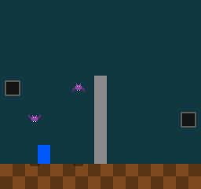
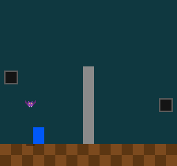

# 16 · Entities

> **Goal:** everything in the game that moves or acts becomes an **entity**: one `Entity` struct with a `kind`, kept in a `Pool` of 32 slots inside `GameState`, and updated and drawn by a `switch` on its kind. Two nests appear, one on each side of the screen, and each one lets out a bat at a time, which flies across and is removed once it's off the screen. Each nest keeps a **handle** to its bat, an index plus a generation, and four seconds in, the right nest's bat takes the slot the left nest's bat has just left. The handle knows the difference. With an index alone, the left nest's next bat comes out two seconds late, because the nest takes the other nest's bat for its own.

## The problem

`GameState` has a field for each thing in the game: `bat_pos` and `bat_vel` for the bat, `player_pos` for the player. A second bat would need `bat2_pos` and `bat2_vel`, and a second copy of the code that moves the first. A MegaMan screen has enemies, shots, items and explosions, and they come and go while the game runs: a shot exists for a second, and an enemy until it's hit. The game needs room for a few dozen things of several kinds, made and removed as it plays.

Some of those things refer to others. Something that lets out enemies keeps track of what it let out. A shot hits one enemy. Chapter 23's camera follows the player. When the thing referred to is gone, the reference has to say so, and not quietly refer to whatever has taken its place.

Earlier chapters left this one their promises. Chapter 01 showed `entity::update` as a `switch` on `e->kind`, and said `-Wall` warns about a kind with no `case`. Chapter 01 also said momo's containers get a fixed capacity and `ASSERT` when they're full, and chapter 04 said they check their indices with `ASSERT`, since AddressSanitizer can't see inside an arena. Chapter 06 stored the bat's name as a string literal in `GameState`, watched it break on a reload, and said that from this chapter on, the game stores kinds as enums.

[Plan §4.7](plan.md#47-entities) decided the shape: one `Entity` struct with a `kind` enum, in a fixed pool with **generational handles**. This chapter works out what that means in code.

## Design

### One struct for every kind

There are a few ways to give a bat, a nest and a player their own data:

| Option | The catch |
|---|---|
| A struct for each kind, each in an array of its own: `Bat bats[16]; Nest nests[4];` | A loop for each kind, and a reference to "any entity" needs a kind as well as an index |
| A base struct and inheritance, `struct Bat : Entity`, with a virtual `update` | Ruled out by the dialect: `virtual` hides which function runs, and its hidden pointer into `game.so` breaks on a reload ([plan §3.2](plan.md#32-rules-for-game-code-required-by-hot-reload)) |
| One `Entity` holding a `union` of a struct for each kind | Smaller, but a zeroed union must mean something for every kind at once, and reading the wrong kind's fields compiles and gives garbage |
| **One `Entity` with every kind's fields** | Every entity carries fields it doesn't use |

momo takes the last, as the plan decided. An `Entity` is 32 bytes: a kind, a position, a velocity, a timer and a handle. A bat leaves the handle at zero, and the player leaves the timer. 32 of them are 1 KB, and one loop goes over all of them. The unused fields are the price, and at this size it's a small one. Part II's ECS chapter splits entities into components and compares the two honestly.

An entity is anything that moves or acts, not only something you can hit. A nest never moves, but it counts ticks and lets out bats, so it's an entity too.

### Zero is no kind

`EntityKind` starts with `ENTITY_NONE`. A zeroed `Entity` is then nothing at all, which is what ZII says zero should be. The other choice, `ENTITY_PLAYER` first, would make a zeroed entity a player: an entity added with `.kind` left out would be a second player, standing at (0, 0), and nothing would complain. With `ENTITY_NONE` first, `update`'s `switch` stops the game on it, at the first tick the entity sees (exercise 1).

### Where entities live

Entities are game state, so they have to live in `GameState`, in memory the engine owns ([plan §3.2](plan.md#32-rules-for-game-code-required-by-hot-reload)).

| Option | The catch |
|---|---|
| `std::vector<Entity>` | Ruled out by the dialect. Its entities live on the heap, outside the engine's memory, where chapter 21's snapshots won't look, and growing it moves every one of them, as chapter 01 showed. |
| An array from the permanent arena, and a pointer to it in `GameState` | A zeroed `GameState` has no array, so `init` has to make one. The array's size isn't part of `sizeof(GameState)`, so a reload that changes it keeps the old array, now too small. |
| **An array inside the pool, and the pool inside `GameState`** | `GameState` grows by the whole pool |

momo takes the last. The pool is a struct with its arrays inside it, `Pool<Entity, 32>`, so a zeroed pool is an empty one, ready to use, and `GameState` holds it like any other field. Its size is part of `sizeof(GameState)`, so changing the capacity changes the size, and the engine starts the game over by itself (chapter 06). Plan §3.1 allows templates for containers, and a container's capacity in its type is what C++'s own `std::array<T, N>` does.

A pool never moves an item. The bat in slot 3 stays in slot 3 until it's removed, so a pointer to it is good until then, even while other entities are added. That's what makes adding an entity in the middle of the update loop safe (below).

### Finding a free slot

Each slot has a `used` flag. Adding an item needs a free slot:

| Option | The catch |
|---|---|
| **Scan for the first slot that isn't used** | Up to 32 flags read per add |
| A free list: each free slot holds the index of the next free one, so the first free slot is always known | A zeroed pool's list is empty, so it needs setting up, or a second counter for slots never used. And which slot a new item gets depends on the order slots were freed in, which is harder to follow in a log. |

momo scans. 32 bools are 32 bytes, half a cache line, and the first free slot is always the lowest, which makes the log below easy to follow. A free list is exercise 4.

The scan doesn't look past the end. `add` first `ASSERT`s that `count < N`: running out of slots is a limit you've hit, as an arena's size is (plan §4.2). With a free slot known to exist, the scan stops at it.

### Referring to an entity

A nest has to know whether its bat is still out. It can remember its bat in three ways:

| Option | Once the bat is removed |
|---|---|
| A pointer, `Entity*` | Points at the bat's old slot: zeros at first, then whatever is added there next. ASan can't see the mistake, since the pool is inside an arena (chapter 04). |
| An index, `i32` | The same: it names the slot, and the slot's next entity |
| **A handle: the index, plus the slot's generation when the bat was added** | Finds nothing |

A pointer would survive a reload: the pool is in the engine's memory, which doesn't move. Reloading isn't the problem. Removing is: a slot doesn't remember who was in it, so a pointer or an index can't tell the bat it was given from the next entity in the same slot.

A **generation** is how many items a slot has held. Each slot starts at 0, and `add` counts it up as it puts an item in, so the slot's first item is generation 1, its second generation 2. A `Handle` is the slot's index and its generation at the time of the add. To find an item, the slot must be used, and its generation must still be the handle's. Once the item is removed and another takes the slot, the generation has moved on, and the old handle finds nothing.

Generations start at 1, so no item ever has generation 0. A zeroed handle, slot 0 and generation 0, then finds nothing, even though slot 0 holds the player. That makes the zeroed handle the handle to no item, as ZII wants: a new nest's handle is zeroed, and needs no special value to say "no bat yet". "Break it" shows what happens without it.

An `i32` generation lasts for 2 billion adds into one slot: over a year, adding into the same slot on every tick.

### Removing

`remove` takes a handle, and `ASSERT`s that it still finds its item. Removing an item twice is a bug, like a double `free`, and a bug stops the game ([plan §3.3](plan.md#33-errors-and-strings)). When chapter 25's shots hit an enemy, the shot that removes it has to check first.

`remove` also zeroes the slot. A pointer kept past the remove then reads zeros, and a zeroed entity's kind is `ENTITY_NONE`, which the `switch` stops on, rather than an old bat that looks fine.

### Visiting every entity

The game goes through the slots in order:

```cpp
for (i32 i = 0; i < MAX_ENTITIES; i++) {
    Handle handle = pool::handle_at(state->entities, i);
    Entity* e = pool::get(&state->entities, handle);
    if (!e)
        continue; // an empty slot
    ...
}
```

`handle_at` gives the handle of whatever is in slot `i`, or a zeroed handle for an empty slot, and `get` turns a handle into a pointer, or null. Two calls where one would do, but every pointer to an entity then comes from a handle, through the same check.

The loop can add and remove entities as it goes, since nothing moves. A bat that flies off the screen removes itself, and the loop goes on to the next slot. A nest adds a bat into the first free slot. If that slot comes later than the nest's, the loop reaches the new bat in the same tick, and it moves on the tick it comes out. If it came earlier, the bat would wait a tick. In this game, the player and the nests take slots 0 to 2 and are never removed, so every bat's slot comes later. Either way the game is the same on every run.

`get` comes in two versions. `pool::get(&state->entities, h)`, with the `&`, returns an `Entity*` you can change. `pool::get(state->entities, h)`, without it, returns a `const Entity*`, which is all `render`'s `const GameState*` can give. The `&` shows at the call that the pool may change, as [plan §3.1](plan.md#31-rules) asks for pointers.

### One `switch` for each job

`update` and `render` each have one `switch` on the entity's kind, and each `case` calls a function for that kind: `update_bat`, `draw_bat`. The functions take what they need: `update_nest` takes `GameState*`, since it adds bats to the pool, and `update_bat` also takes its own handle, which removing itself needs.

Neither `switch` has a `default`. With no `default`, GCC's `-Wswitch`, part of `-Wall`, warns about every kind the `switch` leaves out, which is chapter 01's promise. A `default` would silence it.

`ENTITY_NONE`'s `case` is `ASSERT(!"an entity with no kind")`. A string literal is an address, which is never null, so `!` of one is `false`, and the `ASSERT` always fails. It prints its condition, so the text reads as the message.

### The game

The bat and the player become entities, and two **nests** join them, one on each side of the screen. A nest lets out one bat at a time. While its bat is out, the nest waits. Once the bat is gone, the nest counts 60 ticks, a second, and lets out the next. MegaMan games are full of enemies that come out of something, a few at a time, and keeping count of what's out is the first thing such an enemy needs a handle for.

The left nest's bats fly right at 1.5 pixels a tick, and the right nest's fly left at 2. A bat is removed once it's wholly off the screen. The right nest's bats are faster, so its bat is gone first and comes back first, and four seconds in, it goes into the slot the left nest's bat has just left:

| Tick | What happens | Slot 3 | Slot 4 |
|---|---|---|---|
| 59 | Both nests let out a bat, the left one first | left nest's bat, generation 1 | right nest's bat, generation 1 |
| 182 | The right nest's bat flies off the left edge | left nest's bat | empty |
| 224 | The left nest's bat flies off the right edge | empty | empty |
| 242 | The right nest lets out its next bat, into the first free slot | right nest's bat, generation 2 | empty |
| 284 | The left nest lets out its next bat | right nest's bat | left nest's bat, generation 2 |

From tick 224 to 284, the left nest is waiting, and its handle is slot 3, generation 1. From tick 242, slot 3 holds the right nest's bat, generation 2. An index alone would say the left nest's bat was back.

The nests log each bat they let out, and the bats log leaving the screen, so the log tells the story as it happens.

The nest's `vel` is the velocity it gives its bats: the bat starts with a copy. That puts the speeds in `GameState`, set by `init`, and Run it shows what that means for a reload.

### No `Array` yet

Chapter 04 said momo's containers, `Array` and `Pool`, would arrive in this chapter. `Pool` is here. Nothing in the game needs an `Array`, a list whose items have no handles and can be reordered, so it waits for the first thing that does.

## The code

### The pool: `engine/pool.h`

`engine/pool.h:12`

```cpp
struct Handle {
    i32 index;      // the slot
    i32 generation; // the slot's generation when the item was added
};
```

`engine/pool.h:24`

```cpp
template <typename T, i32 N>
struct Pool {
    static_assert(N > 0, "a pool needs at least one slot");
    T items[N];
    i32 generations[N]; // how many items each slot has held: 0 if none yet
    bool used[N];       // whether each slot holds an item now
    i32 count;          // how many slots hold an item
};
```

A struct of three arrays and a count, all zero in a zeroed pool. `template <typename T, i32 N>` makes `N` part of the type: `Pool<Entity, 32>` and `Pool<Entity, 64>` are different types, of different sizes. Like `fx.h`, the header has no `.cpp`: the functions are templates, so the game compiles its own copy of them, for `Entity`, and none of them is `MOMO_API`.

`engine/pool.h:37`

```cpp
template <typename T, i32 N>
Handle add(Pool<T, N>* pool, const T& item)
{
    ASSERT(pool->count < N);
    // count < N, so a free slot is there to be found.
    i32 i = 0;
    while (pool->used[i])
        i++;
    pool->items[i] = item;
    pool->used[i] = true;
    pool->generations[i]++; // an i32 lasts for 2 billion adds into one slot
    pool->count++;
    return { .index = i, .generation = pool->generations[i] };
}
```

The generation counts up before the handle is made, so the first item in a slot is generation 1. `item` is a `const T&`, so the game can pass a designated initializer straight in: `pool::add(&state->entities, { .kind = ENTITY_BAT, ... })`. C++ works out `T` from the pool, and the braces build an `Entity`.

`engine/pool.h:54`

```cpp
template <typename T, i32 N>
bool contains(const Pool<T, N>& pool, Handle handle)
{
    ASSERT(handle.index >= 0 && handle.index < N);
    return pool.used[handle.index] && pool.generations[handle.index] == handle.generation;
}
```

The whole idea of a handle is the last line. The `ASSERT` is chapter 04's promise: a handle with an index outside the pool is a bug, caught here, since ASan can't see past the arrays inside an arena. The two `get`s (`engine/pool.h:62`) return `&items[index]` when `contains` is true and null when it isn't, one for a `Pool*` and one for a `const Pool&`.

`engine/pool.h:79`

```cpp
template <typename T, i32 N>
void remove(Pool<T, N>* pool, Handle handle)
{
    ASSERT(contains(*pool, handle));
    pool->items[handle.index] = {};
    pool->used[handle.index] = false;
    pool->count--;
}
```

The generation stays as it is. The next `add` into this slot counts it up, and from then on the removed item's handles find nothing. Until then, `used` is false, and they find nothing either. `handle_at` (`engine/pool.h:102`) is the loop's helper: the handle of the item in a slot, or a zeroed handle for an empty one. Its comment shows the loop.

`momo.h` includes `pool.h`, so the game gets it with the rest of the engine.

### Entities: `game/game.cpp`

`game/game.cpp:18`

```cpp
enum EntityKind : u8 {
    ENTITY_NONE,
    ENTITY_PLAYER,
    ENTITY_NEST, // lets out bats
    ENTITY_BAT,
};
```

The comment above it says to add new kinds at the end. "Break it" shows why.

`game/game.cpp:31`

```cpp
struct Entity {
    EntityKind kind;
    Fx2 pos;    // its top left corner, from the screen's top left
    Fx2 vel;    // pixels per tick. A nest's is the velocity it gives its bats.
    i32 timer;  // ticks: a bat's since it left its nest, a nest's while it waits
    Handle bat; // a nest's bat: the last one it let out, which may be gone
};
```

`timer` means one thing to a bat and another to a nest. That's the fat struct's way: two kinds that need the same type of number share a field, and the field's comment says what it means to each.

`game/game.cpp:46`

```cpp
struct GameState {
    i32 tick;                            // ticks run since init: game time (chapter 09)
    Pool<Entity, MAX_ENTITIES> entities; // everything that moves or acts (chapter 16)
    Handle player;                       // the player's entity
    i32 power;                           // the player's power, 0 to POWER_COUNT - 1: its color
    Texture bat_texture;                 // bat.png, a number the renderer gave out (chapter 12)
};
```

`MAX_ENTITIES` is 32. The player is reached through `player`, a handle, the same way a nest reaches its bat. The power stays in `GameState`: it's what the player has chosen, not where the player is. `init` (`game/game.cpp:104`) adds the player, then the two nests, each with its position and its bats' velocity.

`game/game.cpp:152`

```cpp
void update_nest(GameState* state, Entity* nest)
{
    if (pool::contains(state->entities, nest->bat))
        return; // its bat is still out

    nest->timer++;
    if (nest->timer < NEST_WAIT_TICKS)
        return;
    nest->timer = 0;
    // Adding moves no entity, so nest still points at this nest.
    nest->bat =
        pool::add(&state->entities, { .kind = ENTITY_BAT, .pos = nest->pos, .vel = nest->vel });
    LOG_INFO("tick %d: the nest at x = %d lets out a bat into slot %d, generation %d", state->tick,
             fx::floor(nest->pos.x), nest->bat.index, nest->bat.generation);
}
```

Without its comment. A new nest's `bat` is zeroed, which finds nothing, so its first bat comes out 60 ticks after `init`, like every other. `nest` is a pointer into the pool, and the `add` puts a bat into the same pool. With a `std::vector`, that line could move every entity, and `nest` would point at freed memory on the next line. A pool never moves anything, which the comment says.

`game/game.cpp:170`

```cpp
void update_bat(GameState* state, Handle self, Entity* bat)
{
    bat->pos += bat->vel;
    bat->timer++;
    if (bat->pos.x <= fx::from_int(-BAT_SIZE) || bat->pos.x >= fx::from_int(SCREEN_WIDTH)) {
        LOG_INFO("tick %d: the bat in slot %d flew off the screen", state->tick, self.index);
        pool::remove(&state->entities, self);
    }
}
```

A bat moving left goes below x = 0 before it's gone, so its last pixels are drawn at negative x, the first negative positions in the game. The right nest's bats move 2 whole pixels a tick, so `fx::floor` and dividing by 256 agree on every one of them, and chapter 15's case for floor still waits for chapter 23's camera. After the `remove`, `bat` points at a zeroed slot, and the function doesn't touch it again.

`game/game.cpp:186`

```cpp
    for (i32 i = 0; i < MAX_ENTITIES; i++) {
        Handle handle = pool::handle_at(state->entities, i);
        Entity* e = pool::get(&state->entities, handle);
        if (!e)
            continue; // an empty slot
        switch (e->kind) {
        case ENTITY_NONE:
            ASSERT(!"an entity with no kind");
            break;
        case ENTITY_PLAYER:
            update_player(state, e);
            break;
        case ENTITY_NEST:
            update_nest(state, e);
            break;
        case ENTITY_BAT:
            update_bat(state, handle, e);
            break;
        }
    }
```

`update`, before `state->tick++`. `update_player` (`game/game.cpp:131`) is chapter 15's walk and power change, on `player->pos` instead of `state->player_pos`. `render` (`game/game.cpp:268`) has the same loop, with `const Entity*` and the `get` without the `&`, and a `switch` that calls `draw_player`, `draw_nest` and `draw_bat`. `draw_bat` is chapter 15's bat, shadow and all, except that the wings flap on the bat's own `timer` instead of the game's tick, so each bat flaps from the moment it leaves its nest. A nest is two rectangles on the background layer: a stone rim and a dark hole.

`shutdown` (`game/game.cpp:296`) finds the player through its handle, with the `const` `get`, and logs how many entities there are.

### The tests: `tests/pool_test.cpp`

Ten tests, on a pool of four slots, small enough to fill. One of them is the game's tick 242:

`tests/pool_test.cpp:73`

```cpp
static void a_handle_finds_nothing_once_another_item_takes_its_slot()
{
    // The game's two nests (game.cpp): one nest's bat is removed, and the
    // other nest's next bat goes into its slot. The first nest's handle must
    // not find the second nest's bat.
    Pool4 pool = {};
    Handle first_bat = pool::add(&pool, { .id = 1 });
    pool::remove(&pool, first_bat);
    Handle second_bat = pool::add(&pool, { .id = 2 });

    CHECK_EQ(second_bat.index, first_bat.index); // the same slot
    CHECK_EQ(second_bat.generation, 2);          // the slot's second item
    CHECK(pool::get(&pool, first_bat) == nullptr);
    CHECK_EQ(pool::get(&pool, second_bat)->id, 2);
}
```

The others check that a zeroed pool is empty, that `add` hands back handles that find their items, starting at slot 0 and generation 1, that a zeroed handle finds nothing even with slot 0 in use, that a removed item is gone, that `add` takes the first free slot, that `remove` zeroes the slot, that pointers stay put while the pool fills, and that the `handle_at` loop visits every item in slot order.

## Run it

### Two nests

```
$ make
$ ./build/debug/momo
```

A nest on each side of the screen, a dark hole in a stone rim. After a second, each lets out a bat. They fly across, behind the pillar, each with its shadow on the floor, and leave by the far edge. A second after a bat is gone, its nest lets out the next. The log tells the same story:

```
game/game.cpp:106: init
engine/renderer.cpp:338: loaded assets/bat.png, 32x16, as texture 2
engine/renderer.cpp:591: the screen at 3x: 768x720 pixels, in a window of 1432x860
game/game.cpp:164: tick 59: the nest at x = 8 lets out a bat into slot 3, generation 1
game/game.cpp:164: tick 59: the nest at x = 232 lets out a bat into slot 4, generation 1
game/game.cpp:175: tick 182: the bat in slot 4 flew off the screen
game/game.cpp:175: tick 224: the bat in slot 3 flew off the screen
game/game.cpp:164: tick 242: the nest at x = 232 lets out a bat into slot 3, generation 2
game/game.cpp:164: tick 284: the nest at x = 8 lets out a bat into slot 4, generation 2
game/game.cpp:175: tick 365: the bat in slot 3 flew off the screen
game/game.cpp:164: tick 425: the nest at x = 232 lets out a bat into slot 3, generation 3
game/game.cpp:175: tick 449: the bat in slot 4 flew off the screen
game/game.cpp:164: tick 509: the nest at x = 8 lets out a bat into slot 4, generation 3
```

Design's table, tick by tick. At tick 242 the right nest's bat goes into slot 3, which the left nest's bat left at tick 224, and the left nest lets out its own at 284, a second after its bat left, as it should. From then on the two nests take turns with slots 3 and 4, and each slot's generation counts its bats.



`./build/debug/momo --capture 340 book/images/16-nests.png` made this picture. The higher bat is the left nest's, let out at tick 284, and the lower one the right nest's, let out at 242. READY is off: 340 / 16 is 21, odd.

Hold the right arrow for a second, and quit:

```
game/game.cpp:299: shutdown, with 5 entities, the player at x = 130.5, power 0
```

That run came from a program sending key events under X11, as in chapter 15: right held for 60 ticks, which is 48 + 60 × 1.375 = 130.5, as before. Five entities: the player, two nests and two bats.

### A speed that doesn't change

Start momo, and while it runs, make the right nest's bats faster: in `init`, change its `-2` to `-4`,

```cpp
                .vel = { .x = fx::from_int(-4) } });
```

and `make`. The log shows the reload and nothing else changes:

```
engine/momo.cpp:310: reloaded /home/mairuu/repos/momo/build/debug/game.so
game/game.cpp:175: tick 182: the bat in slot 4 flew off the screen
game/game.cpp:175: tick 224: the bat in slot 3 flew off the screen
game/game.cpp:164: tick 242: the nest at x = 232 lets out a bat into slot 3, generation 2
```

The same ticks as before. `init` ran once, when the game started, and copied `-2` into the nest's `vel`, in `GameState`. A reload keeps `GameState` and doesn't run `init` again. Chapter 15's `PLAYER_SPEED` changed at once because `update` reads the constant on every tick. This speed was read once. A number in `GameState` is game state, and only the game changes it.

To start over with the new number, bump `GAME_STATE_VERSION` to 2 and `make` again. The version is there for a `GameState` whose layout changed without its size, and it also starts the game over whenever you ask:

```
engine/momo.cpp:314: warning: GameState changed from version 1, 1208 bytes, to version 2, 1208 bytes: starting the game over
game/game.cpp:106: init
game/game.cpp:164: tick 59: the nest at x = 8 lets out a bat into slot 3, generation 1
game/game.cpp:164: tick 59: the nest at x = 232 lets out a bat into slot 4, generation 1
game/game.cpp:175: tick 120: the bat in slot 4 flew off the screen
```

Now the right nest's bat is gone at tick 120, 61 ticks of flight instead of 123. Put both numbers back, `make`, and the game starts over again.

### Break it: no generations

In `pool::contains` (`engine/pool.h:58`), check only that the slot is used:

```cpp
    return pool.used[handle.index];
```

`make`, and run it:

```
game/game.cpp:106: init
```

and nothing more. No bat ever comes out. Each nest's handle is zeroed, which is slot 0, and slot 0 is used: by the player. So every nest finds "its bat" still out, forever. That's not all. Every empty slot's `handle_at` is a zeroed handle too, which now finds the player, so `update` updates the player once for its own slot and once for each of the 29 empty ones. `--overlay --capture 340` counts 67 rectangles in the last frame, where the real build counts 42 with two bats out: the player is drawn 30 times, in one place. Tap the right arrow, and the player is at the far edge within a few ticks:

```
game/game.cpp:299: shutdown, with 3 entities, the player at x = 240, power 0
```

That was a tenth of a second of right arrow, about 6 ticks, sent by the same program under X11. Each tick moved the player 30 × 1.375 = 41.25 pixels, and the clamp stopped it at 240. Generation 0, which no item ever has, is what makes a zeroed handle find nothing. `make test` knew:

```
pool_test
  ...
  a_zeroed_handle_finds_nothing ... FAIL
tests/pool_test.cpp:57: CHECK(!pool::contains(pool, none)) failed
  ...
  a_handle_finds_nothing_once_another_item_takes_its_slot ... FAIL
tests/pool_test.cpp:85: CHECK(pool::get(&pool, first_bat) == nullptr) failed
  ...
  handle_at_visits_every_item_in_slot_order ... FAIL
tests/pool_test.cpp:145: CHECK_EQ(visited, 3) failed: 4 != 3
```

Now give a zeroed handle its meaning back, and still leave the generation out, so a handle is an index, plus a way to say "none":

```cpp
    return handle.generation != 0 && pool.used[handle.index];
```

```
game/game.cpp:164: tick 59: the nest at x = 8 lets out a bat into slot 3, generation 1
game/game.cpp:164: tick 59: the nest at x = 232 lets out a bat into slot 4, generation 1
game/game.cpp:175: tick 182: the bat in slot 4 flew off the screen
game/game.cpp:175: tick 224: the bat in slot 3 flew off the screen
game/game.cpp:164: tick 242: the nest at x = 232 lets out a bat into slot 3, generation 2
game/game.cpp:175: tick 365: the bat in slot 3 flew off the screen
game/game.cpp:164: tick 407: the nest at x = 8 lets out a bat into slot 3, generation 3
```

The same until tick 242. Then the left nest, waiting with its handle to slot 3, finds slot 3 in use, and takes the right nest's bat for its own. It waits for that bat to fly off, at 365, then a second more, and lets out its bat at 407 instead of 284: 123 ticks, two seconds, late. Nothing crashed, and nothing logged a problem. A nest just waited too long.



`./build/debug/momo --capture 340 book/images/16-no-generations.png`, with this change, made this picture. Compare it with the one above: the right nest's bat is in the same place, and the left nest's is missing. This time one test fails, the one written for this case:

```
pool_test
  ...
  a_handle_finds_nothing_once_another_item_takes_its_slot ... FAIL
tests/pool_test.cpp:85: CHECK(pool::get(&pool, first_bat) == nullptr) failed
  ...
  9 passed, 1 failed
```

Put the generation check back.

### Break it: a kind with no case

Start momo, and wait for the first bats. While they fly, add a kind in the middle of `EntityKind`, after `ENTITY_NEST`:

```cpp
    ENTITY_NEST, // lets out bats
    ENTITY_SLIME,
    ENTITY_BAT,
```

```
$ make
game/game.cpp: In function ‘void game::update(GameState*)’:
game/game.cpp:192:16: warning: enumeration value ‘ENTITY_SLIME’ not handled in switch [-Wswitch]
  192 |         switch (e->kind) {
      |                ^
game/game.cpp: In function ‘void game::render(const GameState*)’:
game/game.cpp:273:16: warning: enumeration value ‘ENTITY_SLIME’ not handled in switch [-Wswitch]
  273 |         switch (e->kind) {
      |                ^
```

Chapter 01's promise: both `switch`es are missing a kind, and GCC names it. A warning doesn't stop the build, so `game.so` reloads, and every bat that was out vanishes. Its nest never lets out another. In this run both bats were out, and nothing happened until the quit:

```
engine/momo.cpp:310: reloaded /home/mairuu/repos/momo/build/debug/game.so
game/game.cpp:300: shutdown, with 5 entities, the player at x = 48, power 0
```

The bats are still in the pool, in slots 3 and 4. Their kind is stored as a number, 3, which was `ENTITY_BAT` in the old code and is `ENTITY_SLIME` in the new. Neither `switch` has a `case` for it, so the bats don't move and aren't drawn, and the nests see their bats still out. A bat let out after the reload would be fine, as kind 4, the new `ENTITY_BAT`. `GameState` kept its size, so the engine couldn't tell: this is the change `GAME_STATE_VERSION` is for, and what the comment above `EntityKind` warns about. Add a kind at the end instead, and old kinds keep their numbers. Take `ENTITY_SLIME` out.

### Memory

```
engine/momo.cpp:104: permanent arena: at most 1208 bytes used of 16 MB
```

`GameState` grew from 36 bytes to 1,208. The pool is 1,188 of them: 32 entities of 32 bytes, 32 generations of 4 bytes, 32 `used` flags and a count.

### The tests

```
$ make test
...
pool_test
  a_zeroed_pool_is_empty ... ok
  add_returns_a_handle_that_gets_the_item ... ok
  the_first_items_are_in_slots_0_1_2_generation_1 ... ok
  a_zeroed_handle_finds_nothing ... ok
  a_removed_item_is_gone ... ok
  a_handle_finds_nothing_once_another_item_takes_its_slot ... ok
  add_takes_the_first_free_slot ... ok
  remove_zeroes_the_slot ... ok
  pointers_stay_put_while_the_pool_fills ... ok
  handle_at_visits_every_item_in_slot_order ... ok
  10 passed
...
```

## Recap

```
momo/
  engine/
    pool.h          new: Pool<T, N>, N slots inside the struct, and Handle, a slot and its
                      generation; add, contains, get, remove, handle_at
    momo.h          includes pool.h
  game/
    game.cpp        Entity, with a kind, in a Pool of 32 in GameState; update and render
                      switch on the kind; two nests let out bats and keep a handle to each
  tests/
    pool_test.cpp   new: ten tests of Pool and Handle
```

- An **entity** is anything that moves or acts. Every kind is one `Entity` struct, with every kind's fields, and a `kind` whose zero is `ENTITY_NONE`.
- A **`Pool<T, N>`** holds its items in arrays inside itself, so a zeroed pool is empty, it lives in `GameState`, and its size is part of `GameState`'s. Adding takes the first free slot, and nothing ever moves.
- A **handle** is a slot and the slot's generation when the item was added. Generations start at 1, so a zeroed handle finds nothing. With an index alone, the left nest took the right nest's bat for its own and let out its next bat two seconds late.
- `update` and `render` each **`switch`** on the kind, with no `default`, so `-Wswitch` names a kind that has no `case`.
- Kinds are numbers in `GameState`: add new ones at the end. Numbers `init` copied into `GameState` don't change on a reload, and bumping `GAME_STATE_VERSION` starts the game over with new ones.

The plan records how the pool and its handles work in [§4.7](plan.md#47-entities).

Chapter 17 builds the room from a text map, `#` for a wall. Appendix A, `book/design.md`, comes as a request of its own before the chapters that need names.

## Exercises

Undo each change before the next exercise: `git checkout -- engine game tests` puts the code back.

1. **No kind.** In `update_nest`, leave `.kind = ENTITY_BAT` out of the `add`. On which tick does the game stop, and on which line? Run it under gdb (`gdb ./build/debug/momo`, then `run`), and when it stops, type `print i` and `print *e`: which slot is the entity in, and what's in its other fields?
2. **Too many.** Set `MAX_ENTITIES` to 4 while momo runs. What does the log say when the reload happens, and when does the game stop? Which entity didn't fit?
3. **Slot numbers.** In `render`, draw each entity's slot number above it with `renderer::draw_text`, formatting it with `str::fmt` in `momo::frame_arena()` (chapter 05). Watch slot 3 change hands between the nests. Then do the same with the generation.
4. **A free list.** Give `Pool` a free list: an `i32 next_free[N]` and the index of the first free slot. How do you keep a zeroed pool valid, with no `init`? Run the game: which slots do the bats get now, and does the left nest still get its bat out at tick 284?
5. **A handle for the wrong pool.** Add a second pool to `GameState`, `Pool<Entity, 4> sparks`, and pass a handle from `entities` to `pool::get(&state->sparks, ...)`. What happens? Change `Handle` into `template <typename T> struct Handle`, with `add` returning a `Handle<T>`. Which line stops compiling now?
6. **A union.** Write `Entity` with a `union` of `struct { ... } nest;` and `struct { ... } bat;` for the fields only one kind uses. What's `sizeof(Entity)` now? What does a zeroed `Entity` mean, and what does reading `e->nest.bat` from a bat give?
