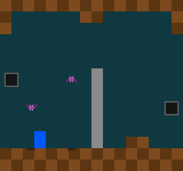
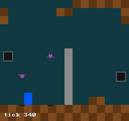

# 17 · Text Tilemaps

> **Goal:** the room comes from a text file. `assets/room.txt` is 15 lines of 16 chars, `#` for a wall, `|` for the stone pillar and `.` for nothing, and the engine reads it into a **tilemap**: a grid of numbers in the stage arena, which the game names and draws. A wrong char in the file logs its line and column, and the game runs on with an empty room. Put the tiles in the frame arena by mistake, and the room still looks right, until the game formats a line of text. Then the ceiling loses one tile for every byte of that text.

## The problem

`render` draws the room in code: two loops for the floor, and one rectangle at numbers picked by hand for the pillar. Every new wall is another line of `game.cpp`. A MegaMan stage is dozens of screens of 240 tiles each, and drawing them all with code won't work.

Drawing isn't the only job, either. Chapter 18 makes walls solid, and to do that the game has to ask "what's at this spot in the room?" every time something moves. A rectangle in `render` can't tell it. The renderer forgets everything once the frame is drawn (chapter 10), and the floor is only a loop that `render` runs, not something the game can look up. The room has to be data: a grid of tiles that `render` draws and chapter 18 reads.

[Plan §6](plan.md#6-content) decided where that data starts: text maps, `#` for a wall, in the first stage chapters, and LDtk files from chapter 32. A text map needs no tool but your editor, and the file looks like the room.

Two earlier chapters left promises here. Chapter 04 put the tilemap first in its list of what goes in the **stage arena**, which nothing has used yet. Chapter 05 said this chapter would cut text into lines.

## Design

### A grid of numbers

A **tilemap** is a grid of tiles, `columns` wide and `rows` high, each tile a number. The numbers go row by row, top row first, in one array: the tile at `column`, `row` is `tiles[row * columns + column]`. That's how the text reads, and how a screen counts its pixels (chapter 11).

A tile is one byte, so there can be 256 kinds. That's far more than this game needs, and a room of 16 by 15 tiles, one screen, is 240 bytes.

### The engine's or the game's

The game decides what a tile is: a wall, a ladder or spikes. Should the tilemap live in the game, then?

| Option | The catch |
|---|---|
| The game reads and parses the text itself | Tests link only the engine (chapter 03), so the parser, the part most worth testing, couldn't be tested. Chapter 18's collision, which reads tiles, would have the same problem. |
| A tilemap in the engine whose tiles are walls, ladders and spikes | The engine would name the game's tiles, which chapter 10 decided against for layers and chapter 14 for buttons |
| **A tilemap in the engine of plain numbers, and the game names them** | Reading the map takes two places: the engine's numbers and the game's names for them |

momo takes the last. The engine keeps a grid of numbers and can look one up, and the game has an enum, `TILE_EMPTY`, `TILE_WALL`, `TILE_PILLAR`, and decides what each one does. Layers and buttons work the same way.

### From chars to numbers

The file holds chars, and the tilemap holds numbers. Something has to turn one into the other:

| Option | The catch |
|---|---|
| Keep the chars: a wall's tile is `'#'` | A zeroed tile, and the tile outside the map, is char 0, which no map has. A typo, `,` for `.`, loads without complaint, and you notice it only because nothing gets drawn there. |
| **The game passes the chars it uses, in the order of its enum: tile n is the nth char** | The string and the enum have to stay in the same order |

momo takes the second. The game passes `STR(".#|")`, so `.` is tile 0, `#` tile 1 and `|` tile 2, the order of its enum. Any other char in the map is a mistake, caught while the map is read. Because tile 0 is the first char, and the game's first char means empty, a zeroed tilemap is empty, as ZII wants. The tile outside the map is 0 too, as if the room had empty tiles all around it. Chapter 18 may want something else at the room's edges, and it can decide then.

A `static_assert` checks that there are as many chars as tiles. It can't check that they're in the right order (exercise 3).

### Which char means empty

Every room is mostly empty, so the empty tile's char is the one you type most. A space looks most like nothing, but the repository's `.editorconfig` has `trim_trailing_whitespace = true`, which Neovim follows. Made with spaces, this chapter's map is 255 bytes. Saved once from Neovim, it was 162:

```
################$                  ################$
#      ##      #$                  #      ##      #$
#              #$        →         #              #$
                $                  $
```

(`cat -A` puts a `$` at the end of each line.) Each line that ended in spaces lost them, and the fourth line, all spaces, was left empty. The map no longer has the same width on every line, and reading it fails:

```
engine/tilemap.cpp:24: error: assets/room.txt, line 4: 0 tiles wide, but line 1 is 16
```

So empty is `.`, which no editor trims, and which you can count.

### Mistakes in the map

A map with a mistake is something you'll do all the time, like a shader that won't compile, and not a bug in momo. [Plan §3.3](plan.md#33-errors-and-strings) says what to do with expected failures: log why, and return something the caller can carry on with.

The log says where the mistake is, with lines and columns counted from 1, as your editor counts them: `assets/room.txt, line 6, column 3: ',' isn't one of the tiles ".#|"`. Then `parse` returns a zeroed `Tilemap`, an empty room, and the game runs on without one.

`parse` reads the text twice. The first pass measures it, and checks every line's width and every char. Only once all of that has passed does the second pass push the tiles and fill them in. A map with a mistake pushes nothing, so it can't leave half a room in the arena.

### Lines

A map is lines, so `str::` gets the two functions chapter 05 promised: `find`, which finds the first time a char appears in a `Str`, and `next_line`, which cuts the first line off a text and returns it:

```cpp
Str rest = text;
while (rest.len > 0) {
    Str line = str::next_line(&rest);
    ...
}
```

Like `slice`, `next_line` copies nothing. The line points into the text, and `rest` moves on past the `'\n'`. A `'\n'` at the very end of the text starts no new line, so a file with one at the end of its last line and a file without one are the same 15 lines, as your editor counts them.

`next_line` doesn't drop a `'\r'` before the `'\n'`, the line ending Windows uses. momo is tested on Linux only ([plan §1](plan.md#1-what-momo-is)), and the repository's `.editorconfig` asks for `'\n'`. A `'\r'` that gets in anyway is a char that isn't a tile, so `parse` reports it (exercise 1).

### Reading a file

The game can't read files yet. `platform::read_file` is the engine's, and not `MOMO_API`: the game never calls the OS ([plan §4.4](plan.md#44-platform-and-input)). `renderer::load_texture` reads a file for the game, but only a PNG, and only to make a texture.

So the engine gets a function the game can call, `momo::read_file(arena, path)`. Like `load_texture`, it takes paths relative to the executable's folder, where `make` copies the assets. `platform::read_file`'s bytes come from `malloc`, and the game has no way to free them. `momo::read_file` copies them into the arena the game picks, gives `malloc`'s memory back before it returns (chapter 12), and puts a 0 after them, as `str::fmt` does. The arena decides how long the bytes last, so the game decides.

### Where the tiles live

A room's size comes from its file, not from the code.

| Option | The catch |
|---|---|
| An array inside `GameState`, `u8 tiles[15][16]` | The code decides how big a room is. Chapter 23's rooms are several screens wide or tall, so every room would be as big as the biggest one, and making that one bigger would change `GameState`'s size and start the game over. |
| The permanent arena, with a pointer in `GameState` | The game never resets the permanent arena, so every stage it ever loaded would stay there |
| **The stage arena, with a pointer in `GameState`** | `GameState` holds its first pointer, which mustn't outlive what it points to |

momo takes the last, which chapter 04 planned. `GameState` gets a `Tilemap`: two counts and a pointer to the tiles. Chapter 06's rules forbid pointers into `game.so`, whose memory a reload unloads, and until now `GameState` held no pointers at all. The arenas' memory belongs to the engine, and a pointer into the stage arena stays good:

- **On a reload.** The engine keeps both arenas, and `GameState` with them.
- **When `GameState`'s layout changes.** The engine resets the permanent arena and the stage arena together, so the pointer and the tiles go at the same time (chapter 06), and `init` reads the room again.
- **When the game loads another stage.** The game resets the stage arena itself (chapter 04), and points at the new stage's tiles. This game has one stage, read once, so nothing resets the stage arena yet. Chapter 28's game flow will.
- **In chapter 21's snapshots,** which copy both arenas and put them back at the same addresses.

A pointer into the frame arena would not stay good: the engine resets that arena at the start of every frame. "Break it" below shows what happens.

The text is the other way round. Once the tiles are filled in, nothing needs it, so it goes in the frame arena:

```cpp
Str room_text = momo::read_file(momo::frame_arena(), room_path);
state->room = tilemap::parse(momo::stage_arena(), room_text, TILE_CHARS, room_path);
```

Two lines, two arenas, and two lifetimes. The tiles are `const u8`. Nothing changes a tile once it's read. `const` on a struct doesn't carry through its pointers, so a `const GameState*` alone wouldn't stop `render` from writing a tile. With `const u8*`, it can't, and chapter 10's promise holds: drawing can't change the game.

### Drawing the room

`render` goes through the room row by row and calls `draw_tile`, which `switch`es on the tile, the same way chapter 16 `switch`es on an entity's kind. A wall is a checkerboard of two browns, as the floor was. A pillar is gray, on the foreground layer, so the bats and the player still go behind it. An empty tile draws nothing, and the clear color shows through.

The `switch` has no `default`, so `-Wswitch` names a tile that's missing its `case`. `TILE_COUNT` is in the enum too, so it needs a `case` of its own. It isn't a tile, so that `case` is an `ASSERT`, like `ENTITY_NONE`'s.

Tiles are numbers in the stage arena, and a reload keeps them, so the rule for kinds holds for tiles too: add new ones at the end (chapter 16).

The room in `room.txt` is chapter 16's room with a few more tiles: a ceiling, the floor, the pillar, and a step on the floor, two tiles wide. The pillar moves 8 pixels to the right, onto the grid: it was at x = 120, half a tile in.

Only `render` reads the tiles. The player still stands at `FLOOR_Y`, a number in `game.cpp`, and walks straight through the step. Chapter 18 makes walls solid.

## The code

### Tilemaps: `engine/tilemap.h`

`engine/tilemap.h:13`

```cpp
struct Tilemap {
    i32 columns;
    i32 rows;
    // columns * rows tile numbers, in memory pushed from an arena: row 0's
    // tiles, then row 1's. Nothing changes a tile once it's read, so a
    // render that's handed a const GameState can't change one either.
    const u8* tiles;
};
```

A zeroed `Tilemap` is no rows, no columns and no tiles. The header has two functions, both `MOMO_API`. `parse` (`engine/tilemap.h:33`) turns text into tiles, and `at` (`engine/tilemap.h:38`) looks one up.

### Reading a map: `engine/tilemap.cpp`

`engine/tilemap.cpp:16`

```cpp
    i32 columns = 0;
    i32 rows = 0;
    Str rest = text;
    while (rest.len > 0) {
        Str line = str::next_line(&rest);
        if (rows == 0)
            columns = line.len;
        if (line.len != columns) {
            LOG_ERROR("%s, line %d: %d tiles wide, but line 1 is %d", name, rows + 1, line.len,
                      columns);
            return {};
        }
        for (i32 column = 0; column < columns; column++) {
            char c = line.data[column];
            if (str::find(chars, c) != -1)
                continue;
            // A char that doesn't print, such as the '\r' of a Windows line
            // ending, would garble the message, so it's shown by its number.
            if (c >= ' ' && c <= '~')
                LOG_ERROR("%s, line %d, column %d: '%c' isn't one of the tiles \"%.*s\"", name,
                          rows + 1, column + 1, c, chars.len, chars.data);
            else
                LOG_ERROR("%s, line %d, column %d: char %d isn't one of the tiles \"%.*s\"", name,
                          rows + 1, column + 1, (u8)c, chars.len, chars.data);
            return {};
        }
        rows++;
    }
    if (columns == 0) {
        LOG_ERROR("%s has no tiles", name);
        return {};
    }
```

The first pass. The first line sets the width, and every line after it must match. Every char must be one of `chars`. `rows` counts the lines already checked, so `rows + 1` is the line being checked, counted from 1. A text with no tiles at all, an empty file or one made only of empty lines, is a mistake too. It's also what `parse` gets when the file couldn't be read, since `read_file` then returns an empty `Str`. Before the loop (`engine/tilemap.cpp:11`), an `ASSERT` checks that `chars` has between 1 and 256 chars, as many as a `u8` can number.

`engine/tilemap.cpp:51`

```cpp
    u8* tiles = arena::push_array<u8>(arena, columns * rows);
    rest = text;
    for (i32 row = 0; row < rows; row++) {
        Str line = str::next_line(&rest);
        for (i32 column = 0; column < columns; column++)
            tiles[row * columns + column] = (u8)str::find(chars, line.data[column]);
    }
    return { .columns = columns, .rows = rows, .tiles = tiles };
```

The second pass. The map is known to be good, so `find` never returns -1 here, and each char becomes its place in `chars`. The `u8*` is assigned to a `const u8*` on the last line: the tiles are written here, and only read from then on.

`engine/tilemap.cpp:61`

```cpp
u8 at(const Tilemap& map, i32 column, i32 row)
{
    if (column < 0 || column >= map.columns || row < 0 || row >= map.rows)
        return 0;
    return map.tiles[row * map.columns + column];
}
```

Outside the map, tile 0. A zeroed map has no columns, so every tile is outside it.

### Lines: `engine/str.cpp`

`engine/str.cpp:56`

```cpp
Str next_line(Str* text)
{
    i32 end = find(*text, '\n');
    if (end == -1) {
        // The last line, with no '\n' after it.
        Str line = *text;
        *text = slice(*text, text->len, text->len);
        return line;
    }
    Str line = slice(*text, 0, end);
    *text = slice(*text, end + 1, text->len); // past the '\n'
    return line;
}
```

`text` is a pointer, so the call changes it, and the `&` at the call shows that ([plan §3.1](plan.md#31-rules)). `find` (`engine/str.cpp:38`) is `find_last` going the other way.

### Reading a file: `engine/momo.cpp`

`engine/momo.cpp:434`

```cpp
Str read_file(Arena* arena, const char* path)
{
    // The full path is needed only until the file is read, so it's formatted
    // on the stack, through an arena of its own, like the overlay's text.
    u8 memory[4096]; // PATH_MAX: Linux takes no longer path
    Arena scratch = {};
    arena::init(&scratch, memory, sizeof(memory));
    Str full_path = str::fmt(&scratch, "%s%s", platform::executable_folder(), path);

    i64 size = 0;
    void* file = platform::read_file(full_path.data, &size);
    if (!file)
        return {}; // already logged

    // The file's bytes came from malloc (chapter 12). They're copied into
    // the arena, and given back.
    ASSERT(size < INT32_MAX); // a Str's len is an i32
    char* data = arena::push_array<char>(arena, (i32)size + 1);
    memcpy(data, file, size);
    platform::free_file(file);
    LOG_INFO("read %s, %lld bytes", path, size);
    return { .data = data, .len = (i32)size };
}
```

`load_texture` formats its full path in the engine's arena, which is never reset. That's fine there, because each texture is loaded once. A game can read a file every time it loads a stage, so `read_file` formats the path on the stack instead, the way chapter 13's overlay formats its text. `momo.h` declares it next to the arenas (`engine/momo.h:46`), and includes `tilemap.h`.

### The room: `assets/room.txt`

```
################
#......##......#
#..............#
................
................
................
........|.......
........|.......
........|.......
........|.......
........|.......
........|.......
........|..##...
################
################
```

The ceiling comes down two tiles at the sides and one in the middle. The pillar runs down from line 7, and the step is on line 13, columns 12 and 13, just above the floor. The Makefile copies it into the build folder, next to `bat.png`: `ASSETS` now finds `assets/*.png assets/*.txt`. `assets/LICENSES.md` has a line for it.

### The game: `game/game.cpp`

`game/game.cpp:32`

```cpp
enum Tile : u8 {
    TILE_EMPTY,  // '.': nothing, the background shows
    TILE_WALL,   // '#'
    TILE_PILLAR, // '|': stone, in front of the entities
    TILE_COUNT,
};
constexpr Str TILE_CHARS = STR(".#|");
static_assert(TILE_CHARS.len == TILE_COUNT, "a char for every tile");
```

Next to `EntityKind`, since tiles are numbers in the game's memory too. The comment above them says to add new tiles at the end of both. `TILE_CHARS` is a `STR`, which points into `game.so`, so it must never be stored in `GameState` ([chapter 05](05-strings-and-logging.md)). `parse` reads it during the call and keeps only the numbers.

`GameState` gets one more field (`game/game.cpp:68`), `Tilemap room;`, and grows from 1,208 bytes to 1,224. The comment above `GameState` now allows pointers into the game's arenas.

`game/game.cpp:134`

```cpp
    const char* room_path = "assets/room.txt";
    Str room_text = momo::read_file(momo::frame_arena(), room_path);
    state->room = tilemap::parse(momo::stage_arena(), room_text, TILE_CHARS, room_path);
```

In `init`, after the bat's texture. The comment above these lines gives each arena's reason. `room_path` is a string literal in `game.so`, used during `init` and never stored.

`game/game.cpp:243`

```cpp
void draw_tile(Tile tile, i32 column, i32 row)
{
    Rect rect = { .x = column * TILE_SIZE, .y = row * TILE_SIZE, .w = TILE_SIZE, .h = TILE_SIZE };
    switch (tile) {
    case TILE_EMPTY:
        break;
    case TILE_WALL:
        renderer::draw_rect(rect, WALL_COLORS[(row + column) % 2], LAYER_BACKGROUND);
        break;
    case TILE_PILLAR:
        renderer::draw_rect(rect, PILLAR_COLOR, LAYER_FOREGROUND);
        break;
    case TILE_COUNT:
        ASSERT(!"TILE_COUNT isn't a tile");
        break;
    }
}
```

Without its comment. `WALL_COLORS` is chapter 10's `FLOOR_COLORS`, renamed: the same two browns now cover the ceiling and the step too.

`game/game.cpp:302`

```cpp
    const Tilemap& room = state->room;
    for (i32 row = 0; row < room.rows; row++) {
        for (i32 column = 0; column < room.columns; column++)
            draw_tile((Tile)tilemap::at(room, column, row), column, row);
    }
```

At the start of `render`, replacing the floor's loops and the pillar's rectangle. The cast turns the engine's number into the game's name for it. `parse` turned every char into a number below `TILE_COUNT`, so every number has a name. `FLOOR_Y` stays (`game/game.cpp:95`), and its comment now says that nothing but `render` reads the tiles.

### The tests

`tests/tilemap_test.cpp` has ten tests. One of them checks that a map with a mistake pushes nothing:

`tests/tilemap_test.cpp:104`

```cpp
static void a_line_of_another_width_pushes_nothing()
{
    alignas(16) u8 memory[64] = {};
    Arena a = {};
    arena::init(&a, memory, sizeof(memory));

    // The second line is one tile short.
    Tilemap map = tilemap::parse(&a, STR("###\n##\n###\n"), CHARS, "room.txt");
    CHECK_EQ(map.columns, 0);
    CHECK_EQ(map.rows, 0);
    CHECK(map.tiles == nullptr);
    CHECK_EQ(a.used, 0);
}
```

The others check that a zeroed tilemap is empty, that each char becomes its place in `chars`, that rows count down from the top, that the tiles take one byte each in the arena, that the text isn't needed once it's parsed, that the last `'\n'` is optional, that outside the map is tile 0, that a char that isn't a tile (an `x`, and a Windows `'\r'`) pushes nothing, and that no text is no map. `tests/str_test.cpp` gains six tests of `find` and `next_line`.

## Run it

### The room

```
$ make
$ ./build/debug/momo
```

```
game/game.cpp:127: init
engine/renderer.cpp:338: loaded assets/bat.png, 32x16, as texture 2
engine/momo.cpp:454: read assets/room.txt, 255 bytes
engine/renderer.cpp:591: the screen at 5x: 1280x1200 pixels, in a window of 1432x1720
game/game.cpp:193: tick 59: the nest at x = 8 lets out a bat into slot 3, generation 1
game/game.cpp:193: tick 59: the nest at x = 232 lets out a bat into slot 4, generation 1
game/game.cpp:204: tick 182: the bat in slot 4 flew off the screen
```

15 lines of 16 chars and a `'\n'` each: 255 bytes. The nests and their bats are chapter 16's, tick for tick.



`./build/debug/momo --capture 340 book/images/17-room.png` made this picture. Put it next to `room.txt`: each char is a 16×16 square, and the file is the room. Compared with chapter 16's picture, the pillar is 8 pixels further right, and there's a ceiling and a step.

Hold the right arrow. The player walks behind the pillar, which is right, since the pillar is in the foreground. Then it walks through the step, which isn't. Nothing but `render` reads the tiles yet.

### Changing the room

With momo running, give the room a platform: change line 9 of `assets/room.txt` to

```
..###...|.......
```

and `make`:

```
$ make
cp assets/room.txt build/debug/assets/room.txt
```

`make` copies the map, and nothing else changes: `game.so` wasn't rebuilt, so nothing reloads, and the room was read once, by `init`. As with chapter 16's speeds, quit and start momo again, and the platform is there, between the two bats' paths. Chapter 33 makes the engine notice a changed file by itself. Take the platform out again.

### A typo

`,` sits right next to `.` on the keyboard. Change the third char of line 6 in `build/debug/assets/room.txt` (the build's copy, so `make` doesn't get involved) to a `,`, and run momo:

```
engine/momo.cpp:454: read assets/room.txt, 255 bytes
engine/tilemap.cpp:35: error: assets/room.txt, line 6, column 3: ',' isn't one of the tiles ".#|"
```

In Neovim, `:6` and then `3|` go straight to it. The game runs on, with no room at all: the player and the nests float on the clear color, and the bats fly as before. Now delete the file, `rm build/debug/assets/room.txt`:

```
engine/platform.cpp:384: error: Couldn't open /home/mairuu/repos/momo/build/debug/assets/room.txt: No such file or directory
engine/tilemap.cpp:45: error: assets/room.txt has no tiles
```

Two lines: SDL's reason, and what the game got. `make` copies the map back.

### Break it: the wrong arena

Quit momo first: `init` runs only when the game starts. Swap the two arenas in `init`, the text into the stage arena and the tiles into the frame arena:

```cpp
    Str room_text = momo::read_file(momo::stage_arena(), room_path);
    state->room = tilemap::parse(momo::frame_arena(), room_text, TILE_CHARS, room_path);
```

`make`, and run it. The room looks exactly as it did, and a capture at tick 340 is byte for byte the picture above. Only the log, when you quit, gives it away:

```
engine/momo.cpp:105: stage     arena: at most 256 bytes used of 32 MB
engine/momo.cpp:105: frame     arena: at most 240 bytes used of 8 MB
```

The 240 bytes of tiles were the first thing pushed into the frame arena, at its start. The engine reset that arena as the first frame started, so the memory is free to reuse. But resetting an arena only sets `used` back to 0 (chapter 04), and nothing has pushed anything since, so the tiles are still there, and `render` still finds them through `GameState`'s pointer. The game works by accident.

Now give the frame arena one small job. Draw the tick at the bottom left, in `render`, before READY:

```cpp
    Str tick = str::fmt(momo::frame_arena(), "tick %d", state->tick);
    renderer::draw_text(tick, 8, 224, TEXT_COLOR, LAYER_HUD);
```



`./build/debug/momo --capture 340 book/images/17-wrong-arena.png`, with both changes, made this picture. The first nine tiles of the ceiling are gone. `str::fmt` pushed the text, `tick` and a three-digit number, eight chars and a 0, at the start of the frame arena, over the first nine tiles. The push zeroed them first, then wrote the text. `render` draws the room before it formats the tick, so the room it draws holds the last frame's text. Tile 0 is empty, and `'t'` is tile 116, which has no `case`, so neither draws anything. By tick 1010 the number has four digits, and ten tiles are gone. No sanitizer said a word. AddressSanitizer can't see inside an arena (chapter 04), and every byte read was memory the program owns.

Chapter 04 warned about exactly this: a pointer into a shorter-lived arena, stored in something that lives longer, points at whatever gets pushed there next. `GameState` lives longer than every frame, and now it holds a pointer. A pointer in `GameState` may point into the permanent arena or the stage arena, and never into the frame arena. Put both lines back.

### Memory

```
engine/momo.cpp:105: permanent arena: at most 1224 bytes used of 16 MB
engine/momo.cpp:105: stage     arena: at most 240 bytes used of 32 MB
engine/momo.cpp:105: frame     arena: at most 256 bytes used of 8 MB
```

The stage arena holds something for the first time since chapter 04: 240 tiles of one byte. The frame arena's peak is the text, 255 bytes and its 0, pushed during `init` and never needed again. `GameState` grew by the `Tilemap`'s 16 bytes. With `--overlay`, the frame at tick 340 draws 72 rectangles, where chapter 16 drew 42: 63 of them are tiles, where the floor and the pillar were 33.

### The tests

```
$ make test
...
str_test
  ...
  find_finds_the_first_one ... ok
  find_looks_only_inside_the_str ... ok
  ...
  next_line_cuts_one_line_at_a_time ... ok
  next_line_points_into_the_text ... ok
  a_last_line_needs_no_newline ... ok
  empty_lines_are_lines ... ok
  eq_compares_chars_not_pointers ... ok
  16 passed
tilemap_test
  a_zeroed_tilemap_has_no_tiles ... ok
  each_char_becomes_its_place_in_chars ... ok
  rows_count_down_from_the_top ... ok
  the_tiles_go_in_the_arena_one_byte_each ... ok
  the_text_isnt_needed_afterwards ... ok
  the_last_newline_is_optional ... ok
  outside_the_map_is_tile_0 ... ok
  a_line_of_another_width_pushes_nothing ... engine/tilemap.cpp:24: error: room.txt, line 2: 2 tiles wide, but line 1 is 3
ok
  a_char_that_isnt_a_tile_pushes_nothing ... engine/tilemap.cpp:35: error: room.txt, line 2, column 2: 'x' isn't one of the tiles ".#|"
engine/tilemap.cpp:38: error: room.txt, line 1, column 4: char 13 isn't one of the tiles ".#|"
ok
  no_text_is_no_map ... engine/tilemap.cpp:45: error: room.txt has no tiles
engine/tilemap.cpp:45: error: room.txt has no tiles
ok
  10 passed
...
```

The errors are the maps `parse` refused, logged as the game would see them, in the middle of the tests that asked for them.

## Recap

```
momo/
  assets/
    room.txt        new: the room, 16x15 tiles as text
    LICENSES.md     + room.txt
  engine/
    tilemap.h/cpp   new: Tilemap, a grid of tile numbers; parse, at
    str.h/cpp       + find, next_line
    momo.h/cpp      + read_file, relative to the executable's folder, into an arena;
                      momo.h includes tilemap.h
  game/
    game.cpp        Tile and TILE_CHARS; the room is a Tilemap in GameState, read in
                      init, drawn tile by tile in render
  tests/
    tilemap_test.cpp  new: ten tests of parse and at
    str_test.cpp    + six tests of find and next_line
  Makefile          copies assets/*.txt too
```

- A **tilemap** is a grid of numbers, one byte a tile, row by row from the top. The engine keeps the numbers, and the game names them.
- A text map is one line a row and one char a tile. The game passes its chars in the order of its enum: tile n is the nth char, and tile 0, empty, is `.`. The repository's `.editorconfig` trims trailing spaces, so a space for empty would cut lines short.
- A map with a mistake is an expected failure: the log gives its line and column, nothing is pushed, and the game gets an empty room.
- `momo::read_file` reads a file for the game into the arena it picks. The text goes in the frame arena, and the tiles in the stage arena, with a pointer in `GameState`.
- A pointer in `GameState` may point into the permanent and stage arenas, never into the frame arena: there, the room looked right until something else pushed, and then lost a tile for every byte. No sanitizer noticed.

The plan records the tilemap and the text format in [§6](plan.md#6-content), where a stage's memory goes in [§4.2](plan.md#42-memory), reading files in [§4.4](plan.md#44-platform-and-input), and which arenas `GameState` may point into in [§3.2](plan.md#32-rules-for-game-code-required-by-hot-reload). The outline says this chapter also gave the game `momo::read_file`.

Chapter 18 makes the walls solid. The player moves one pixel at a time, asks the tilemap what's there, and stops at the step instead of walking through it.

## Exercises

Undo each change before the next exercise: `git checkout -- engine game assets` puts the code and the room back.

1. **Windows line endings.** Open `assets/room.txt` in Neovim, type `:set fileformat=dos`, save, `make` and run momo. What does the log say, and why column 17? Then make `next_line` drop a `'\r'` that comes right before the `'\n'`, and add a test for it to `str_test.cpp`. Does `tilemap_test` still pass? Should it?
2. **A ladder.** Add `TILE_LADDER`, `'H'`, at the end of both the enum and `TILE_CHARS`, and a column of `H` to the map. Before you write its `case`, `make`: what does GCC say? Draw it as two rails and three rungs. Then, with momo running, move `TILE_LADDER` and its `'H'` to just after `TILE_WALL` and `'#'`, and `make`. What happens to the pillar, and why doesn't the engine start the game over?
3. **The wrong order.** Swap `#` and `|` in `TILE_CHARS`, and leave the enum alone. Does it compile? What does the room look like? Think of a way to write the chars and the enum so that they can't get out of order.
4. **A wider room.** Make the map 32 columns wide by doubling every line. What does the screen show, and how many rectangles does the overlay count? Where do the other 16 columns go? (Chapter 23's camera.)
5. **A map in the code.** Instead of reading the file, parse a string literal, one `"...\n"` per line, written one after another. Edit it while momo runs, and `make`: does the room change? Now parse it in `render`, into the frame arena, every frame, and draw from that `Tilemap` instead of `state->room`. Does the room change on a reload now? What does it cost, according to the overlay's work line? Why is this one pointer into the frame arena safe, when "Break it"'s wasn't?
6. **Edges.** Draw a lighter strip, two pixels high, along the top of every wall tile with an empty tile above it, using `tilemap::at` on the row above. Which tiles in the ceiling's top row get a strip, and why? Is that what you want?
