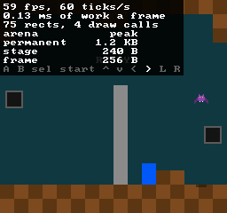
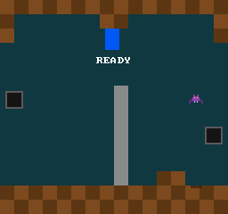

# 18 · Collision

> **Goal:** the room's walls are solid. The player moves the way the d-pad points, up and down too for now, and stops flush against the step, the floor and the ceiling. The engine moves a box one whole pixel at a time and checks the tiles under it before each step, and the game says which tiles stop it. Nineteen tests check where a box stops, to the pixel. Check only where the box ends up instead, and nine of them fail: the box stops short of walls, and goes through one at 200 pixels a tick. Keep the game's `tile_is_solid` in `GameState`, and the next reload jumps into the middle of `init`.

## The problem

Chapter 17 gave the room tiles, and the player walks through them. `update_player` adds 1.375 pixels a tick to the player's x and never looks at the room, so it walks straight through the step at the bottom right.

To stop it, the game has to answer one question every time something moves: how far can it go before it hits a wall? The tilemap can say what's in one tile (`tilemap::at`, chapter 17), but a move needs more than that. The player is a box 16 pixels wide and 24 high, so it covers up to six tiles at once. Its position counts 256ths of a pixel (chapter 15), and a tile is 16 whole pixels on a side.

The question has an exact answer, to the pixel, and it's pure logic: a box, a move and some tiles in, a position out. Chapter 03 promised that this chapter's collision would be tested, and that it "moves an entity one pixel at a time until it touches a wall". [Plan §4.8](plan.md#48-collision) chose that way of moving before chapter 01. This chapter shows why, by measuring the obvious way too.

Two more chapters left questions here. Chapter 15 left open how its positions, in 256ths, fit with moving one whole pixel at a time. Chapter 17 made the tiles outside the map empty, and said this chapter might want something else at the room's edges.

## Design

### Actors and solids

The plan calls its choice **Actor/Solid**, after the way Celeste and TowerFall move things, which Maddy Thorson wrote up in "Celeste and TowerFall Physics". An *actor* is something that moves and gets stopped: the player, an enemy, a shot. A *solid* is something that stops actors: a wall, or a moving platform, which pushes the actors in its way and carries the ones standing on it. An actor never overlaps a solid. It moves one whole pixel at a time, and before each pixel it checks whether the pixel would overlap a solid. If it would, the actor stops where it is, touching the solid.

momo has one actor, the player, and nothing moving that could stop it. Its walls are tiles. Moving platforms wait until a stage needs one, and so does the name: in Celeste, a Solid is something that moves, so the engine calls its walls `SolidTiles` instead.

### Where the box ends up

Why step one pixel at a time? The obvious way is to move the box and see where it lands:

| Option | The catch |
|---|---|
| Add the move, and if the box would then overlap a wall, don't move | The box stops wherever its last free move left it, short of the wall by up to its speed. A move longer than the box and the wall together lands past the wall: it goes through. |
| Add the move, and push the box back out of any wall it overlaps | The box is already in the wall, and the code has to work out which way is out. A box that got more than halfway into a thin wall is pushed out the far side. |
| **Step one pixel at a time, from where the box is drawn to where it would be drawn, checking the whole box at each, and stop before the first blocked one** | A check for every pixel moved |

momo takes the last, as the plan said. The box never overlaps a wall, so nothing has to push it out. Every pixel on the way is checked, so no speed goes through a wall. It stops at the last free pixel, so it's always flush. And the checks are few at MegaMan's speeds: at 1.375 pixels a tick, the player moves one pixel on five ticks of every eight and two on the other three (chapter 15), and each check looks at the tiles under the box, six at most for the player.

"Break it" measures the first option against the tests. It stops a pixel short at walking speed, 15 short at 16 pixels a tick, and goes through a wall at 32.

### Where the fraction goes

The plan's version adds each move to a fixed-point **remainder**, and moves the entity whole pixels out of it. Celeste keeps each position in whole pixels and a remainder beside it. momo's positions are `Fx2` since chapter 15, and an `Fx`'s low 8 bits already are a remainder:

| Option | The catch |
|---|---|
| A position in whole pixels (`i32`) and a remainder (`Fx`), for each axis | Two fields an axis, and everything that reads a position has to change: drawing, the bats, the shadows |
| **Keep `Fx2 pos`: the pixel is `fx::floor(pos.x)`, and the remainder is the fraction under it** | A hit has to decide what happens to the fraction |

momo takes the second. The box is drawn at `fx::floor(pos.x)`, and that's the pixel it steps from. The pixel it steps to is `fx::floor(pos.x + dx)`, where it would be drawn after the move. If every pixel on the way is free, the move is added as it is, fraction and all, so walking keeps chapter 15's speed exactly.

If a pixel is blocked, the box stops at the one before it, a whole pixel, and the fraction is dropped. A box stopped by a wall is at the wall, however fast it came: at 30.5, moving 3 to the right, against a wall at 48, a 16-pixel box stops at 32, not 32.5.

### Across, then down

A move has two parts, across and down, and a wall can stop one without the other:

| Option | The catch |
|---|---|
| Step across and down together, and stop both at the first blocked step | A box walking along the floor and moving down into it, as chapter 20's gravity will make the player do on every tick, would stop walking at once |
| **Across first, then down, each on its own** | Moving diagonally onto the corner of a block, the order decides the outcome: across first, the box can land on top of the block, where down first would stop it at its side |

momo takes the second. `collision::move_x` moves across and `collision::move_y` moves down, and the game calls one, then the other. Each step checks the whole box at its new pixel, every tile under it. A box standing on the floor touches it without overlapping it, so it slides along the floor while `move_y` keeps it there.

### Which tiles stop a box

The engine keeps tiles as numbers, and only the game knows that tile 1 is a wall (chapter 17). The game has to tell the engine which numbers stop a box:

| Option | The catch |
|---|---|
| A set of bits, one for each solid tile, in a `u64` | A new tile is left out unless someone remembers its bit, so it's silently not solid. And a tile is a `u8`, with room for 256 kinds. |
| A table of `bool`s, in the enum's order | The table and the enum can get out of order, and nothing says so. Chapter 17's exercise 3 found the same for the chars. |
| The engine names kinds of collision: empty, solid, ladder | The engine would name the game's tiles, which chapter 17 decided against. It may come back for chapter 22's ladder tops, which stop you from above only. |
| **The game passes a function, `tile_is_solid`: a `switch` on its enum, with no `default`** | The function is code in `game.so`, so it can't be kept in `GameState` |

momo takes the last. A tile with no `case` is a warning (`-Wswitch`), as in `draw_tile`, so every new tile has to decide whether it stops the player. The engine gets the map, the tile size and the function together, in a `SolidTiles`.

The catch is one of chapter 06's rules: no function pointers in game state. A reload closes the old `game.so` and loads the new one, and a pointer to the old one's `tile_is_solid` points at whatever the new code has at that address. So the game fills a `SolidTiles` on the stack in every `update_player`, and lets it go at the end. "Break it" keeps one in `GameState` and reloads.

`TILE_PILLAR` isn't solid. It's drawn in the foreground (chapter 17), and the player walks behind it.

### Pixels left of the map

The tile size is a parameter, since chapter 17 made `TILE_SIZE` the game's. To find the tile a pixel is in, divide by it: pixel 40 is in column 2. Below zero, C++'s division rounds the wrong way. It rounds toward zero, so -1 / 16 is 0, which would put the pixel just left of the map in column 0, the map's first. It's in column -1, outside the map.

Chapter 15 chose floor over division for turning positions into pixels, and expected chapter 23's camera to be the first to need it below zero. A box partly left of the map needs it first. `collision.cpp` has its own `floor_div`, which rounds down. With plain `/` instead, two tests fail: a box walking in from the left of the map stops at -17 instead of -16, a pixel short of the wall.

### The room's edges

Outside the map, `tilemap::at` says tile 0, empty (chapter 17). Should collision treat it as a wall instead?

| Option | The catch |
|---|---|
| Outside the map is solid | Chapter 23 joins rooms at their edges, and in chapter 22 the player can fall out of the bottom of a pit. A solid edge would stop both. |
| **Outside stays empty, and the game keeps its clamp** | Two things stop the player at the screen's sides: walls in the map, and the clamp |

momo takes the second. The room's rows 3 to 12 are open at both sides, so chapter 14's clamp still stops the player at the screen's edges there. The top row and the two floor rows are walls from side to side, so y needs no clamp. Chapters 22 and 23 decide what a room's edges are.

### Up and down, for now

Nothing pulls the player down yet: gravity and the jump are chapter 20's. So that the floor and the ceiling can be tried before then, up and down on the d-pad move the player too, at the walking speed. For two chapters the player floats, and stays wherever you leave it.

## The code

### Rectangles: `engine/base.h`

`Rect` was the renderer's (chapter 10). Collision checks rectangles too, and has nothing to do with drawing, so `Rect` moved to `engine/base.h:107`, under a new heading, "Rectangles", unchanged. `renderer.h` includes `base.h`, so nothing that draws a `Rect` changed.

### Solid tiles: `engine/collision.h`

`engine/collision.h:16`

```cpp
struct SolidTiles {
    // The map's tiles aren't copied, only the pointer to them, as with a Str.
    // Outside the map, every tile is tile 0 (chapter 17).
    Tilemap map;
    i32 tile_size; // pixels on each side of a tile; more than 0
    bool (*is_solid)(u8 tile);
};
```

The comment above it says why the game fills one in every update and never keeps it. A `Tilemap` is two numbers and a pointer, so copying one into a `SolidTiles` copies 16 bytes, not the tiles.

The header declares three functions, all `MOMO_API`:

```cpp
MOMO_API bool overlaps(const SolidTiles& solids, Rect rect);
MOMO_API bool move_x(const SolidTiles& solids, Fx2* pos, i32 w, i32 h, Fx dx);
MOMO_API bool move_y(const SolidTiles& solids, Fx2* pos, i32 w, i32 h, Fx dy);
```

`overlaps` (`engine/collision.h:28`) says whether a rectangle, in pixels from the map's top left corner, overlaps a solid tile. `move_x` (`engine/collision.h:44`) moves a box `w` pixels wide and `h` high, with its top left corner at `*pos`, `dx` pixels to the right, or to the left if `dx` is negative. `move_y` (`engine/collision.h:47`) moves it down, or up. Each returns `true` if a wall stopped the box. The game doesn't use that yet, but a jump needs to know when the player lands.

`collision.h` includes `fx.h` and `tilemap.h`, and nothing from SDL, so the tests link it without SDL, as they do the tilemap (chapter 17). `momo.h` includes it.

### Moving: `engine/collision.cpp`

`engine/collision.cpp:11`

```cpp
static i32 floor_div(i32 a, i32 b)
{
    i32 q = a / b;
    if (a % b != 0 && a < 0)
        q--;
    return q;
}
```

When `a` is negative and isn't a multiple of `b`, `/` gives the number one above the one rounded down, so `q--` takes it down: `-1 / 16` is 0, and `floor_div(-1, 16)` is -1. Tiles are always more than 0 pixels wide, so `b` is never negative.

`engine/collision.cpp:19`

```cpp
bool overlaps(const SolidTiles& solids, Rect rect)
{
    ASSERT(solids.tile_size > 0);
    ASSERT(rect.w > 0 && rect.h > 0);

    // The tiles under the rectangle's first and last pixels, across and down.
    i32 first_column = floor_div(rect.x, solids.tile_size);
    i32 last_column = floor_div(rect.x + rect.w - 1, solids.tile_size);
    i32 first_row = floor_div(rect.y, solids.tile_size);
    i32 last_row = floor_div(rect.y + rect.h - 1, solids.tile_size);
    for (i32 row = first_row; row <= last_row; row++) {
        for (i32 column = first_column; column <= last_column; column++) {
            if (solids.is_solid(tilemap::at(solids.map, column, row)))
                return true;
        }
    }
    return false;
}
```

A rectangle's last pixel is `x + w - 1`. A box 16 wide at x 160 covers pixels 160 to 175, all in column 10, and the step's first pixel is 176. With `x + w`, the box would overlap the step when it only touches it, and stop a pixel short. Down, the player's 24 pixels from 184 to 207 are in rows 11 and 12. Elsewhere it covers up to two columns and three rows, six tiles. `tilemap::at` says tile 0 for anything outside the map, so the loops need no bounds of their own.

`engine/collision.cpp:38`

```cpp
bool move_x(const SolidTiles& solids, Fx2* pos, i32 w, i32 h, Fx dx)
{
    i32 x = fx::floor(pos->x); // where the box is drawn now
    i32 y = fx::floor(pos->y);
    i32 to = fx::floor(pos->x + dx); // and where it would be drawn after
    i32 step = to > x ? 1 : -1;
    while (x != to) {
        if (overlaps(solids, { .x = x + step, .y = y, .w = w, .h = h })) {
            pos->x = fx::from_int(x);
            return true;
        }
        x += step;
    }
    pos->x += dx;
    return false;
}
```

Follow the player into the step. At x 159.5, moving 1.375 to the right, `x` is 159, `to` is `fx::floor(160.875)`, which is 160, and `step` is 1. The box at 160 is free, so `x` becomes 160, which is `to`, the loop ends, and `pos->x` becomes 160.875. On the next tick, `x` is 160 and `to` is `fx::floor(162.25)`, 162. The box at 161 would cover 161 to 176, and 176 is the step's, so `pos->x` becomes exactly 160, and `move_x` returns `true`. From then on, every tick the right arrow is held tries 161 again, and stays at 160.

When `to` is `x`, because the move stays inside one pixel, the loop runs zero times and the move is added without a check. Chapter 15's player at a quarter pixel a tick moves one whole pixel every four ticks, and only those ticks check anything.

`move_y` (`engine/collision.cpp:55`) is the same, with x and y swapped. One function could take the axis as a parameter, but each of these is 15 lines that read from top to bottom, and a function that picks `pos->x` or `pos->y`, `w` or `h`, by a flag reads worse than either, so momo keeps two.

### The game: `game/game.cpp`

`game/game.cpp:164`

```cpp
bool tile_is_solid(u8 tile)
{
    switch ((Tile)tile) {
    case TILE_EMPTY:
        return false;
    case TILE_WALL:
        return true;
    case TILE_PILLAR:
        return false; // it's in the foreground, and the player walks behind it
    case TILE_COUNT:
        break;
    }
    ASSERT(!"not a tile");
    return false;
}
```

The engine passes a `u8`, and the `switch` casts it to the game's `Tile`, so that `-Wswitch` knows which `case`s are missing. A number that isn't one of the tiles, `TILE_COUNT` or past it, gets to the `ASSERT`: `tilemap::parse` never makes one (chapter 17), so it's a bug.

`game/game.cpp:183`

```cpp
void update_player(GameState* state, Entity* player)
{
    // Both directions at once cancel out.
    player->vel = {};
    if (input::down(BUTTON_LEFT))
        player->vel.x -= PLAYER_SPEED;
    if (input::down(BUTTON_RIGHT))
        player->vel.x += PLAYER_SPEED;
    if (input::down(BUTTON_UP))
        player->vel.y -= PLAYER_SPEED;
    if (input::down(BUTTON_DOWN))
        player->vel.y += PLAYER_SPEED;

    // Across first, then down, each on its own, so a wall that stops one
    // doesn't stop the other. tile_is_solid is code in game.so, so solids is
    // filled again on every update, and never kept in GameState.
    SolidTiles solids = { .map = state->room, .tile_size = TILE_SIZE, .is_solid = tile_is_solid };
    collision::move_x(solids, &player->pos, PLAYER_WIDTH, PLAYER_HEIGHT, player->vel.x);
    collision::move_y(solids, &player->pos, PLAYER_WIDTH, PLAYER_HEIGHT, player->vel.y);

    // The room's rows 3 to 12 are open at both sides, and outside the map
    // is empty tiles, so the screen's edges stop the player there.
    player->pos.x =
        clamp(player->pos.x, fx::from_int(0), fx::from_int(SCREEN_WIDTH - PLAYER_WIDTH));
```

Every entity has had a `vel` since chapter 16, and until now only the nests and the bats used it. Now it holds the player's move for this tick, and starts from zero on every tick, so the player moves only while a direction is held. `GameState` didn't change, so a reload keeps the player where it is. The box is `PLAYER_WIDTH` by `PLAYER_HEIGHT`, 16 by 24, the same rectangle `draw_player` draws, so the player stops where its pixels touch the wall. The power buttons follow, as before.

`FLOOR_Y`'s comment changed too (`game/game.cpp:93`). The player stops at the floor's tiles now, but its start and the bats' shadows still use the number, so a floor moved in `room.txt` leaves both where they were. `shutdown` (`game/game.cpp:379`) logs the player's y as well as its x, now that it moves up and down.

### The tests: `tests/collision_test.cpp`

Each test reads a small map with `tilemap::parse`, through a helper:

`tests/collision_test.cpp:20`

```cpp
static SolidTiles solid_tiles(Str map, i32 tile_size)
{
    Arena a = {};
    arena::init(&a, memory, sizeof(memory));
    return { .map = tilemap::parse(&a, map, CHARS, "test map"),
             .tile_size = tile_size,
             .is_solid = wall_is_solid };
}
```

`memory` is 256 bytes, and each test reads its map over the last test's. The tests use the game's chars, `.#|`, but their `wall_is_solid` says only `#` is solid, which one test checks: the engine stops a box at what the game says, not at any tile that isn't 0.

Six tests check `overlaps`: by one pixel, outside the map, left of the map, a zeroed map, `|`, and tiles 10 pixels wide. Thirteen check the moves. A free move keeps its fraction, a move of zero goes nowhere, and a box stops flush against walls on the right and left, on the floor and under the ceiling. A hit drops the fraction. The box stops flush left of the map and with tiles 8 pixels wide. A hit across doesn't stop the move down, a box slides along the floor, and a box that starts inside a wall stays where it is. The other two are why the box steps:

`tests/collision_test.cpp:157`

```cpp
static void never_overlaps_at_walking_speed()
{
    // MegaMan's 1.375 pixels a tick, into a wall, for 40 ticks.
    SolidTiles solids = solid_tiles(STR("...#\n"), 16);
    Fx2 pos = at(0, 0);
    for (i32 tick = 0; tick < 40; tick++) {
        collision::move_x(solids, &pos, 16, 16, fx::from_double(1.375));
        CHECK(!collision::overlaps(solids, { .x = fx::floor(pos.x), .y = 0, .w = 16, .h = 16 }));
    }
    CHECK_EQ(pos.x.raw, fx::from_int(32).raw);
}

static void cant_go_through_a_wall_however_fast()
{
    // 200 pixels in one move is more than 12 tiles, and a wall one tile thick
    // is in the way. Checking only where the box ends up would put it past
    // the wall.
    SolidTiles solids = solid_tiles(STR("....#.........\n"), 16);
    Fx2 pos = at(0, 0);
    CHECK(collision::move_x(solids, &pos, 16, 16, fx::from_int(200)));
    CHECK_EQ(pos.x.raw, fx::from_int(48).raw);
}
```

`at(x, y)` (`tests/collision_test.cpp:30`) is an `Fx2` at whole pixels. A box that starts inside a wall can't happen in the game unless something puts it there, but a floor moved up in `room.txt` would (exercise 4). Every step from inside overlaps the wall, so the box doesn't move at all.

## Run it

### The step and the bump

```
$ make
$ ./build/debug/momo --overlay
```

Hold the right arrow. The player walks to the step and stops against it, its right side at pixel 175 and the step's left side at 176. Hold left for half a second, then up. The player rises behind the pillar, which isn't solid, and stops under the bump in the ceiling. Let go, and it floats there. Quit with Ctrl+C in the terminal:

```
game/game.cpp:129: init
...
engine/platform.cpp:245: quit requested
game/game.cpp:379: shutdown, with 5 entities, the player at x = 118.75, y = 32, power 0
engine/momo.cpp:408: quit after 8.53 s: 505 frames, 510 ticks
```

The lines left out are chapter 17's: the bat's texture, the room, the screen's size and the nests. In this run, right was held for 2 seconds, then left for half a second, then up for 2.6 seconds. Right ended flush at 160, the fraction dropped. Left was 30 ticks at 1.375, 41.25 pixels, all free, so x kept its fraction: 118.75. Up stopped at y 32, flush under the bump, whose bottom pixel is 31.





These two pictures weren't made the way earlier chapters' were. A capture takes no input (chapter 14), so `--capture` alone would only ever show the player at its start. They came from a throwaway copy of the code without `engine.pad = {};` (`engine/momo.cpp:356`), with a script holding the keys: `./build/debug/momo --overlay --capture 200 book/images/18-step.png` with right held, and `./build/debug/momo --capture 420 book/images/18-bump.png` with right, left and up held as in the run above. The pad line shows `>` held in the first. The player's pixels are x 160 to 175 and y 184 to 207 there, against the step at 176 and on the floor at 208, and x 118 to 133 and y 32 to 55 in the second. `--capture` promised the same picture for the same command (chapter 13), and with keys held by a script it isn't quite: the second depends on when the keys went up. Chapter 21 records input, and from then on a picture with input can be made again exactly.

The capture momo can make is unchanged: after `./build/debug/momo --capture 340 room.png`, `cmp room.png book/images/17-room.png` prints nothing. With no input, nothing moves into a wall.

### The tests

```
$ make test
...
collision_test
  a_rect_overlaps_a_wall_by_one_pixel ... ok
  the_game_decides_which_tiles_are_solid ... ok
  ...
  slides_along_the_floor ... ok
  a_box_inside_a_wall_stays_put ... ok
  19 passed
...
```

### Break it: checking only where the box ends up

Replace `move_x`'s body (`engine/collision.cpp:38`) with the first option from the design: move, unless the box would then overlap a wall.

```cpp
    Fx to = pos->x + dx;
    if (overlaps(solids, { .x = fx::floor(to), .y = fx::floor(pos->y), .w = w, .h = h }))
        return true;
    pos->x = to;
    return false;
```

```
$ make test
...
collision_test
  a_rect_overlaps_a_wall_by_one_pixel ... ok
  the_game_decides_which_tiles_are_solid ... ok
  outside_the_map_nothing_is_solid ... ok
  left_of_the_map_rounds_down ... ok
  a_zeroed_map_is_all_empty ... ok
  tiles_can_be_any_size ... ok
  a_free_move_keeps_the_fraction ... ok
  a_move_of_zero_goes_nowhere ... ok
  stops_flush_against_a_wall_on_the_right ... FAIL
tests/collision_test.cpp:120: CHECK_EQ(pos.x.raw, fx::from_int(32).raw) failed: 0 != 8192
  stops_flush_against_a_wall_on_the_left ... FAIL
tests/collision_test.cpp:132: CHECK_EQ(pos.x.raw, fx::from_int(16).raw) failed: 10240 != 4096
  stops_flush_on_the_floor_and_under_the_ceiling ... ok
  a_hit_drops_the_fraction ... FAIL
tests/collision_test.cpp:154: CHECK_EQ(pos.x.raw, fx::from_int(32).raw) failed: 7808 != 8192
  never_overlaps_at_walking_speed ... FAIL
tests/collision_test.cpp:166: CHECK_EQ(pos.x.raw, fx::from_int(32).raw) failed: 8096 != 8192
  cant_go_through_a_wall_however_fast ... FAIL
tests/collision_test.cpp:176: CHECK(collision::move_x(solids, &pos, 16, 16, fx::from_int(200))) failed
  stops_flush_left_of_the_map ... FAIL
tests/collision_test.cpp:188: CHECK_EQ(pos.x.raw, fx::from_int(-16).raw) failed: -10240 != -4096
  stops_flush_with_small_tiles ... FAIL
tests/collision_test.cpp:197: CHECK_EQ(pos.x.raw, fx::from_int(16).raw) failed: 0 != 4096
  a_hit_across_doesnt_stop_the_box_going_down ... FAIL
tests/collision_test.cpp:208: CHECK_EQ(pos.x.raw, fx::from_int(32).raw) failed: 0 != 8192
  slides_along_the_floor ... ok
  a_box_inside_a_wall_stays_put ... FAIL
tests/collision_test.cpp:230: CHECK_EQ(pos.x.raw, fx::from_int(16).raw) failed: 4224 != 4096
  10 passed, 9 failed
...
```

The numbers are 256ths: 8192 is 32 pixels. A move of 40 toward a wall 32 away ends inside the wall, so the box doesn't move at all, and stays at 0. At walking speed it stops at 8096, 31.625, short by a fraction that's a whole pixel on the screen: drawn at 31, with a gap before the wall at 48. At 200 pixels a tick it lands past the wall and `move_x` says nothing hit it. The tests that move only down pass, since `move_y` is still the real one.

How short, at other speeds? A throwaway program moved a 16-pixel box into a wall one tile thick, from every fraction of a start pixel, and kept the widest gap:

| Speed, pixels a tick | Widest gap, pixels |
|---|---|
| 1.375 | 1 |
| 2 | 1 |
| 4 | 3 |
| 7 | 6 |
| 16 | 15 |
| 32 and more | goes through |

The widest gap is the speed, rounded up, less one pixel. At 32, the box's 16 and the wall's 16, the box lands past the wall. Stepping is flush at every speed and never goes through.

Now run the game. From x 48, the player reaches 160.75, drawn at 160, and the next tick's 162.125 would overlap the step, so it stays: flush against the step, by luck. 48 is the one start the game has, and from it the bug doesn't show. The tests start elsewhere, and catch it. Put `move_x` back.

### Break it: `is_solid` in `GameState`

Quit momo first: `init` runs only when the game starts. Keep the function in `GameState`, as chapter 06's rule says not to:

1. Add `bool (*is_solid)(u8 tile);` at the end of `GameState`.
2. In `init`, set `state->is_solid = tile_is_solid;`. `tile_is_solid` is defined further down, under Update, so put a declaration, `bool tile_is_solid(u8 tile);`, above `init`.
3. In `update_player`, fill `solids` with `.is_solid = state->is_solid`.

`make`, run momo, and hold the right arrow. The player stops at the step as before. Now, with momo still running, add one line to the top of `init`, which comes before `tile_is_solid` in `game.cpp`:

```cpp
    LOG_INFO("a line added before tile_is_solid, which moves it");
```

and `make`. The log says the game reloaded, and nothing else happens: a player standing still calls no `is_solid`, since a move that stays inside one pixel checks nothing. Hold the right arrow again:

```
engine/momo.cpp:311: reloaded .../build/debug/game.so
AddressSanitizer:DEADLYSIGNAL
=================================================================
==79801==ERROR: AddressSanitizer: SEGV on unknown address 0x000000000002 (pc ...)
==79801==The signal is caused by a WRITE memory access.
...
    #0 ... in game::init(GameState*) game/game.cpp:131
    #1 ... in collision::move_x(SolidTiles const&, Fx2*, int, int, Fx) engine/collision.cpp:45
    #2 ... in game::update_player(GameState*, Entity*) game/game.cpp:205
    #3 ... in game::update ... game/game.cpp:268
    #4 ... in momo::run ... engine/momo.cpp:376
...
SUMMARY: AddressSanitizer: SEGV game/game.cpp:131 in game::init(GameState*)
```

This run held the right arrow through the reload, so the crash came on the next tick. The line numbers are the changed `game.cpp`'s, and your address may differ. `GameState` kept its size, so the reload kept the state, `is_solid` and all (chapter 06). The engine closes the old `game.so` before it opens the new one (`engine/momo.cpp:304`), and the new one loaded at the same address. But `init` is longer by a line, and every function after it in the file moved further along, `tile_is_solid` too. The old address of `tile_is_solid` is now partway through the new `init`.

So `overlaps` called `is_solid`, and ran `init` from the middle, with registers and a stack set up for a function that takes a tile. The code there wrote to address 2, and the program stopped. `overlaps`, which made the call, isn't in the list: the jump skipped `init`'s first instructions, which set up its frame, so the trace took `overlaps`' frame for `init`'s, and went on from `overlaps`' caller, `move_x`. What runs depends on what the new code has at the old address: with another change, it could be any function, or no crash at all, only a wrong answer.

Only a reload that moves `tile_is_solid` shows it. `nm -C build/debug/game.so` lists the functions in `game.so` and their addresses, and for this chapter's code, without "Break it"'s changes, it puts `game::tile_is_solid` at `c122`. Rebuilt with `PLAYER_SPEED` at 2, which changes only `update_player`, further down, it's still at `c122`, and a stale pointer would still find it. With the line added to `init` as well, it's at `c14a`, 40 bytes along. So a game can break the rule through many reloads without a sign, until one moves the function. In `update_player`, `solids` is filled from the current `game.so` on every tick, and can't go stale. Put the three lines back.

## Recap

```
momo/
  engine/
    base.h          + Rect, moved here from renderer.h
    renderer.h      - Rect
    collision.h/cpp new: SolidTiles; overlaps, move_x, move_y
    momo.h          includes collision.h
  game/
    game.cpp        tile_is_solid; the player moves four ways with move_x and move_y,
                      and keeps its clamp; shutdown logs y
  tests/
    collision_test.cpp  new: 19 tests of overlaps, move_x and move_y
```

- A box moves one whole pixel at a time, from the pixel it's drawn at to the one it would be drawn at, checking the whole box before each step, and stops before the first blocked pixel. It never overlaps a wall, stops flush at every speed, and can't go through one. Checking only where the box ends up stopped up to a pixel short at walking speed and went through a wall at 32 pixels a tick.
- The remainder is the fraction of `Fx2 pos`. A free move adds the move, fraction and all. A hit puts the box at the last free whole pixel, and drops the fraction.
- Across first, then down, each on its own, so a wall that stops one doesn't stop the other, and a box slides along the floor.
- The game says which tiles stop a box, with a `switch` that names every tile. It passes the function in a `SolidTiles` it fills on every update: kept in `GameState`, a reload sent the call into the middle of `init`.
- Pixels become tiles by rounding down, which matters left of the map: chapter 15's floor, here before chapter 23's camera.
- Outside the map is still empty, and the clamp stays. The player floats, up and down, until chapter 20.

The plan records how a move works, where the remainder is, and how the game says which tiles stop a box in [§4.8](plan.md#48-collision), and that moving platforms wait. The outline says so too, and that this chapter moves the player up and down until chapter 20.

Chapter 19 draws what collision sees: the player's box and the tiles that stop it, on top of the picture.

## Exercises

Undo each change before the next exercise: `git checkout -- engine game assets` puts the code and the room back.

1. **A solid pillar.** Make `TILE_PILLAR` solid, and walk right from the start. Where does the player stop, and why there? Hold up while pushing right: does it slide up the pillar? What happens at the pillar's top?
2. **Bats that turn.** Add a wall tile in row 6 of `room.txt`, where the left nest's bats fly, and watch them fly through it. Move the bats with `move_x` instead of `pos += vel`, and turn a bat around when it returns `true`. How big is a bat's box? Where does a bat go after it turns, and does its nest get it back?
3. **Fast.** With momo running, set `PLAYER_SPEED` to `fx::from_int(16)` and `make`. Does the player still stop flush against the step? How many tiles does `overlaps` look at in one tick now? Try it with "Break it"'s `move_x` too.
4. **Stuck.** Change line 13 of `room.txt` to 16 `#`s, so the floor is three rows high, `make`, and run momo. The player starts at `FLOOR_Y`, inside the new floor. Which way can it move, and why? What would get it out: a change to the room, to `FLOOR_Y`, or to `move_x` and `move_y`? Which would you want if a level editor put the player there?
5. **No clamp.** Take out the clamp, and walk left off the screen. Where does the player go, and can it come back? What should chapter 23 do when the player walks out of a room?
6. **Ladder tops.** Chapter 22's ladder tops stop a box falling onto them, but not one climbing up through them, or walking across them. `is_solid` can't say that: it's told only the tile. What else would the engine have to pass it? Sketch the change to `SolidTiles` and to `move_y`.
