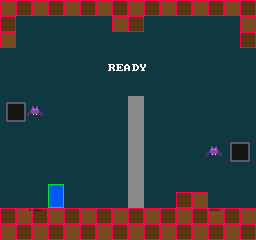
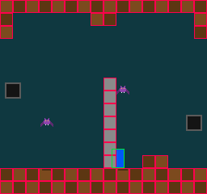

# 19 · Debug Drawing

> **Goal:** press F1, and momo draws what collision sees over the picture: a red outline on each of the 56 tiles that stop the player, and a green one around the player's box. The pillar gets none, because the player walks through it. The game draws its boxes on every frame and never learns whether they're shown, so it plays the same with them on or off: without `--boxes`, a capture comes out byte for byte as chapter 18's did. Four tests check an outline against a picture of it, pixel by pixel. Draw the tiles' boxes from what the map holds instead of from what collision checks, and the green box ends up inside red ones, where collision would never let it go.

## The problem

Chapter 18's collision is tested to the pixel, but in the running game you can't see any of it. The player stops against the step, and the picture can't say which tile stopped it. The pillar looks as solid as the walls, but the player walks behind it. The only way to know which tiles stop the player is to read `tile_is_solid`.

The player's box is invisible too. Today the blue rectangle is the box, because `draw_player` happens to draw the same 16 by 24 pixels that collision moves. That won't last. Chapter 29 gives the player a sprite, with see-through pixels around it, and a box that may be smaller than the picture. Chapter 22's ladders and spikes, and chapter 25's shots, bring more boxes that nothing on screen outlines.

So this chapter draws them. [Plan §4.10](plan.md#410-debug-tools-and-tests) lists "hitbox / hurtbox / collision-tile overlays" among Part I's debug tools, and chapter 18 ended with "Chapter 19 draws what collision sees: the player's box and the tiles that stop it, on top of the picture". Chapter 10 turned blending on partly because "chapter 19's hitboxes want to show what's under them".

Four questions: what a box looks like, whether the engine or the game decides what gets one, how the boxes are shown and hidden, and which boxes there are.

## Design

### What a box looks like

| Option | The catch |
|---|---|
| A see-through fill, as chapter 10 expected | Solid tiles side by side run together into one tinted block, so you can't tell where one tile ends. The fill tints the sprite under it, and its color changes with what's under it. |
| A 1-pixel outline just outside the box | Two boxes that touch draw on each other's pixels: the player flush against the step puts its green line on the step's first column. |
| **A 1-pixel outline just inside the box, opaque** | It hides a ring of pixels of what's under it |

momo draws the outline inside. Every pixel it covers is one of the box's own pixels, so the outline says exactly which pixels the box has. Two tiles side by side show a line 2 pixels wide between them, 1 from each, so each tile reads as checked on its own. When the player is flush against the step, its green line and the step's red one sit side by side, touching, with no gap and no overlap. That is what flush means, and you can see it.

Chapter 10's promise still holds: an outline shows what's under it, because its middle is empty, and it needs no blending to do so. Blending stays for the shadow and the overlay's backdrop. An opaque outline also looks the same however many times a pixel is drawn, which matters for boxes 1 pixel wide (see the code).

### Who decides what gets a box

| Option | The catch |
|---|---|
| The engine finds the boxes itself: the solid tiles in a `SolidTiles`, the entities' boxes in the pool | The engine would have to know which `SolidTiles` and which entities matter, and what each box means. Chapter 25's hitboxes and hurtboxes are the game's ideas. |
| The game draws them with `draw_rect`, on a layer of its own above the HUD | They'd count against the game's 4,096 rectangles and in the overlay's numbers, and the game would have to know whether they're shown. |
| **The game says which boxes and in which colors, with `debug_box`, and the engine draws them** | One more function for the game to call |

This is chapter 10's split again: the engine has the mechanism, a box drawn as an outline, and the game says what it means. The engine never learns what a solid tile is, or a player. It gets a rectangle and a color.

### Shown or hidden, the same frame

| Option | The catch |
|---|---|
| The game asks the engine whether the boxes are shown, and draws them only then | The game runs other code with them on. A bug in drawing the boxes, or too many of them, shows up only when someone presses F1. |
| A flag in `GameState`, flipped by a pad button | It takes a button from the game. Chapter 21 would record and replay it along with the moves. |
| **The game draws its boxes on every frame, and the engine decides whether they reach the screen** | The work is done even while they're hidden: 228 rectangles a frame in this room |

momo takes the last. `debug_box` does the same work whether the boxes are shown or not, so the game's frame is the same either way. Then the limit is the same either way too: drawing more boxes than the engine has room for is an `ASSERT` the first time it happens, F1 or not.

The engine keeps the boxes in a batch of their own, a third one. The game's batch is drawn first, then the boxes if they're shown, then the overlay's batch (chapter 13). The batches come out in that order, so the boxes are over every layer the game drew and under the overlay. Whether they're drawn is a flag passed to `end_frame`.

### F1, apart from the overlay

The boxes are about the game, and the overlay is about the engine. Each can be shown without the other, with a key of its own: F1 for the boxes, and `--boxes` to start with them shown, as `` ` `` and `--overlay` do for the overlay. F1 is far from the pad's keys (the arrows, Z, X, Q, W, Return and right Shift), and it's the engine's key, never the pad's (chapter 14). Chapter 21's pause and frame step may want keys of their own, and could take F-keys too.

### Which boxes

The player's box and the tiles that stop it, and nothing else yet. The bats don't collide with anything, so they get boxes in chapter 25, with hitboxes and hurtboxes. The nests are only pictures.

The tiles' boxes come from the same `SolidTiles` that `update_player` moves the player through, and the player's box from the same position and size. So the boxes can't disagree with collision about which tiles stop the player, or where the player is. The pillar gets no box, because `tile_is_solid` says it isn't solid. "Break it" draws the boxes from the map instead, and they lie.

## The code

### Outlines: `engine/batch.h`

`engine/batch.h:60`

```cpp
// Writes the outline of rect to edges, which has room for 4: the rectangles
// along its four edges, 1 pixel thick and inside it. The top and bottom ones
// are as wide as rect, and the left and right ones fit between them, so no
// pixel is in two of them, unless rect is 1 pixel wide or high. Returns how
// many there are: 4, or 0 if rect has no pixels, 0 wide or high.
i32 outline(Rect rect, Rect* edges);
```

An outline is four rectangles, so the shader, the instance format and the draw calls stay as they were. The batch module never calls OpenGL (chapter 10), so the tests can check an outline without a GPU.

`engine/batch.cpp:78`

```cpp
i32 outline(Rect rect, Rect* edges)
{
    if (rect.w <= 0 || rect.h <= 0)
        return 0;
    // A box 1 or 2 pixels high has no rows between its top and its bottom.
    i32 side_h = max(rect.h - 2, 0);
    i32 right = rect.x + rect.w - 1;
    i32 bottom = rect.y + rect.h - 1;
    edges[0] = { .x = rect.x, .y = rect.y, .w = rect.w, .h = 1 };     // top
    edges[1] = { .x = rect.x, .y = bottom, .w = rect.w, .h = 1 };     // bottom
    edges[2] = { .x = rect.x, .y = rect.y + 1, .w = 1, .h = side_h }; // left
    edges[3] = { .x = right, .y = rect.y + 1, .w = 1, .h = side_h };  // right
    return 4;
}
```

`right` and `bottom` are the box's last column and row, inside it. The sides start a row below the top and stop a row above the bottom, so they're 2 rows shorter than the box. A box 1 pixel high has its top and bottom on the same row, and sides 0 high, which draw nothing. A box 1 pixel wide has its left and right in the same column. Those pixels are drawn twice, which an opaque color can't show. Exercise 2 makes it show.

### `debug_box`: `engine/renderer.h`

`engine/renderer.h:105`

```cpp
// Draws a debug box: rect's outline, 1 pixel thick and inside it, in color,
// over every layer the game draws and under the debug overlay. It shows what
// the game's code sees, such as the boxes collision checks (chapter 19).
//
// The engine shows the boxes only while F1 or --boxes asks it to, and the
// game never knows whether they're shown: debug_box does the same work
// either way, so the game can't play any differently with them on. It works
// only inside the game's render, like the rest, and its boxes aren't counted
// in RenderStats.
MOMO_API void debug_box(Rect rect, Color color);
```

There's no layer: every box is over every layer, in the order the game drew them. Its room is separate from the game's:

`engine/renderer.h:44`

```cpp
// The most boxes debug_box can draw in a frame, apart from MAX_RECTS. More is
// an ASSERT, whether the boxes are shown or not.
constexpr i32 MAX_DEBUG_BOXES = 512;
```

It's public because the game is the one it limits. This room draws 57 boxes. 512 leaves room for a room full of walls, 240 tiles, plus the entities chapter 25 will box.

`end_frame` takes the flag:

```cpp
void end_frame(bool boxes_shown);
```

### A third batch: `engine/renderer.cpp`

`engine/renderer.cpp:113`

```cpp
// A debug box is drawn as four rectangles, its outline.
constexpr i32 MAX_BOX_RECTS = 4 * MAX_DEBUG_BOXES;

// Room for a frame's rectangles: the game's, its boxes' and the overlay's.
constexpr i32 MAX_FRAME_RECTS = MAX_RECTS + MAX_BOX_RECTS + MAX_OVERLAY_RECTS;
```

`box_batch` (`engine/renderer.cpp:136`) sits between the game's batch and the overlay's. `init` gives it room for 2,048 rectangles, and `begin_frame` clears it with the others.

`engine/renderer.cpp:539`

```cpp
void debug_box(Rect rect, Color color)
{
    // The boxes go in a batch of their own, shown or not, and only end_frame
    // decides whether that batch is drawn. They're all on one layer, in the
    // order the game drew them.
    ASSERT(in_frame);
    Rect edges[4] = {};
    i32 edge_count = batch::outline(rect, edges);
    for (i32 i = 0; i < edge_count; i++) {
        RectInstance instance = {
            .rect = edges[i],
            .source = { .x = 0, .y = 0, .w = 1, .h = 1 }, // all of the white pixel
            .color = color,
        };
        batch::add(&box_batch, instance, WHITE_TEXTURE, 0);
    }
}
```

It's `draw_rect` four times, into another batch, on layer 0. `batch::add` `ASSERT`s when the batch is full (chapter 10), and that happens here whether or not anything will draw the batch.

`engine/renderer.cpp:565`

```cpp
static void draw_batches(bool boxes_shown)
{
    // The batches go into one array in drawing order: the game's, its boxes
    // if they're shown, and the overlay's. Each comes out on top of every
    // layer of the ones before it. The game's draw calls are counted for the
    // overlay before the other rectangles join them.
    batch::sort(game_batch, sorted, sorted_textures);
    i32 count = game_batch.count;
    stats = {
        .rects = count,
        .draw_calls = batch::draw_calls(sorted_textures, count, calls),
    };
    if (boxes_shown) {
        batch::sort(box_batch, sorted + count, sorted_textures + count);
        count += box_batch.count;
    }
    batch::sort(overlay_batch, sorted + count, sorted_textures + count);
    count += overlay_batch.count;
    if (count == 0)
        return;
```

The rest is chapter 13's: the draw calls for the whole array, one buffer upload, and the runs drawn in order. Hidden boxes are the only rectangles a frame builds and then leaves out. The stats are taken from the game's batch alone, before the boxes join, so the overlay's count is the same with them shown or hidden.

### F1 and `--boxes`: the engine

The platform layer reports F1 the way it reports `` ` ``. Both keys toggle, so a held key's repeats don't count (`engine/platform.cpp:259`):

```cpp
            if (event.key.down && !event.key.repeat) {
                if (event.key.scancode == SDL_SCANCODE_GRAVE)
                    events.backquote_pressed = true;
                if (event.key.scancode == SDL_SCANCODE_F1)
                    events.f1_pressed = true;
            }
```

`Events` gains `bool f1_pressed` (`engine/platform.h:43`), and `Options` gains `bool boxes`, which `--boxes` sets (`engine/options.cpp:37`). The usage line names it:

```
usage: momo [--overlay] [--boxes] [--capture TICK FILE]
```

`momo.cpp` keeps `bool boxes_shown` in `Engine` (`engine/momo.cpp:53`), starts it from `--boxes` (`:333`), and flips it on F1:

`engine/momo.cpp:360`

```cpp
        if (events.f1_pressed)
            engine.boxes_shown = !engine.boxes_shown;
```

and passes it on when the frame ends:

`engine/momo.cpp:388`

```cpp
        // The game draws its picture of where the ticks left it, and its
        // debug boxes, which reach the screen only if they're shown. The
        // overlay goes on top.
        renderer::begin_frame();
        if (engine.game_lib)
            engine.game.render(engine.state);
        if (engine.overlay_shown)
            draw_overlay();
        renderer::end_frame(engine.boxes_shown);
```

Nothing in `GameApi` changed, and `boxes_shown` never reaches `game.so`.

### The game: `game/game.cpp`

Two colors that nothing else in the room uses:

`game/game.cpp:117`

```cpp
// The debug boxes' colors (chapter 19), which nothing else in the room uses:
// red for the tiles that stop the player, and green for the player's box.
constexpr Color SOLID_BOX_COLOR = renderer::rgb(0xff004d);
constexpr Color PLAYER_BOX_COLOR = renderer::rgb(0x00e436);
```

The `SolidTiles` that `update_player` filled in itself is now made by a function, so the boxes can be drawn from the same one. Chapter 18's comment about why it's never kept moved onto it:

`game/game.cpp:185`

```cpp
// The tiles that stop the player: the room's, with tile_is_solid to say which
// ones. update_player moves the player through them, and draw_boxes shows
// them, so what it shows is what collision checks. tile_is_solid is code in
// game.so, so a SolidTiles is made again wherever it's needed, and never kept
// in GameState.
SolidTiles room_solids(const GameState* state)
{
    return { .map = state->room, .tile_size = TILE_SIZE, .is_solid = tile_is_solid };
}
```

`update_player` calls it (`game/game.cpp:213`):

```cpp
    SolidTiles solids = room_solids(state);
    collision::move_x(solids, &player->pos, PLAYER_WIDTH, PLAYER_HEIGHT, player->vel.x);
    collision::move_y(solids, &player->pos, PLAYER_WIDTH, PLAYER_HEIGHT, player->vel.y);
```

The player's rectangle moved out of `draw_player` into a function of its own, for the same reason:

`game/game.cpp:313`

```cpp
// The player's box, in the whole pixels it's drawn at: the box collision
// moves through the room, from fx::floor of its position.
Rect player_box(const Entity* player)
{
    return { .x = fx::floor(player->pos.x),
             .y = fx::floor(player->pos.y),
             .w = PLAYER_WIDTH,
             .h = PLAYER_HEIGHT };
}
```

`move_x` and `move_y` check the box at `fx::floor` of the position, `PLAYER_WIDTH` by `PLAYER_HEIGHT` (chapter 18), so this is the box they move. `draw_player` draws the blue rectangle with it.

`game/game.cpp:355`

```cpp
// The debug boxes (chapter 19): what collision sees, over the picture. A box
// for each tile that stops the player, from the same SolidTiles update_player
// moves it through, so a tile the player walks through, such as the pillar,
// gets none. Then the player's own box, on top.
void draw_boxes(const GameState* state)
{
    SolidTiles solids = room_solids(state);
    for (i32 row = 0; row < solids.map.rows; row++) {
        for (i32 column = 0; column < solids.map.columns; column++) {
            if (!solids.is_solid(tilemap::at(solids.map, column, row)))
                continue;
            Rect tile = { .x = column * solids.tile_size,
                          .y = row * solids.tile_size,
                          .w = solids.tile_size,
                          .h = solids.tile_size };
            renderer::debug_box(tile, SOLID_BOX_COLOR);
        }
    }
    const Entity* player = pool::get(state->entities, state->player);
    renderer::debug_box(player_box(player), PLAYER_BOX_COLOR);
}
```

Everything it asks, it asks `solids`: the map, the tile size and which tiles are solid. It never names `TILE_WALL`. A tile made solid in `tile_is_solid` gets a box with no change here.

`render` calls it last (`game/game.cpp:417`):

```cpp
    // The game draws its boxes every frame, and the engine decides whether
    // they're shown: F1, or --boxes.
    draw_boxes(state);
```

Since the boxes are a batch of their own, calling it first would draw the same picture. Last reads as "on top".

### The tests: `tests/batch_test.cpp`

An outline is easier to check as a picture than as four sets of numbers. `check_outline` (`tests/batch_test.cpp:334`) takes a picture with one string per row, from pixel 0, 0, where each pixel is `.` if no edge covers it, or how many do, as a digit. `covering` counts how many of the edges a pixel is in.

```cpp
static void an_outline_is_the_edge_of_its_box_inside_it()
{
    // A box 4 wide and 5 high, at 1, 1: every pixel along its edge is in
    // exactly one of the four, and none outside it or in its middle.
    const char* picture[] = {
        "......", ".1111.", ".1..1.", ".1..1.", ".1..1.", ".1111.", "......",
    };
    check_outline({ .x = 1, .y = 1, .w = 4, .h = 5 }, picture, ARRAY_COUNT(picture));
}
```

clang-format put the picture's rows on one line. Read one string at a time, top to bottom:

```
......
.1111.
.1..1.
.1..1.
.1..1.
.1111.
......
```

The border of `.` checks that nothing falls outside the box. Two more tests draw a box 1 pixel wide (a column of `1`, `2`, `2`, `1`: its left and right in one place) and one 1 pixel high (a row of `2`s: its top and bottom in one place), and a fourth checks that a box 0 wide, 0 high or less than 0 wide gets no outline, and that `edges` is left alone.

`tests/options_test.cpp` gains `boxes_shows_the_boxes_from_the_start`, which also checks that `--boxes` doesn't show the overlay, and `--boxes` in the tests of no arguments and of any order.

## Run it

### The boxes

```
$ make
$ ./build/debug/momo --boxes
```

The room has red outlines on all 56 `#` tiles and a green one on the player, standing on the floor. Press F1, and they go. Press it again, and they're back. Press `` ` `` too, and the overlay comes up over them: its backdrop is see-through, so the top left corner's red boxes show faintly under it.

Hold the right arrow. The player walks to the step and stops, its green right edge at x 175 and the step's red left edge at 176, side by side. Hold left for half a second, then up, as in chapter 18. The player rises behind the pillar, and its green box goes up over the pillar's stone, where no red is: the pillar doesn't stop it. It stops under the bump in the ceiling, with its green top edge at y 32 against the bump's red bottom edge at 31. The player still floats, and moves up and down, until chapter 20.



That picture is `./build/debug/momo --boxes --capture 72 book/images/19-boxes.png`, and it comes out the same, byte for byte, on every run and in both builds:

```
engine/momo.cpp:286: saved the screen at tick 72 as book/images/19-boxes.png
game/game.cpp:425: shutdown, with 5 entities, the player at x = 48, y = 184, power 0
engine/momo.cpp:416: quit after 1.25 s: 75 frames, 72 ticks
```

The tiles touching each other show the 2-pixel lines between them, and the bump in the ceiling is two boxes. The player's green outline covers the blue rectangle's edge pixels, since they're the same box.

Without `--boxes`, nothing changed:

```
$ ./build/debug/momo --capture 340 room.png
$ cmp room.png book/images/17-room.png
```

`cmp` prints nothing, as it did in chapter 18. The game drew its 57 boxes on each of those frames, and none reached the screen.

### What they cost

With `--overlay`, the third line reads "77 rects, 6 draw calls" with the boxes shown and hidden. Those are the game's own rectangles, as before. The boxes are another 228, 4 for each of the 57.

Their room costs memory whether they're shown or not. The engine arena's peak, in the log when momo quits, went from 491,772 bytes in chapter 18 to 688,238, which is 196,466 bytes more for 2,048 rectangles of room: about 96 bytes each, in the batch, in the sorted array, and for a draw call each. The buffer on the GPU grows by 2,048 rectangles of 36 bytes, 72 KB.

### The tests

```
$ make test
...
batch_test
  an_empty_batch_sorts_to_nothing ... ok
  ...
  the_frame_from_chapter_12 ... ok
  an_outline_is_the_edge_of_its_box_inside_it ... ok
  a_box_1_pixel_wide_has_its_left_and_right_in_one_place ... ok
  a_box_1_pixel_high_has_its_top_and_bottom_in_one_place ... ok
  a_box_with_no_pixels_has_no_outline ... ok
  18 passed
...
options_test
  no_arguments_is_a_plain_run ... ok
  overlay_shows_the_overlay_from_the_start ... ok
  boxes_shows_the_boxes_from_the_start ... ok
...
```

### Break it: boxes from the map

Draw the tiles' boxes from what the map holds, the way you might if you had only the picture to go by: every tile that isn't empty. In `draw_boxes` (`game/game.cpp:364`):

```cpp
            if (tilemap::at(solids.map, column, row) == TILE_EMPTY)
                continue;
```

Run `./build/debug/momo --boxes` and hold the right arrow from the start. The pillar now has seven red boxes, and the player walks into them.



The player's green box starts at x 138, and its first 6 columns are inside the pillar's red boxes: it walked through them. If those red boxes were what collision checks, it could never be there: it would have stopped at x 112, with its right edge flush against the pillar's left. Collision didn't change, only the view, and now they disagree. A view like that is worse than none: it says the pillar is solid, and sends you looking for a bug in `move_x`.

Drawn from `room_solids`, the view can't disagree with collision about which tiles stop the player: they both ask the same `tile_is_solid`. Make the pillar solid in `tile_is_solid` (chapter 18's exercise 1), and it gets its boxes and starts stopping the player in the same change.

This picture wasn't made with `--capture` alone, since a capture takes no input. As in chapter 18, it came from a throwaway copy without `engine.pad = {};` (`engine/momo.cpp:363`), with a script holding the right arrow for 1.1 seconds: `./build/debug/momo --boxes --capture 150 book/images/19-lying-boxes.png`. The player walked 66 ticks at 1.375 pixels, from 48 to 138.75. It won't come out the same on every run, since it depends on when the key went up. READY is off at tick 150. Put the line back.

### Break it: sides a pixel too long

In `outline` (`engine/batch.cpp:83`), make the sides one row shorter than the box instead of two:

```cpp
    i32 side_h = max(rect.h - 1, 0);
```

Each side now starts a row below the top and runs onto the bottom row. Make a capture:

```
$ ./build/debug/momo --boxes --capture 72 boxes.png
$ cmp boxes.png book/images/19-boxes.png
```

`cmp` prints nothing. The sides' last pixels are drawn over the bottom edge's, in the same opaque color, and the screen can't tell. The tests can:

```
$ make test
...
  an_outline_is_the_edge_of_its_box_inside_it ... FAIL
tests/batch_test.cpp:343: pixel 1, 5 is in 2 edges, not 1
  a_box_1_pixel_wide_has_its_left_and_right_in_one_place ... FAIL
tests/batch_test.cpp:343: pixel 1, 4 is in 3 edges, not 1
  a_box_1_pixel_high_has_its_top_and_bottom_in_one_place ... ok
  a_box_with_no_pixels_has_no_outline ... ok
  16 passed, 2 failed
```

Pixel 1, 5 is the 4 by 5 box's bottom left corner, now in the bottom edge and the left one. In the box 1 pixel wide, its last pixel is in the bottom, the left and the right. The box 1 pixel high still passes: its sides are 0 high either way. The pictures in the tests say which edge each pixel belongs to, which the screen never shows. A see-through color would show it: each bottom corner is blended twice, so it stands out from the rest of the outline (exercise 2). Put the 2 back.

## Recap

```
momo/
  engine/
    batch.h/cpp     + outline
    renderer.h/cpp  + debug_box, MAX_DEBUG_BOXES, and a third batch for the boxes;
                      end_frame takes boxes_shown
    platform.h/cpp  + Events::f1_pressed
    options.h/cpp   + --boxes
    momo.cpp        boxes_shown: from --boxes, flipped by F1, passed to end_frame
  game/
    game.cpp        room_solids, player_box, draw_boxes, and the boxes' two colors
  tests/
    batch_test.cpp    + 4 tests of outline, against pictures
    options_test.cpp  + --boxes
```

- A debug box is an outline, 1 pixel thick, opaque and inside the box, so every pixel it covers is the box's own. Tiles side by side show a line 2 pixels wide between them, and two boxes that touch never draw on each other.
- The game says which boxes and in which colors, with `debug_box`, and the engine draws them over every layer and under the overlay. They aren't counted in the game's stats or its 4,096 rectangles, and have room for 512 boxes of their own.
- The game draws its boxes on every frame, and never learns whether they're shown. The engine draws their batch only while F1 or `--boxes` asks it to. The game plays the same either way, and too many boxes is an `ASSERT` before anyone presses F1.
- The boxes come from the same `SolidTiles` and box that collision uses. Drawn from the map instead, they put the player inside the pillar's boxes.
- An outline is checked against a picture of how many edges cover each pixel. Sides a pixel too long left the screen unchanged and failed two tests.

The plan records debug boxes in [§4.5](plan.md#45-rendering), and what the game draws with them, and F1, in [§4.10](plan.md#410-debug-tools-and-tests). The outline says this chapter draws the player's box and the solid tiles, and that hitboxes wait for chapter 25.

Chapter 20 gives the player gravity and a jump, and `move_y`'s `true` says when it lands. The green box will show where it lands, and how high it goes.

## Exercises

Undo each change before the next exercise: `git checkout -- engine game` puts the code back.

1. **Bats.** Give each bat a box in a third color, the size of its sprite. Fly a bat past the player: do the boxes overlap? Chapter 25 needs to know when they do. Which part of the sprite would you want to count as the bat?
2. **See-through.** Pass `debug_box` a color with an alpha of 128, and draw a box 1 pixel wide. Which pixels stand out from the rest of the outline, and why? Change `outline` so no pixel is in two edges at any size, and change the tests' pictures to match. How many rectangles does a box 1 pixel wide need now?
3. **Too many.** Make `draw_boxes` draw each tile's box ten times, and run momo without `--boxes`. What happens, and when? Would you rather find out then, or the first time you pressed F1?
4. **What collision looks at.** Draw a box, in another color, on each tile that `overlaps` would check for the player's box, solid or not: the tiles from `floor(x / 16)` to `floor((x + w - 1) / 16)` across, and the same down (`engine/collision.cpp:25`). How many are there as the player walks along the floor, and as it rises? Why is it never 5?
5. **Over the overlay.** Draw the boxes after the overlay instead of before it. What do you see at the top left with both shown? Which order would you want while reading the overlay's numbers, and which while watching the player near the ceiling?
