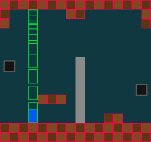
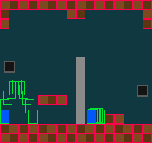
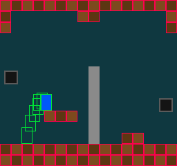

# 20 · Run and Jump

> **Goal:** the player falls. It starts up by the ceiling, drops 168 pixels to the floor, speeding up by a quarter of a pixel every tick until it falls 7 a tick, and lands in 38 ticks. X jumps. A hold of 11 ticks or more rises 49.92 pixels, enough to land on a new ledge three tiles up. A tap shorter than a frame rises 2.5, and every hold in between gives a jump in between. Every number is MegaMan's, from TASVideos, where chapter 15 found 1.375, and each one is an exact 256th of a pixel. Take "standing" from `move_y`'s `true`, which chapter 18 said would tell when the player lands, and a player standing still on the floor stands on only one tick in three.

## The problem

Since chapter 18, the player floats. Up and down on the d-pad move it, at walking speed, so that the floor and the ceiling could be tried before anything pulled the player down. That was always for two chapters. A platformer's player falls, and gets off the floor only by jumping.

Earlier chapters left this one a list:

- Chapter 14 said the game would name `JUMP_BUTTON = BUTTON_A`, that letting go ends a jump early with `released`, and that a press and release on one tick, a 0 ms tap, "gives the smallest jump".
- Chapter 15 said gravity changes the speed by a fraction every tick, and that MegaMan moves 1.3125 pixels a tick across in the air.
- Chapter 18 said gravity replaces the d-pad's up and down, that `vel.y` is kept from one tick to the next, and that `move_y`'s `true` says when the player lands.
- Chapter 19 ended with "The green box will show where it lands, and how high it goes."

The room needs something to jump onto, too. Its only raised tiles are the step, two tiles wide and one high, which a player walks into and can't climb.

Five questions: which numbers, how the hold changes the jump's height, which comes first in a tick, gravity or the jump, whether gravity pulls a player who's standing, and how the player knows it's standing.

## Design

### MegaMan's numbers

[TASVideos' page of MegaMan data](https://tasvideos.org/GameResources/NES/Rockman/Data) gives the numbers for MegaMan 1 to 4, as the NES kept them: a whole byte, a dot, and a byte of 256ths, both in hex. `04.DF` is 4 and 0xDF/256, which is 4 and 223/256, or 4.87109375. An NES frame is one of momo's ticks, 60 a second.

| What | TASVideos, MegaMan 1 and 2 | Pixels per tick | In `game.cpp` |
|---|---|---|---|
| Walking | 01.60 | 1.375 | `PLAYER_SPEED`, since chapter 14 |
| Across, in the air | 01.50 | 1.3125 | `PLAYER_AIR_SPEED` |
| Gravity, every frame | 00.40 | 0.25 | `GRAVITY` |
| A jump's speed | 04.DF | 4.87109375 | `JUMP_SPEED` |
| Letting go while rising faster than | 02.1F | 2.12109375 | `JUMP_CUT_ABOVE` |
| ... sets the speed to | 01.00 | 1 | `JUMP_CUT_SPEED` |
| The fastest fall | 0C.00 | 12 | `MAX_FALL_SPEED` is MegaMan 3 and 4's 7 |

Every one is a whole number of 256ths, because that's how the NES kept them, so `Fx` holds them exactly. This is what [plan §4.6](plan.md#46-numbers) meant when it said MegaMan-style numbers "translate directly". `fx::from_double(4.87109375)` rounds nothing.

On the page, up is plus: a jump sets the speed to plus 04.DF, and gravity takes 00.40 away. momo's y grows downward (chapter 10), so in `game.cpp` a rise is a minus speed and gravity adds.

### The fastest fall

Gravity adds a quarter of a pixel every tick, so a long fall gets faster and faster until something stops it. MegaMan 1 and 2 stop it at 12 pixels a tick, and MegaMan 3 and 4 at 7.

At a quarter a tick, the speed reaches 12 on the 48th tick of a fall, 294 pixels down. The screen is 240 high, and momo's room is one screen. The cap would never act, and you couldn't see it. 7 comes on the 28th tick, 101.5 pixels down, and the player's opening fall, 168 pixels, reaches it. So `MAX_FALL_SPEED` is 7, the one number here from a later game. Exercise 4 tries 12.

Speed isn't a risk to collision: `move_y` checks every pixel on the way (chapter 18), so at 7 or 12 the player can't fall through a floor 1 tile thick.

### How long you hold it

Chapter 14 promised that a jump's height depends on how long you hold the button. There are several ways to get that:

| Option | The catch |
|---|---|
| Letting go stops the rise: the speed becomes 0 at once | The rise stops dead, with no slowing down. MegaMan 4 does this. |
| Letting go starts the fall: the speed becomes a fall | MegaMan 3 does this, with half a pixel down. A short jump turns around harder still. |
| Two gravities: a weaker one while the button is held and the player rises, a stronger one otherwise | Two numbers to tune, and MegaMan doesn't work this way, so TASVideos has nothing to check them against. |
| **MegaMan 1 and 2's cut: letting go while rising faster than 2.12 sets the speed to 1** | A hold of 11 ticks or more gives the same full jump, because by then the rise has slowed to 2.12 on its own |

momo uses MegaMan 1 and 2's cut. The rise slows to 1 and keeps going, slowing a quarter a tick, so even the shortest jump curves over its top: 1, 0.75, 0.5, 0.25.

TASVideos words the rule as "if the Y speed is larger than 02.1F and the player is not holding the A button", checked every frame. momo checks it once, on the tick the button is `released`. For a jump the two are the same: a jump starts with the button down, so the first tick it isn't held is the tick it was let go.

The cut gives chapter 14's smallest jump for free. A press and a release on the same tick start the jump, at 4.87, and cut it, to 1, before the player has moved. It rises 2.5 pixels: 1, 0.75, 0.5 and 0.25.

### Gravity, then the jump

In each tick, gravity adds its quarter, and then, if the player stands and X has gone down, the jump sets the speed to `-JUMP_SPEED`. The jump replaces that tick's gravity, so its first tick rises the whole 4.87.

The other order, the jump and then gravity on the same tick, rises 4.62 on its first tick, and from there a quarter less each tick:

- **Gravity, then the jump:** 4.87 + 4.62 + ... + 0.12, 20 ticks, **49.92 pixels**.
- **The jump, then gravity:** 4.62 + 4.37 + ... + 0.12, 19 ticks, **45.05 pixels**.

Rooms are made of 16-pixel tiles, so what matters is how many tiles a jump clears. 49.92 clears three, with 2 pixels to spare. 45.05 clears two. The new ledge is three tiles up, and with the other order the player couldn't land on it.

### Gravity on the ground

| Option | The catch |
|---|---|
| No gravity while standing: the speed stays 0 | The player's y stays a whole number, but `standing` now decides whether the player falls. The floor already stops a fall, so that's a second rule for the same thing. |
| **Gravity every tick, standing or not, and the floor stops it** | A standing player's y has a fraction on 2 ticks in 3 (Run it) |

TASVideos says "every frame, 00.40 is subtracted", and momo does the same. The floor stops the pull, like any other move into a tile. Nothing has to decide when to start falling: walk off the ledge, and the floor isn't there to stop it. `standing` decides only two things: whether X jumps, and which speed walks.

The fraction comes from how `move_y` works. Chapter 18's `move_y` steps whole pixels, from where the box is drawn to where it would be drawn, so a move that stays inside one pixel checks no tiles at all. A player standing at y 184 is pulled 0.25: it's still drawn at 184, nothing is checked, and it ends at 184.25. The next tick it's pulled 0.5, to 184.75, still drawn at 184. The third tick, 0.75 would draw it at 185, inside the floor: `move_y` checks that pixel, hits, and puts the player back at 184, fraction dropped. Then the cycle starts over. The player is drawn at 184 on every tick, so you never see it.

### Where standing comes from

The cycle settles what chapter 18 expected `move_y`'s `true` to do.

| Option | The catch |
|---|---|
| `move_y`'s `true`, kept in the player's entity for the next tick | A player standing still gets `true` on one tick in three, the third of the cycle. A press of X on the other two starts no jump. |
| **A 1-pixel strip just under the feet, checked with `collision::overlaps`, every tick** | One more `overlaps` a tick, over one or two tiles |

The strip is the row of pixels under the box, at the y the player is drawn at. Standing on the floor at 184, 184.25 or 184.75, the player is drawn at 184, and the strip, at y 208, is in the floor's top row every time. It's worked out again each tick from the position, so it's never kept, and `GameState` doesn't change.

`move_y`'s `true` still does what chapter 18 said: it ends the fall. When `move_y` hits a floor, the player has landed, and the speed goes back to 0, so gravity starts over from nothing. A ceiling does the same to a rise. What it can't do is say, on any tick, whether the player is standing. Run it measures the first option.

### What's left out

Two things modern platformers often add, which make jumps more forgiving:

- **Coyote time:** a press a few ticks after walking off a ledge still jumps.
- **A jump buffer:** a press a few ticks before landing jumps as soon as the player lands.

Both are exercises. This chapter's numbers are MegaMan's, and none of the numbers on TASVideos' page is one of these. So is MegaMan 2's walk, which TASVideos says starts at 0.125 a tick for 7 ticks before full speed, and stops by sliding at 0.5 a tick for 8 more. momo's player walks at full speed at once, and stops at once.

Up and down on the d-pad do nothing now. Chapter 22's ladders give them something to do.

## The code

### The room: `assets/room.txt`

Row 10 gets a ledge:

```
################
#......##......#
#..............#
................
................
................
........|.......
........|.......
........|.......
........|.......
....###.|.......
........|.......
........|..##...
################
################
```

It's three tiles, x 64 to 111 and y 160 to 175, with its top 48 pixels above the floor's, at 208. It floats: rows 11 and 12 under it are empty, so the player walks under it, with 8 pixels between its head and the ledge. momo reads the room once, when it starts (chapter 17), so a running game won't see the ledge. Start momo again.

### The numbers: `game/game.cpp`

The buttons, with the one chapter 14 promised:

`game/game.cpp:85`

```cpp
// What the pad's buttons do in this game. The engine names them for where
// they are on the pad, and the game decides what they mean (chapter 14). Left
// and right on the d-pad walk, and up and down do nothing yet.
constexpr Button JUMP_BUTTON = BUTTON_A;
constexpr Button PREVIOUS_POWER_BUTTON = BUTTON_L;
constexpr Button NEXT_POWER_BUTTON = BUTTON_R;
```

`BUTTON_A` is X on the keyboard, and the bottom face button on a gamepad (chapter 14).

`FLOOR_Y` used to say where the player starts, too. Now it says only where the bats' shadows fall:

`game/game.cpp:94`

```cpp
// Where the bats' shadows fall: the top of room.txt's floor, two rows of
// tiles high. It doesn't read the room, so a floor moved in room.txt leaves
// the shadows falling here.
constexpr i32 FLOOR_Y = SCREEN_HEIGHT - 2 * TILE_SIZE;
```

Then the table from Design, with each number in 256ths where it has a fraction, so it can be checked against TASVideos' hex:

`game/game.cpp:99`

```cpp
// How MegaMan moves in MegaMan 1 and 2, in pixels per tick, and in 256ths of
// a pixel where there's a fraction. y grows downward, so a rise is a minus
// speed, and gravity is a plus.
constexpr Fx PLAYER_SPEED = fx::from_double(1.375);      // walking: 1 and 96/256
constexpr Fx PLAYER_AIR_SPEED = fx::from_double(1.3125); // across, in the air: 1 and 80/256
constexpr Fx GRAVITY = fx::from_double(0.25);            // more down, every tick: 64/256
constexpr Fx JUMP_SPEED = fx::from_double(4.87109375);   // up, as a jump starts: 4 and 223/256
// Letting go of the jump button while rising faster than JUMP_CUT_ABOVE slows
// the rise to JUMP_CUT_SPEED at once, so a short press is a low jump.
constexpr Fx JUMP_CUT_ABOVE = fx::from_double(2.12109375); // 2 and 31/256
constexpr Fx JUMP_CUT_SPEED = fx::from_int(1);
// The fastest fall. This is MegaMan 3 and 4's: 1 and 2's is 12, which only a
// fall of more than a screen reaches.
constexpr Fx MAX_FALL_SPEED = fx::from_int(7);

// The player starts up by the ceiling, in a gap in the room's top rows, and
// falls to the floor.
constexpr i32 PLAYER_START_X = 48;
constexpr i32 PLAYER_START_Y = 16;
```

0xDF is 223, 0x1F is 31, 0x60 is 96, 0x50 is 80 and 0x40 is 64. The player starts at y 16, just under the room's top row, where row 1 has a gap at x 48. It falls on every run, so every run shows gravity and the fastest fall. `init` uses `PLAYER_START_Y` where it used `FLOOR_Y - PLAYER_HEIGHT` (`game/game.cpp:166`).

### Standing: `on_ground`

`game/game.cpp:211`

```cpp
// Whether the player stands on a tile that stops it: whether the row of
// pixels just under its feet overlaps one. It's worked out again every tick,
// from where the player is drawn, and never kept.
bool on_ground(const SolidTiles& solids, const Entity* player)
{
    Rect under_feet = { .x = fx::floor(player->pos.x),
                        .y = fx::floor(player->pos.y) + PLAYER_HEIGHT,
                        .w = PLAYER_WIDTH,
                        .h = 1 };
    return collision::overlaps(solids, under_feet);
}
```

It's `player_box` (chapter 19), moved down by its own height and squashed to 1 pixel. `collision::overlaps` is the check `move_x` and `move_y` make at every pixel (chapter 18), so "standing" means exactly "a move 1 pixel down would hit".

### `update_player`

`game/game.cpp:224`

```cpp
// Walks the way the d-pad is held, jumps, falls, stops at the room's walls,
// floors and ceilings, and changes power.
void update_player(GameState* state, Entity* player)
{
    SolidTiles solids = room_solids(state);
    bool standing = on_ground(solids, player);

    // Across: a little slower in the air than on the ground, and both
    // directions at once cancel out.
    Fx speed = standing ? PLAYER_SPEED : PLAYER_AIR_SPEED;
    player->vel.x = {};
    if (input::down(BUTTON_LEFT))
        player->vel.x -= speed;
    if (input::down(BUTTON_RIGHT))
        player->vel.x += speed;

    // Down: vel.y is kept from one tick to the next, and gravity adds to it
    // every tick, up to the fastest fall. It pulls a standing player too,
    // into the floor, which stops it.
    player->vel.y = min(player->vel.y + GRAVITY, MAX_FALL_SPEED);

    // A jump starts only from the ground, on the tick the button goes down.
    // It replaces that tick's gravity, so the jump's first tick rises the
    // whole JUMP_SPEED. Letting go while still rising fast cuts the jump
    // short, so a button pressed and let go on one tick is the lowest jump.
    if (standing && input::pressed(JUMP_BUTTON))
        player->vel.y = -JUMP_SPEED;
    if (input::released(JUMP_BUTTON) && player->vel.y < -JUMP_CUT_ABOVE)
        player->vel.y = -JUMP_CUT_SPEED;

    // Across first, then down, each on its own, so a wall that stops one
    // doesn't stop the other. A floor that stops the player lands it, and a
    // ceiling bumps its head: either way, it stops moving down or up, and
    // gravity starts again from 0.
    collision::move_x(solids, &player->pos, PLAYER_WIDTH, PLAYER_HEIGHT, player->vel.x);
    if (collision::move_y(solids, &player->pos, PLAYER_WIDTH, PLAYER_HEIGHT, player->vel.y))
        player->vel.y = {};
```

The rest, the clamp to the screen's edges and the power buttons, is chapter 18's and 14's.

In order:

1. **`standing`** is worked out once, before anything moves, from where the player was at the end of the last tick. Everything in this tick that asks uses the same answer.
2. **`vel.x`** is set from nothing every tick, as before: the player walks only while the d-pad is held. Only the speed changes, 1.375 on the ground and 1.3125 in the air. On the tick a jump starts, the player is still standing, so that tick walks at 1.375.
3. **`vel.y`** is not set from nothing. It's last tick's speed plus gravity, and `min` holds it at 7. `min` is chapter 03's, from `base.h`, and works on `Fx` because `Fx` has `<` (chapter 15). Before this chapter, `player->vel = {}` cleared both speeds at the top of every tick, which is why the player floated.
4. **The jump** overwrites the speed that gravity just set. `input::pressed` is true only on the tick X goes down (chapter 14), so holding X jumps once, and only from the ground: in the air, `standing` is false.
5. **The cut** comes after the jump, so a press and a release on the same tick do both: the jump sets 4.87 up, and the cut sees 4.87 and sets 1. `< -JUMP_CUT_ABOVE` is "rising faster than 2.12": speeds up are below 0, and faster ones further below.
6. **The moves** are chapter 18's, across then down. `move_y`'s `true` sets `vel.y` to 0 whichever way the player was going: landing on a floor, or bumping its head on a ceiling. Without it, the speed would keep growing while the floor held the player, and walking off the ledge would drop it at 7 a tick from the first tick.

`Entity` and `GameState` don't change. `vel` has been an `Fx2` in the entity since chapter 16. Only what this function does with `vel.y` changed.

### The test: `tests/collision_test.cpp`

The cycle in Design is `move_y` doing what chapter 18 built it to do, so it gets a test of its own:

`tests/collision_test.cpp:157`

```cpp
static void a_move_within_a_pixel_checks_nothing()
{
    // A box standing on a floor at y 48, pulled down 0.25, 0.5 and 0.75, as
    // gravity pulls a player who stands still (chapter 20). The first two
    // moves leave the box drawn at 32, so no tile is checked, and they aren't
    // hits, though the floor is right under the box. The third would draw it
    // at 33, in the floor.
    SolidTiles solids = solid_tiles(STR(".\n.\n.\n#\n"), 16);
    Fx2 pos = at(0, 32);
    CHECK(!collision::move_y(solids, &pos, 16, 16, fx::from_double(0.25)));
    CHECK_EQ(pos.y.raw, fx::from_double(32.25).raw);
    CHECK(!collision::move_y(solids, &pos, 16, 16, fx::from_double(0.5)));
    CHECK_EQ(pos.y.raw, fx::from_double(32.75).raw);
    CHECK(collision::move_y(solids, &pos, 16, 16, fx::from_double(0.75)));
    CHECK_EQ(pos.y.raw, fx::from_int(32).raw);
}
```

A map of four rows with the floor in the last, at y 48, and a box 16 high on it, at y 32. The three moves are a standing player's three ticks. The test is about `move_y`, not the game: if a later chapter made `move_y` check tiles on a move inside a pixel, this test would say so, and `on_ground` would still work.

## Run it

```
$ make
$ ./build/debug/momo --boxes
```

### The fall

The player drops from the top of the room. It starts slowly and speeds up, then falls at one speed for the last part, and stops on the floor without bouncing or sinking in. That's 168 pixels in 38 ticks, about two thirds of a second.



The green boxes are where the player was every 4 ticks, from tick 0 to tick 36. The gaps grow by 4 pixels each time, 4 ticks of a quarter more, until tick 28. The speed reaches 7 on tick 27, at y 117.5, and after that every gap is 28 pixels, 7 a tick for 4 ticks. On tick 36 the player is at y 180.5. On tick 37, 7 more would put it at 187.5, and `move_y` stops it at 184, flush on the floor.

The pictures in this chapter are several captures in one: a short script pasted the green box from each of them onto the last. The fall needs no input, but the jumps needed X down and up on exact ticks, which momo can't do yet. They came from a throwaway copy that reads its input from a list of ticks, and logs the player on every tick. The numbers in this section come from its log. Chapter 21 records and replays input for real.

### Standing still

Let the player stand, and capture three ticks in a row:

```
$ ./build/debug/momo --capture 48 a.png
...
game/game.cpp:469: shutdown, with 3 entities, the player at x = 48, y = 184.25, power 0
$ ./build/debug/momo --capture 49 b.png
...
game/game.cpp:469: shutdown, with 3 entities, the player at x = 48, y = 184.75, power 0
$ ./build/debug/momo --capture 50 c.png
...
game/game.cpp:469: shutdown, with 3 entities, the player at x = 48, y = 184, power 0
$ cmp a.png b.png
$ cmp b.png c.png
```

That's the cycle from Design: 184.25, 184.75, then back to 184 when the third pull would have drawn the player at 185. `cmp` prints nothing: the three pictures are the same, byte for byte. No bat is out yet, and the player is drawn at 184 in all three.

### How high

Press X and let go. Short presses give low jumps, and long ones high jumps, up to a limit.

| X held for | Rise in pixels |
|---|---|
| 0 ms: down and up on one tick | 2.5 |
| 1 tick | 7.37 |
| 2 ticks | 11.99 |
| 4 ticks | 20.48 |
| 8 ticks | 34.47 |
| 10 ticks | 39.96 |
| 11 ticks or more | 49.92 |

At 11 ticks, the release comes at 4.87 − 11 × 0.25 = 2.12 exactly: equal to the cut's 2.12, not faster, so nothing is cut. Any hold from there on is the full jump. A finger can't make a 0 ms tap at 60 ticks a second, but chapter 14's latching keeps a tap shorter than a frame, and the throwaway copy sent one.

A full jump starting at y 184.25 is in the air 40 ticks, two thirds of a second. It rises for 20 ticks, to y 134.33 on its 20th, drawn at 134. Whichever tick of the standing cycle you press on, it's drawn at 134 at the top: 184.75 − 49.92 is 134.83. On its 40th tick it's at 184.41, already drawn at 184 with nothing checked, and the 41st tick's move hits the floor.



On the left, X and left go down together on tick 60, from x 48. The boxes are every 4 ticks. The jump moves 1.375 on its first tick and 1.3125 after that, so the player reaches the screen's left edge, x 0, before it lands, and the clamp holds it there. The highest box's bottom edge is just above the ledge's top. On the right, the player walked into the step and then pressed left and tapped X on the same tick. The boxes are every 2 ticks. The tap barely leaves the floor, and is back on it 9 ticks later.

### Onto the ledge

The ledge floats, so a jump onto it has to start beside it. Stand under the ledge, at x 79.625, and jump: the head hits the ledge's underside one tick later, at y 176, 8 pixels up. `move_y` hits the ceiling, the speed goes to 0, and the player falls back, landing 9 ticks after it jumped.

From x 48, beside the ledge, X and right together go under it too: the player is at x 49.375 after one tick, its right edge under the ledge, and its head hits on the next. So walk left first, to x 31.5, then press X and right:



The player rises and drifts right. After 13 ticks it's at x 48.625. On the 14th, the move right would put its right edge into the ledge's side: `move_x` stops it at x 48, flush, and drops the fraction (chapter 18). For three ticks it rises at x 48, sliding up the ledge's side, because a wall that stops the move across doesn't stop the move up. On the 17th tick, its feet are above the ledge's top, and it moves right again. It peaks with its feet 2 pixels over the ledge, and lands on it 24 ticks after the jump, at x 59.875, y 136.

With the jump and gravity the other way around, the peak would be 4.87 pixels lower, and the feet would reach only 3 pixels short of the ledge's top. The player would slide up its side and fall back.

### Tuning while it runs

Hot reload (chapter 06) suits this kind of number. With momo running, change `GRAVITY` to `fx::from_double(0.125)` and `make`:

```
engine/momo.cpp:315: reloaded /home/mairuu/repos/momo/build/debug/game.so
```

No `init`: the player stays where it was, and its next jump floats up to about twice the height, 97 pixels if you hold it, and comes down slowly. The cut still works, at the same 2.12. Put 0.25 back and `make` again. A `constexpr` is code in `game.so`, so a reload changes it, and `GameState` is the same size, so nothing starts over.

### The tests

```
$ make test
...
collision_test
  a_rect_overlaps_a_wall_by_one_pixel ... ok
  ...
  a_hit_drops_the_fraction ... ok
  a_move_within_a_pixel_checks_nothing ... ok
  never_overlaps_at_walking_speed ... ok
  ...
  20 passed
...
```

### Break it: standing from `move_y`

Chapter 18 said landing comes from `move_y`'s `true`. The obvious way to know whether the player stands is to keep that answer, a `bool on_ground` in `Entity`, and read it on the next tick. A throwaway build logged what `move_y` returned on every tick while the player stood still.

Over 82 ticks, from tick 38 to 119, it returned `true` on 27: every third tick, the one where the pull would have reached pixel 185. On the other two, the player would be in the air as far as the game knew.

`pressed(JUMP_BUTTON)` is true on one tick per press, so a jump would start only when that tick fell on the third of the cycle. Two presses in three would do nothing, and a player walking along the floor would walk at the air speed on two ticks in three. The new test shows why: a move that stays inside one pixel checks nothing, so it can't report a floor. The strip under the feet asks the question directly.

## Recap

```
momo/
  assets/
    room.txt        a ledge in row 10, three tiles wide, its top 48 pixels above the floor
  game/
    game.cpp        JUMP_BUTTON; MegaMan's numbers; PLAYER_START_Y; on_ground;
                    update_player keeps vel.y, adds gravity, jumps and cuts;
                    up and down do nothing
  tests/
    collision_test.cpp  + a_move_within_a_pixel_checks_nothing
```

- The player moves with MegaMan 1 and 2's numbers from TASVideos: walking 1.375, 1.3125 across in the air, gravity 0.25, and a jump of 4.87. The fastest fall is MegaMan 3 and 4's, 7, because MegaMan 1 and 2's 12 needs a fall of 294 pixels. Each is an exact 256th, so `Fx` holds it exactly.
- Letting go of X while rising faster than 2.12 slows the rise to 1. A 0 ms tap rises 2.5 pixels, and a hold of 11 ticks or more 49.92. Every hold in between gives a height in between.
- Gravity pulls every tick, standing or not, and the floor stops it, so a standing player's y has a fraction on 2 ticks in 3. The jump replaces its tick's gravity: the other order rises 45.05 and misses the ledge.
- `move_y`'s `true` ends a fall or a rise, and sets the speed back to 0. Whether the player stands comes from a 1-pixel strip under its feet, every tick, because `move_y` checks nothing on a move inside a pixel: taken from `move_y`, standing still stood on 27 ticks of 82.

The plan records the numbers, gravity and the jump, and how standing works, in [§5](plan.md#5-game). The outline says this chapter also gives the room a ledge and starts the player in the air, and that up and down wait for chapter 22's ladders.

The jumps in this chapter's pictures needed a throwaway copy of momo, because a jump is about which tick a button goes down and up, and a finger can't hit a tick. Chapter 21 records the pad's input, tick by tick, and plays it back: pause, step, record and loop.

## Exercises

Undo each change before the next exercise: `git checkout -- game` puts the code back.

1. **Coyote time.** Let a press of X jump for up to 5 ticks after the player walked off a ledge. Where does the count go, and what does `GAME_STATE_VERSION` need? Does a player who jumped, and is falling back down, get coyote time too? It shouldn't: how do you tell the two falls apart?
2. **A jump buffer.** Let a press of X up to 5 ticks before landing jump on the tick the player lands. Press X just before landing with and without it. Which feels better, and does the cut still work if X was let go before the landing?
3. **MegaMan 2's walk.** Make the player walk at 0.125 a tick for its first 7 ticks, then 1.375, and slide at 0.5 a tick for 8 ticks after letting go. Walk into the step: how far is the player from it when it stops? Does the slide go on in the air?
4. **MegaMan 2's fastest fall.** Set `MAX_FALL_SPEED` to 12. How many ticks sooner does the opening fall land? Why so few? How tall would a room need to be for the difference to show?
5. **MegaMan 3 and 4's cut.** Set `JUMP_CUT_SPEED` to `-fx::from_double(0.5)`, which is MegaMan 3's half a pixel down, then to 0, MegaMan 4's. How high does a 0 ms tap rise with each? Compare a jump let go halfway up with each of the three.
